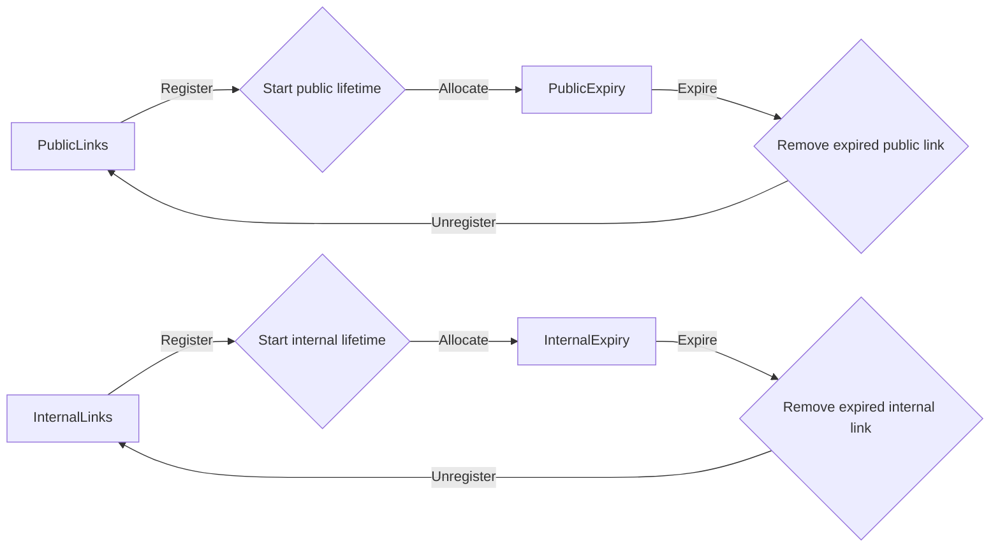
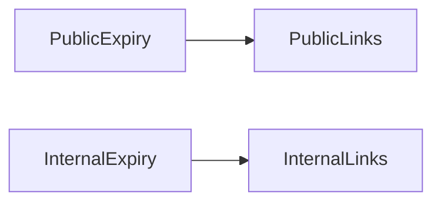

# Concept design reference

Generated from authored specifications. Regenerate this view instead of editing it.

Model `0.14.0-draft`; mapping `dotspec-markdown/13`. Relationships reflect explicit declarations. These views do not establish behavioral completeness or implementation guarantees.

## Concepts

### Expiry

[Source](../../examples/concept-design/specs/concepts/expiry.concept.spec.md).

#### Purpose

Identify when a resource's explicitly allocated lifetime has ended.

#### Operational principles

Allocate a resource with a lifetime. Once that time has passed, expiration reports
the resource identity so the surrounding application can react.

#### Type parameters

##### Resource

An opaque resource identity; expiry does not inspect or modify the resource itself.

#### State

##### Initial state

No resources have an allocated deadline or a completed expiration.

##### Deadlines

A partial mapping from Resource to deadline. Pending expiration retains the identity
and deadline until the expiration action completes.

###### Type

Resource → instant.

##### Completed resources

The identities whose expiration completed, retained to make replayed allocations
idempotent even after their deadlines have been removed.

#### Actions

##### Allocate

Associate the resource with a deadline after the supplied positive lifetime.
A repeated allocation for a pending resource retains its original deadline.
An allocation for a completed resource succeeds without adding another deadline.

###### Inputs

**Resource input**

**Type:** [Resource](../../examples/concept-design/specs/concepts/expiry.concept.spec.md#resource)

The identity whose lifetime is tracked.

**Lifetime**

**Primitive:** Duration

A positive elapsed duration.

###### Rejections

A nonpositive lifetime returns an error and leaves state unchanged.

##### Expire

Complete expiration for a resource whose deadline has passed, remove its deadline,
add it to Completed resources, and return its identity. An already expired or unknown resource produces no new
expiration result.

###### Initiation

System-initiated when a deadline has passed. The implementation must arrange timely
execution; this specification does not assume an external user invokes expiration.

###### Guards

- The resource has an allocated deadline that has passed.

###### Outputs

**Expired resource**

**Type:** [Resource](../../examples/concept-design/specs/concepts/expiry.concept.spec.md#resource)

The identity whose lifetime ended.

### Shorthand

[Source](../../examples/concept-design/specs/concepts/shorthand.concept.spec.md).

#### Purpose

Let people refer to a target with a short, memorable code.

#### Operational principles

##### Access through a shorthand

Register a target, retain the returned code, and look it up later to recover the
same target while the registration remains active.

##### End access

Unregister the code. Subsequent lookups report that it is unknown.

#### Type parameters

##### Target

An opaque target identity. The concept makes no assumptions about its structure.

#### Introduced types

##### Code

An identity for a registered shorthand. Each use maintains its own codes.

#### State

##### Initial state

No codes are registered and no codes have been issued.

##### Issued codes

All identities previously issued by this use, retained even after unregistration.

##### Targets

A partial mapping from Code to Target. Registered codes are its domain, a subset
of Issued codes.

###### Type

Code → Target.

##### Registered count

The number of currently registered codes.

###### Derivation

The cardinality of the domain of Targets; no separate counter is required.

##### Invariants

- Each registered code identifies exactly one target.

#### Actions

##### Register

Create a code not in Issued codes for the supplied target. Do not replace an earlier registration.

###### Inputs

**Target input**

**Type:** [Target](../../examples/concept-design/specs/concepts/shorthand.concept.spec.md#target)

The target to make accessible.

###### Outputs

**Code result**

**Bound type:** [Code](../../examples/concept-design/specs/concepts/shorthand.concept.spec.md#code)

The newly registered code.

###### Effects

Add the code to Issued codes and add the code-to-target association.

##### Lookup

For a registered code, return its target. Otherwise return an unknown-code result.

###### Inputs

**Code input**

**Bound type:** [Code](../../examples/concept-design/specs/concepts/shorthand.concept.spec.md#code)

The code to look up.

###### Outputs

**Target result**

**Type:** [Target](../../examples/concept-design/specs/concepts/shorthand.concept.spec.md#target)

Returned on a successful lookup. An unknown code returns no target.

##### Unregister

Remove a code's association. Repeated removal succeeds without further changes.
Never reassign that code to another target in this use.

## System compositions

### Expiring links

[Source](../../examples/concept-design/specs/system.spec.md).

| Use | Definition | Type bindings |
| --- | --- | --- |
| PublicLinks | [Shorthand](../../examples/concept-design/specs/concepts/shorthand.concept.spec.md) | Target = URL |
| PublicExpiry | [Expiry](../../examples/concept-design/specs/concepts/expiry.concept.spec.md) | Resource = PublicLinks.Code |
| InternalLinks | [Shorthand](../../examples/concept-design/specs/concepts/shorthand.concept.spec.md) | Target = URL |
| InternalExpiry | [Expiry](../../examples/concept-design/specs/concepts/expiry.concept.spec.md) | Resource = InternalLinks.Code |

#### Coordination

Only resolved action references appear as edges. A rule node does not imply a transaction.

#### Application dependencies

An arrow means the source use requires the target use for its role in this system. Cycles are permitted. Bindings and action calls do not imply these edges.

#### Concept use declarations

##### PublicLinks

Named shorthand registrations for public links.

###### Definition

[Shorthand](../../examples/concept-design/specs/concepts/shorthand.concept.spec.md).

###### Bindings

**Public targets**

**Parameter:** [Target](../../examples/concept-design/specs/concepts/shorthand.concept.spec.md#target)
**Primitive:** URL

##### PublicExpiry

Tracks lifetimes for codes registered by PublicLinks.

###### Definition

[Expiry](../../examples/concept-design/specs/concepts/expiry.concept.spec.md).

###### Bindings

**Public resources**

**Parameter:** [Resource](../../examples/concept-design/specs/concepts/expiry.concept.spec.md#resource)
**Bound type:** [Code](../../examples/concept-design/specs/concepts/shorthand.concept.spec.md#code)
**Supplying concept use:** [PublicLinks](../../examples/concept-design/specs/system.spec.md#publiclinks)

###### Dependencies

[PublicLinks](../../examples/concept-design/specs/system.spec.md#publiclinks) supplies the identities whose lifetimes justify
this use. This is an application-scoping dependency, not a call from Expiry.

###### Configuration

The application allocates each registration a lifetime of 1 hour.

##### InternalLinks

Named shorthand registrations for internal links.

###### Definition

[Shorthand](../../examples/concept-design/specs/concepts/shorthand.concept.spec.md).

###### Bindings

**Internal targets**

**Parameter:** [Target](../../examples/concept-design/specs/concepts/shorthand.concept.spec.md#target)
**Primitive:** URL

##### InternalExpiry

Tracks lifetimes for codes registered by InternalLinks.

###### Definition

[Expiry](../../examples/concept-design/specs/concepts/expiry.concept.spec.md).

###### Bindings

**Internal resources**

**Parameter:** [Resource](../../examples/concept-design/specs/concepts/expiry.concept.spec.md#resource)
**Bound type:** [Code](../../examples/concept-design/specs/concepts/shorthand.concept.spec.md#code)
**Supplying concept use:** [InternalLinks](../../examples/concept-design/specs/system.spec.md#internallinks)

###### Dependencies

[InternalLinks](../../examples/concept-design/specs/system.spec.md#internallinks) supplies the identities whose lifetimes justify
this use. This is an application-scoping dependency, not a call from Expiry.

###### Configuration

The application allocates each registration a lifetime of 1 day.

#### Synchronization rules

##### Start public lifetime

###### When

**Completed action**

**Concept use:** [PublicLinks](../../examples/concept-design/specs/system.spec.md#publiclinks)
**Action:** [Register](../../examples/concept-design/specs/concepts/shorthand.concept.spec.md#register)

**Result**

A successful completion and its returned identity, correlated to this named use.

###### Where

Only successful completions participate. An error is not a successful result.

###### Then

**Invoke action**

**Concept use:** [PublicExpiry](../../examples/concept-design/specs/system.spec.md#publicexpiry)
**Action:** [Allocate](../../examples/concept-design/specs/concepts/expiry.concept.spec.md#allocate)

**Arguments**

Pass the returned Code as Resource and 1 hour as Lifetime.

###### Semantics

Event-based coordination, without an atomic transaction across concepts. Retain
successful completion events until the resulting invocation succeeds; retry failures
with the same arguments. Delivery may repeat, so the receiving action is idempotent.
Do not treat emission of an event as completion of the receiving action. Links may
remain accessible while expiration delivery is delayed; no instantaneous revocation
promise is made. Each use has independent state even when definitions or code values
coincide. These are requirements for an implementation, not guarantees from dotspec.

##### Remove expired public link

###### When

**Completed action**

**Concept use:** [PublicExpiry](../../examples/concept-design/specs/system.spec.md#publicexpiry)
**Action:** [Expire](../../examples/concept-design/specs/concepts/expiry.concept.spec.md#expire)

**Result**

A successful completion and its returned identity, correlated to this named use.

###### Where

Only successful completions participate. An error is not a successful result.

###### Then

**Invoke action**

**Concept use:** [PublicLinks](../../examples/concept-design/specs/system.spec.md#publiclinks)
**Action:** [Unregister](../../examples/concept-design/specs/concepts/shorthand.concept.spec.md#unregister)

**Arguments**

Pass the expired Resource identity as the Code to unregister.

###### Semantics

Event-based coordination, without an atomic transaction across concepts. Retain
successful completion events until the resulting invocation succeeds; retry failures
with the same arguments. Delivery may repeat, so the receiving action is idempotent.
Do not treat emission of an event as completion of the receiving action. Links may
remain accessible while expiration delivery is delayed; no instantaneous revocation
promise is made. Each use has independent state even when definitions or code values
coincide. These are requirements for an implementation, not guarantees from dotspec.

##### Start internal lifetime

###### When

**Completed action**

**Concept use:** [InternalLinks](../../examples/concept-design/specs/system.spec.md#internallinks)
**Action:** [Register](../../examples/concept-design/specs/concepts/shorthand.concept.spec.md#register)

**Result**

A successful completion and its returned identity, correlated to this named use.

###### Where

Only successful completions participate. An error is not a successful result.

###### Then

**Invoke action**

**Concept use:** [InternalExpiry](../../examples/concept-design/specs/system.spec.md#internalexpiry)
**Action:** [Allocate](../../examples/concept-design/specs/concepts/expiry.concept.spec.md#allocate)

**Arguments**

Pass the returned Code as Resource and 1 day as Lifetime.

###### Semantics

Event-based coordination, without an atomic transaction across concepts. Retain
successful completion events until the resulting invocation succeeds; retry failures
with the same arguments. Delivery may repeat, so the receiving action is idempotent.
Do not treat emission of an event as completion of the receiving action. Links may
remain accessible while expiration delivery is delayed; no instantaneous revocation
promise is made. Each use has independent state even when definitions or code values
coincide. These are requirements for an implementation, not guarantees from dotspec.

##### Remove expired internal link

###### When

**Completed action**

**Concept use:** [InternalExpiry](../../examples/concept-design/specs/system.spec.md#internalexpiry)
**Action:** [Expire](../../examples/concept-design/specs/concepts/expiry.concept.spec.md#expire)

**Result**

A successful completion and its returned identity, correlated to this named use.

###### Where

Only successful completions participate. An error is not a successful result.

###### Then

**Invoke action**

**Concept use:** [InternalLinks](../../examples/concept-design/specs/system.spec.md#internallinks)
**Action:** [Unregister](../../examples/concept-design/specs/concepts/shorthand.concept.spec.md#unregister)

**Arguments**

Pass the expired Resource identity as the Code to unregister.

###### Semantics

Event-based coordination, without an atomic transaction across concepts. Retain
successful completion events until the resulting invocation succeeds; retry failures
with the same arguments. Delivery may repeat, so the receiving action is idempotent.
Do not treat emission of an event as completion of the receiving action. Links may
remain accessible while expiration delivery is delayed; no instantaneous revocation
promise is made. Each use has independent state even when definitions or code values
coincide. These are requirements for an implementation, not guarantees from dotspec.
