# Core domain model

Generated from [the canonical model](../../../model/metamodel.yaml) and [the view definition](../../../model/views/core-domain.yaml). Do not edit this file.

A focused reference for maintainers and authors understanding business requirements, user requirements, software requirements, and their traceability. Business rules describe business constraints independently of enforcement. Jobs describe user progress; use cases describe software interactions. Supporting and generic model machinery remains available in the complete reference.

Model version: `0.16.0-draft`. See the [complete reference](index.md) for all fields and constraints.

## Core subsets

| Subset | Responsibility | Selected types |
| --- | --- | --- |
| Business requirements (`core`) | Business objectives, scope, assumptions, and rules governing permissible business activity. | [Specification](index.md#specification), [TraceableElement](index.md#traceableelement), [SystemGoal](index.md#systemgoal), [Assumption](index.md#assumption), [Constraint](index.md#constraint), [ObligationClause](index.md#obligationclause), [System](index.md#system), [BusinessRule](index.md#businessrule), [ObligationContainer](index.md#obligationcontainer), [Obligation](index.md#obligation), [Capability](index.md#capability), [OpenQuestion](index.md#openquestion), [AssessmentPlan](index.md#assessmentplan), [AssessmentCase](index.md#assessmentcase) |
| User requirements (`core`) | The progress people seek, their circumstances, work, and desired outcomes. | [Specification](index.md#specification), [TraceableElement](index.md#traceableelement), [ObligationClause](index.md#obligationclause), [Job](index.md#job), [JobStep](index.md#jobstep), [DesiredOutcome](index.md#desiredoutcome), [ProgressCase](index.md#progresscase), [ObligationContainer](index.md#obligationcontainer), [Obligation](index.md#obligation), [OpenQuestion](index.md#openquestion), [AssessmentPlan](index.md#assessmentplan), [AssessmentCase](index.md#assessmentcase) |
| Software requirements (`core`) | Software interactions, concept behavior, obligations, quality classifications, and verification guidance. | [Specification](index.md#specification), [TraceableElement](index.md#traceableelement), [Assumption](index.md#assumption), [Constraint](index.md#constraint), [ObligationClause](index.md#obligationclause), [System](index.md#system), [UseCase](index.md#usecase), [Scenario](index.md#scenario), [ScenarioStep](index.md#scenariostep), [UseCaseExtension](index.md#usecaseextension), [Concept](index.md#concept), [ConceptType](index.md#concepttype), [ConceptUse](index.md#conceptuse), [TypeBinding](index.md#typebinding), [Synchronization](index.md#synchronization), [SynchronizationAction](index.md#synchronizationaction), [StateDescription](index.md#statedescription), [StateElement](index.md#stateelement), [ActionParameter](index.md#actionparameter), [ConceptAction](index.md#conceptaction), [Requirement](index.md#requirement), [GeneralRequirement](index.md#generalrequirement), [QualityRequirement](index.md#qualityrequirement), [QualityModel](index.md#qualitymodel), [QualityAttribute](index.md#qualityattribute), [ObligationContainer](index.md#obligationcontainer), [Obligation](index.md#obligation), [Component](index.md#component), [Feature](index.md#feature), [Capability](index.md#capability), [OpenQuestion](index.md#openquestion), [InterfaceCollection](index.md#interfacecollection), [Interface](index.md#interface), [EffectsTable](index.md#effectstable), [EffectsRow](index.md#effectsrow), [AssessmentPlan](index.md#assessmentplan), [AssessmentCase](index.md#assessmentcase) |
| Specification traceability (`core`) | Explicit connections between specification meaning, authored occurrences, and resolved relationships. | [ContentBinding](index.md#contentbinding), [SourceReference](index.md#sourcereference), [Resolution](index.md#resolution) |

Subset membership organizes model definitions; it does not infer the level or importance of an authored instance. Shared types can appear in several subsets. Supporting and generic types appear as context where a diagram needs them.

## Relationships

See the [relationship reference](relationships.md) for the complete edge contracts.

Arrows use schema-owned relationship labels; reference tables retain exact canonical field paths. Diamond arrows represent declaration containment, dashed arrows structural context and citations, and plain arrows semantic associations or provenance; triangle arrows represent declared inheritance. Multiple edges with the same path show alternative target types; cardinality applies to the slot as a whole. Collection wrappers are omitted from diagrams; exact paths remain in the reference tables. `system_context` is a directory-derived association, not a use-case boundary or inherited requirement. Contextual links to business rules, jobs, and concepts do not assert enforcement, fulfillment, or compliance.

### Specification kinds

Specification is a cohesive definition independent of document placement. Eight document families supply roots; Component, Feature, Capability, ConceptUse, Synchronization and Interface are named inline specifications. Subsets classify concerns separately from this hierarchy.

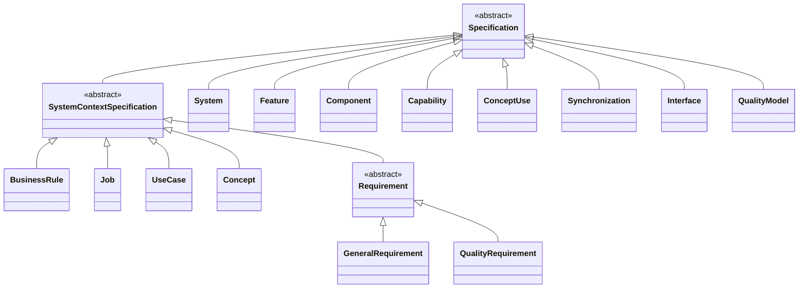

### Specification system association

Document families derived from SystemContextSpecification select a specification system explicitly or use the nearest directory system by default. Inline specifications have declaring owners instead. Neither association establishes structural parentage. Quality models stand independently.

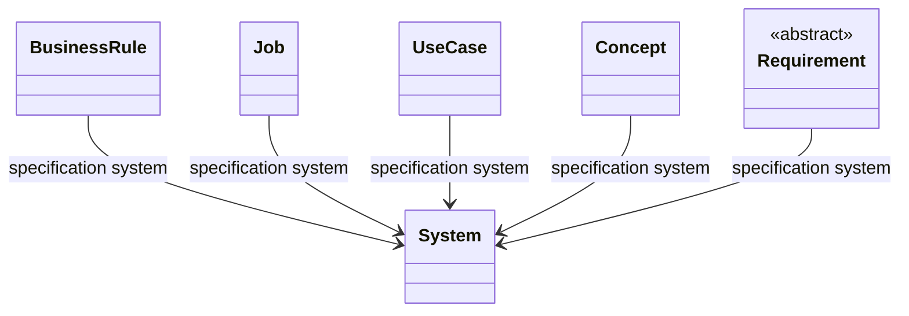

### Boundary interfaces

Required and provided are relative to the declaring System or Component. Each Interface is an addressable specification with one declaration membership. Requirements can apply to it and it may own obligation clauses. Native contract references do not establish implementation or compatibility.

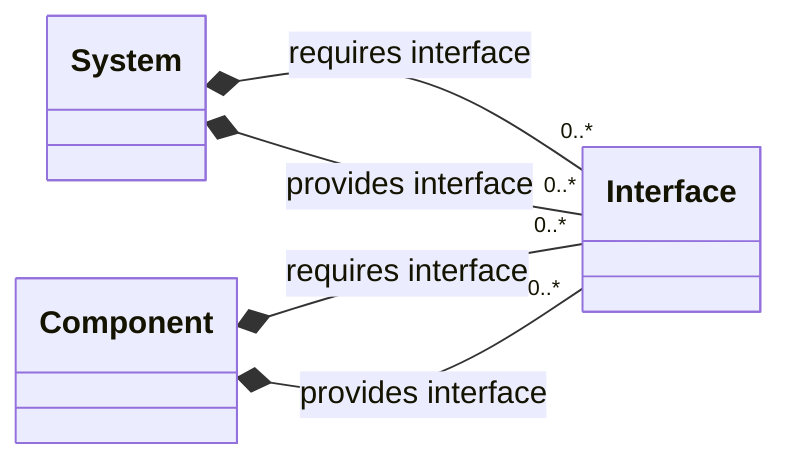

### System structure and feature grouping

Declaration membership identifies where records are authored. Explicit part_of identifies structural parents independently of directories. Features group specifications without owning them. Applicability identifies subjects; no implementation, allocation, inheritance or satisfaction is inferred. Interacts with identifies boundary partners, independently of structural parentage.

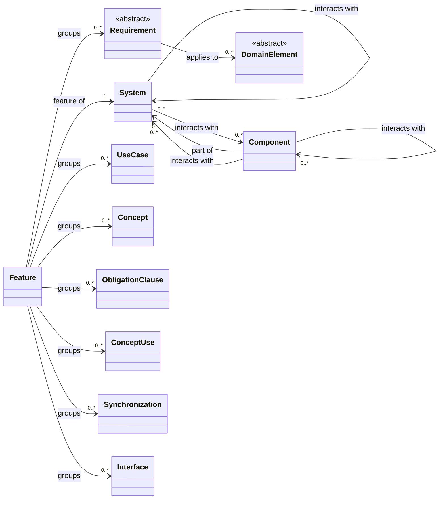

### Shared obligation capabilities

Both standalone requirement forms and embedded clauses share statement, classification, applicability and assessment plans through Obligation. ObligationContainer separately grants clause ownership to System, Component, Interface, BusinessRule, Job, JobStep, UseCase, Concept, ConceptUse, ConceptAction, Synchronization and Requirement. Goals, assumptions and desired outcomes retain traceability without containing clauses. Triangle arrows include explicitly mixed-in capabilities.

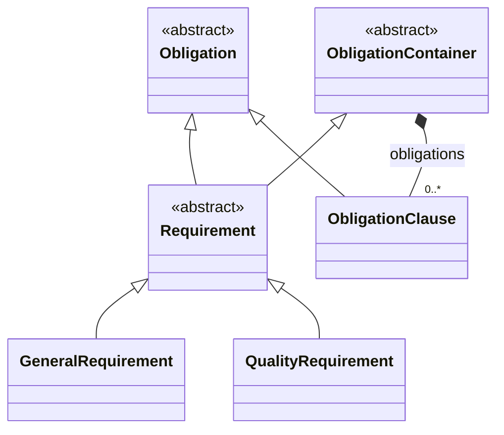

### User progress

Jobs optionally declare functional steps, outcomes and progress cases. These edges describe declaration ownership; step order is presentation order.

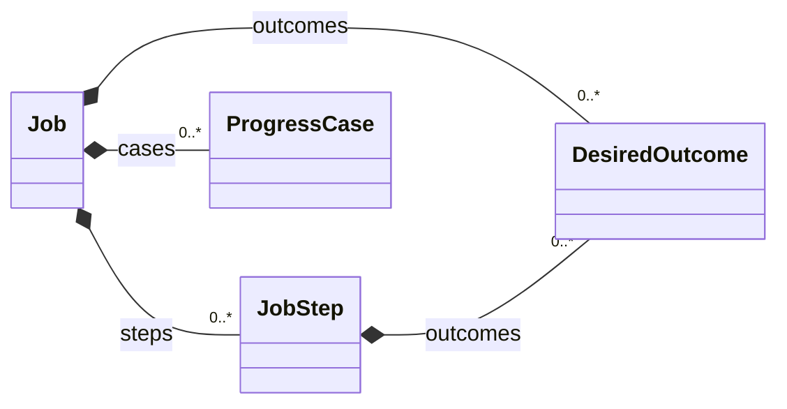

### Outcome applicability

An outcome can explicitly apply to several jobs or steps independently of its single declaration owner. Applicability does not assert achievement.

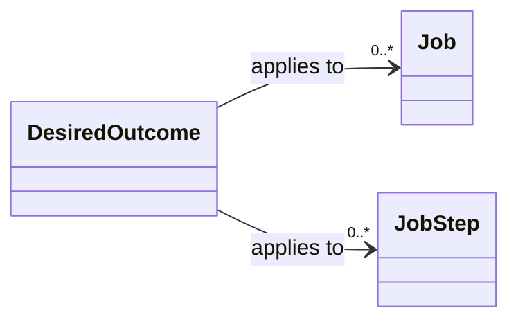

### Software behavior

Use cases describe interactions and alternatives; concepts describe purposeful state and actions. These are complementary views, with no mandatory authoring or execution order. Steps may explicitly illustrate obligations or actions; this does not prove completeness.

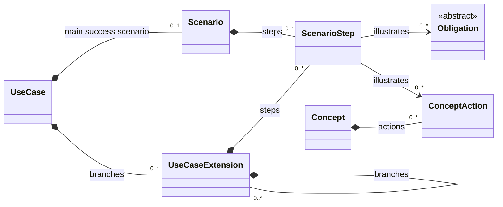

### Quality classification

Systems and reusable quality models declare attributes. Each attribute has exactly one declaring owner: a System or a QualityModel. Obligations reference attributes for classification. Sub-attribute of permits multiple parents within the same declaring owner and must be acyclic.

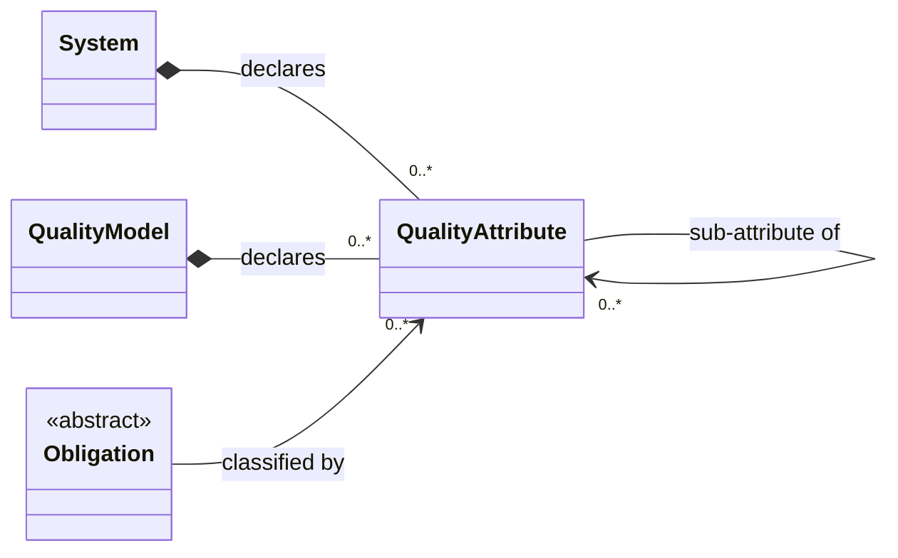

### Concept definitions and type bindings

Explicit named uses reference reusable definitions. Bindings distinguish a type declaration from the use supplying its identities. Type parameters and introduced types share a declaration scope but play different roles.

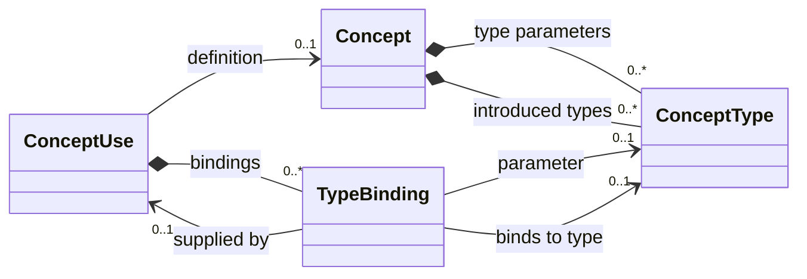

### System coordination

Systems explicitly include named uses and own synchronization rules. Each referenced action is qualified by its use and must belong to that use's definition. Application dependencies are separately declared and may cycle. None of these relations implies execution, atomicity or behavioral completeness.

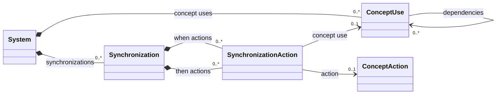

### Explicit requirements relationships

Explicit authoring distinguishes a use case boundary, support for user progress, and applicability from ordinary citations. Applicability may target any domain record; links do not establish enforcement, satisfaction or achieved outcomes.

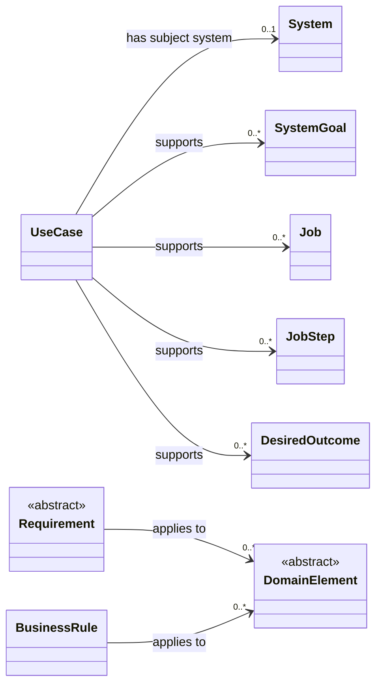

### Motivation, basis and assumptions

Concern subsets are independent of artifact kind and core/supporting/generic classification. Explicit support describes intended contribution; derivation records a basis rather than entailment. Requirements may link directly to a business rule or design decision without an intervening user record. Assumptions condition validity. These links do not impose authoring order or prove satisfaction.

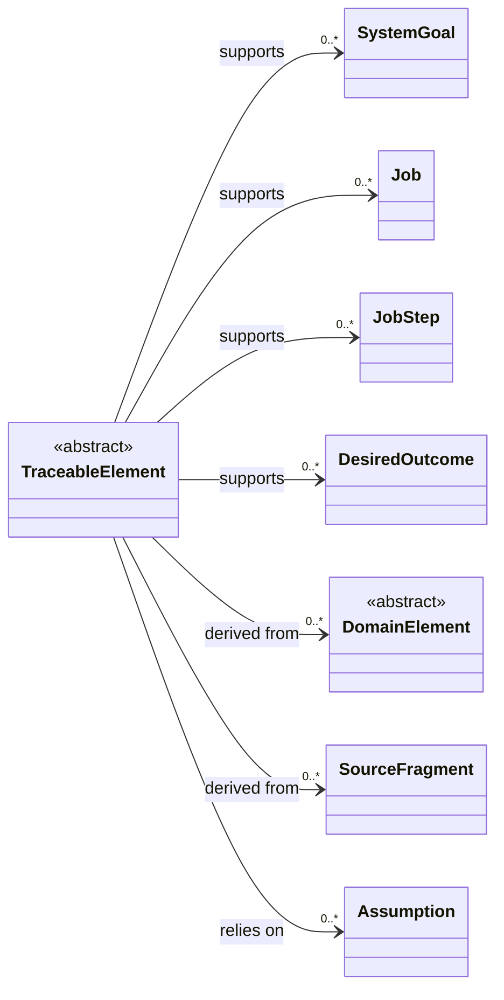

### Obligations and complementary behavioral views

Requirement is the standalone obligation document family, not every normative expression. Explicit clauses identify obligations within existing specifications without duplicating them. Refinement preserves a parent commitment and must be acyclic; multiple parents are permitted. Use cases involve named concept uses many-to-many; neither view is the mandatory parent of the other.

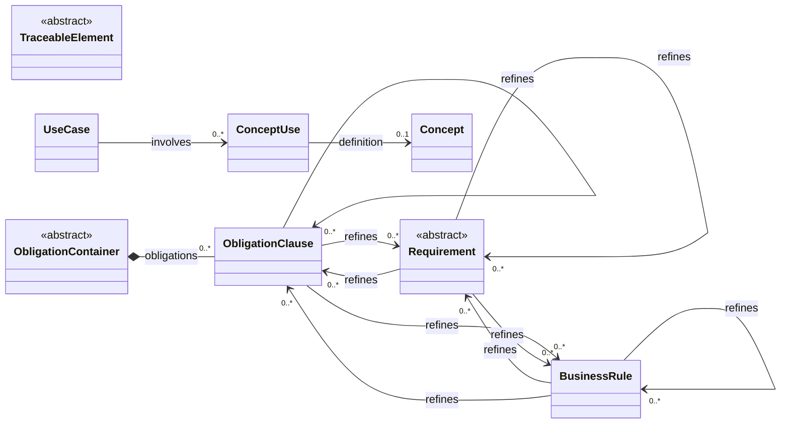

### Traceability to authored content

Bindings associate model fields with content occurrences; references preserve authored targets and their resolution. Record and ContentNode provide context from the generic subsets. A resolved target does not prove compliance.

### Enabling capabilities

Capabilities connect user needs to enabling abilities and explicit system or component providers. Dependency is not structural containment; providers are optional and non-exhaustive.

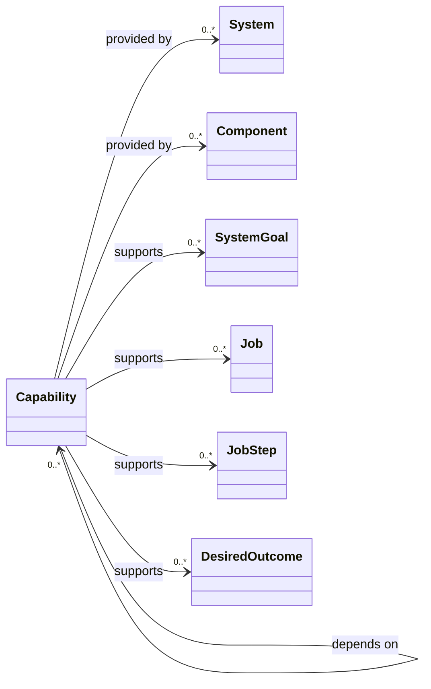

### Assessment planning

Verification and validation retain distinct field roles while sharing plan structure. The authored subject and basis identify what is assessed and against what. Neither plan nor case is an observation, assessment conclusion or acceptance decision.

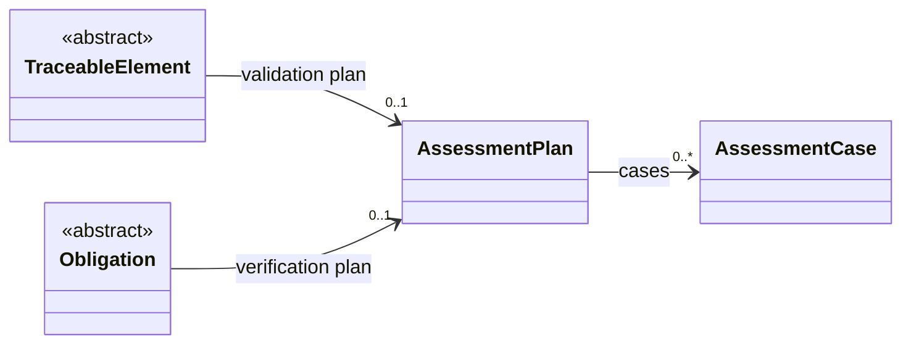

## Selected type reference

### Specification

A cohesive definition of a subject, behavior, obligation or classification scheme. Specification kind is independent of document placement; a named inline definition is also a specification. Narrative authority and evidence do not create executable authority assertions.

Subsets: `business-requirements`, `user-requirements`, `software-requirements`. [Specification](index.md#specification) contains the complete definition.

| Field | Range | Shape | Meaning |
| --- | --- | --- | --- |
| `notes` | [RichContent](index.md#richcontent) | optional | Recognized Notes content. |
| `evidence` | [EvidenceCollection](index.md#evidencecollection) | optional |  |
| `related_specifications` | [ContextualReferences](index.md#contextualreferences) | optional |  |

### TraceableElement

An element with explicit motivation, derivation and assumptions. Concern subset, artifact kind and core/supporting/generic classification are independent; neither traceability nor document location confers normative authority.

Subsets: `business-requirements`, `user-requirements`, `software-requirements`. [TraceableElement](index.md#traceableelement) contains the complete definition.

| Field | Range | Shape | Meaning |
| --- | --- | --- | --- |
| `supports` | [SystemGoal](index.md#systemgoal) or [Job](index.md#job) or [JobStep](index.md#jobstep) or [DesiredOutcome](index.md#desiredoutcome) | optional; list | Intended contribution to a goal or user progress; does not assert achievement. |
| `derived_from` | [DomainElement](index.md#domainelement) or [SourceFragment](index.md#sourcefragment) | optional; list | Source or rationale for this element, including rules, decisions and obligations; not logical entailment. |
| `relies_on` | [Assumption](index.md#assumption) | optional; list | Assumptions on which the validity of this element depends. |
| `validation_plan` | [AssessmentPlan](index.md#assessmentplan) | optional | Plan to assess a proposed requirement, need, concept or solution against stakeholder needs and intended use. Identify the subject and basis explicitly; no outcome or endorsement is inferred. |

### SystemGoal

An explicitly distinguished system goal.

Subsets: `business-requirements`. [SystemGoal](index.md#systemgoal) contains the complete definition.

| Field | Range | Shape | Meaning |
| --- | --- | --- | --- |
| `statement` | [RichContent](index.md#richcontent) | optional |  |
| `supports` | [SystemGoal](index.md#systemgoal) or [Job](index.md#job) or [JobStep](index.md#jobstep) or [DesiredOutcome](index.md#desiredoutcome) | optional; list | Intended contribution to a goal or user progress; does not assert achievement. |

### Assumption

An explicitly distinguished system assumption; no inferred truth assertion.

Subsets: `business-requirements`, `software-requirements`. [Assumption](index.md#assumption) contains the complete definition.

| Field | Range | Shape | Meaning |
| --- | --- | --- | --- |
| `statement` | [RichContent](index.md#richcontent) | optional |  |
| `basis` | [RichContent](index.md#richcontent) | optional | Why reliance on this statement is justified, including cited evidence. |
| `applicability` | [RichContent](index.md#richcontent) | optional | Conditions, locations or periods in which this assumption is expected to hold. |
| `validation_plan` | [AssessmentPlan](index.md#assessmentplan) | optional | Plan to assess empirical support for the premise in its stated conditions and whether reliance on it is justified for intended use; not a guarantee that it holds. |

### Constraint

An explicitly distinguished system constraint.

Subsets: `business-requirements`, `software-requirements`. [Constraint](index.md#constraint) contains the complete definition.

| Field | Range | Shape | Meaning |
| --- | --- | --- | --- |
| `statement` | [RichContent](index.md#richcontent) | optional |  |

### ObligationClause

An explicitly distinguished obligation within an existing specification or behavioral model. Its content is the authored expression, not a duplicate requirement document. Project authority determines acceptance; declaration alone does not.

Subsets: `business-requirements`, `user-requirements`, `software-requirements`. [ObligationClause](index.md#obligationclause) contains the complete definition.

| Field | Range | Shape | Meaning |
| --- | --- | --- | --- |
| `statement` | [RichContent](index.md#richcontent) | optional |  |
| `quality_attributes` | [QualityAttribute](index.md#qualityattribute) | optional; list | Only resolved classifications; original occurrences remain separately addressable. |
| `refines` | [Requirement](index.md#requirement) or [BusinessRule](index.md#businessrule) or [ObligationClause](index.md#obligationclause) | optional; list | Adds precision while preserving the referenced obligation; not replacement, duplication or proof. Multiple parents are permitted. |
| `applies_to` | [DomainElement](index.md#domainelement) | optional; list |  |
| `verification_plan` | [AssessmentPlan](index.md#assessmentplan) | optional | Plan for assessing a system, component or process realization against this obligation; not a review of requirement wording and not completed verification evidence. |
| `criterion` | [ObligationCriterion](index.md#obligationcriterion) | optional | Optional explicit satisfaction rule, defining or referencing the required bounds once. Available to both general and quality obligations; assessment plans refer to it. |
| `measurement_plan` | [MeasurementPlan](index.md#measurementplan) | optional |  |

### System

The system described by a system document; subordinate systems retain their own boundaries and quality attributes.

Subsets: `business-requirements`, `software-requirements`. [System](index.md#system) contains the complete definition.

| Field | Range | Shape | Meaning |
| --- | --- | --- | --- |
| `purpose` | [RichContent](index.md#richcontent) | optional |  |
| `scope` | [RichContent](index.md#richcontent) | optional |  |
| `goals` | [GoalCollection](index.md#goalcollection) | optional |  |
| `constraints` | [ConstraintCollection](index.md#constraintcollection) | optional |  |
| `concept_uses` | [ConceptUse](index.md#conceptuse) | optional; ordered list |  |
| `synchronizations` | [Synchronization](index.md#synchronization) | optional; ordered list |  |
| `quality_attributes` | [QualityAttribute](index.md#qualityattribute) | optional; ordered list | Attributes declared by this system, in authored order. Absent means no declaration; a present empty list is distinct. Must be present together with quality_attributes_content. |
| `part_of` | [System](index.md#system) | optional | Optional explicit parent System. Directory context does not supply this relationship. |
| `components` | [Component](index.md#component) | optional; ordered list | Named component declarations in authored order; membership does not establish structural parentage. |
| `features` | [Feature](index.md#feature) | optional; ordered list | Named feature declarations in authored order; each feature belongs to this System. |
| `capabilities` | [Capability](index.md#capability) | optional; ordered list | Capability declarations; the declaring System is a documentation home, not an inferred provider. |
| `out_of_scope` | [RichContent](index.md#richcontent) | optional | Explicit boundary exclusions; absence is not a statement of scope. |
| `interacts_with` | [System](index.md#system) or [Component](index.md#component) | optional; list | Explicit interaction partners across this subject boundary; does not establish structural containment. |
| `required_interfaces` | [RequiredInterfaceCollection](index.md#requiredinterfacecollection) | optional | Services this subject expects from its environment. |
| `provided_interfaces` | [ProvidedInterfaceCollection](index.md#providedinterfacecollection) | optional | Services this subject exposes to its environment. |
| `project_context` | [ContextualReferences](index.md#contextualreferences) | optional | Project context and links to authoritative schedules, risks, responsibilities and workflows; not a project-management model. |

### BusinessRule

A declarative business constraint independent of the software or process that enforces it.

Subsets: `business-requirements`. [BusinessRule](index.md#businessrule) contains the complete definition.

| Field | Range | Shape | Meaning |
| --- | --- | --- | --- |
| `statement` | [RichContent](index.md#richcontent) | optional | The rule expressed in business language, independently of enforcement. |
| `applicability` | [Applicability](index.md#applicability) | optional |  |
| `applies_to` | [DomainElement](index.md#domainelement) | optional; list |  |
| `rationale` | [RichContent](index.md#richcontent) | optional |  |
| `authority_and_evidence` | [RichContent](index.md#richcontent) | optional | Maps both Authority and Authority and evidence headings; retain original heading nodes. |
| `exceptions` | [RichContent](index.md#richcontent) | optional | Authored qualifications or references to exception rules; no inferred exemption. |
| `related_specifications` | [ContextualReferences](index.md#contextualreferences) | optional |  |

### Job

What a performer seeks to accomplish or change in particular circumstances, independent of the chosen solution. Functional maps, progress cases and job-story phrasing are optional complementary perspectives.

Subsets: `user-requirements`. [Job](index.md#job) contains the complete definition.

| Field | Range | Shape | Meaning |
| --- | --- | --- | --- |
| `statement` | [RichContent](index.md#richcontent) | optional | The Job section, including existing job-statement phrasing. |
| `performer` | [RichContent](index.md#richcontent) | optional |  |
| `situation` | [RichContent](index.md#richcontent) | optional |  |
| `intended_progress` | [RichContent](index.md#richcontent) | optional |  |
| `steps` | [JobMap](index.md#jobmap) | optional |  |
| `outcomes` | [OutcomeCollection](index.md#outcomecollection) | optional |  |
| `progress_cases` | [ProgressCaseCollection](index.md#progresscasecollection) | optional |  |

### JobStep

A meaningful accomplishment within a functional job map; not a prescribed software interaction or execution sequence.

Subsets: `user-requirements`. [JobStep](index.md#jobstep) contains the complete definition.

| Field | Range | Shape | Meaning |
| --- | --- | --- | --- |
| `stage` | [RichContent](index.md#richcontent) | optional | Authored stage value; unrestricted vocabulary and repeated labels are valid. |
| `description` | [RichContent](index.md#richcontent) | optional |  |
| `outcomes` | [OutcomeCollection](index.md#outcomecollection) | optional |  |

### DesiredOutcome

A desired result or criterion by which a person judges success. Declaration ownership, explicit applicability and evidence of achievement are distinct. ODI measurable wording is optional authoring guidance.

Subsets: `user-requirements`. [DesiredOutcome](index.md#desiredoutcome) contains the complete definition.

| Field | Range | Shape | Meaning |
| --- | --- | --- | --- |
| `statement` | [RichContent](index.md#richcontent) | optional |  |
| `supporting_content` | [RichContent](index.md#richcontent) | optional | Explicit support prose or nested bullets belonging to the outcome. |
| `name` | [RichContent](index.md#richcontent) | optional | Authored title or item name, if present. |
| `owner` | [Job](index.md#job) or [JobStep](index.md#jobstep) | required |  |
| `applies_to` | [Job](index.md#job) or [JobStep](index.md#jobstep) | optional; list | Jobs and steps for which this outcome is a criterion for success. Explicit, many-to-many applicability, independent of its single declaration owner; no inherited applicability or achievement is inferred. |

### ProgressCase

An explicitly authored example or hypothesis about progress; do not invent cases from unsegmented prose.

Subsets: `user-requirements`. [ProgressCase](index.md#progresscase) contains the complete definition.

| Field | Range | Shape | Meaning |
| --- | --- | --- | --- |
| `current_approach` | [RichContent](index.md#richcontent) | optional |  |
| `desired_progress` | [RichContent](index.md#richcontent) | optional |  |
| `forces` | [ForceCollection](index.md#forcecollection) | optional |  |
| `timeline` | [Timeline](index.md#timeline) | optional |  |
| `evidence` | [EvidenceCollection](index.md#evidencecollection) | optional |  |
| `circumstances` | [RichContent](index.md#richcontent) | optional | Case-specific circumstances, distinct from the general job situation. |
| `struggling_moment` | [RichContent](index.md#richcontent) | optional | The event or difficulty that made change worth considering. |
| `participants` | [RichContent](index.md#richcontent) | optional | People and roles in this case; distinguish performer, buyer and decision maker where relevant. |
| `alternatives_considered` | [RichContent](index.md#richcontent) | optional | Approaches considered, including doing nothing or continuing the current approach. |
| `tradeoffs_and_selection_criteria` | [RichContent](index.md#richcontent) | optional | Trade-offs and criteria for choosing, hiring or rejecting an approach. |

### UseCase

An actor goal and its interactions at a stated system boundary, with alternative paths and protections.

Subsets: `software-requirements`. [UseCase](index.md#usecase) contains the complete definition.

| Field | Range | Shape | Meaning |
| --- | --- | --- | --- |
| `involves` | [ConceptUse](index.md#conceptuse) | optional; list | Named concept uses participating in this actor-goal interaction; not a service boundary or mandatory execution order. |
| `obligations` | [ObligationClause](index.md#obligationclause) | optional; ordered list |  |
| `goal` | [RichContent](index.md#richcontent) | optional |  |
| `boundary_description` | [RichContent](index.md#richcontent) | optional | Boundary description is independent of directory ownership. |
| `subject_system` | [System](index.md#system) | optional |  |
| `supports` | [SystemGoal](index.md#systemgoal) or [Job](index.md#job) or [JobStep](index.md#jobstep) or [DesiredOutcome](index.md#desiredoutcome) | optional; list | Intended contribution to a goal or user progress; does not assert achievement. |
| `primary_actor` | [ActorMention](index.md#actormention) | optional |  |
| `preconditions` | [ConditionCollection](index.md#conditioncollection) | optional |  |
| `minimum_guarantees` | [ConditionCollection](index.md#conditioncollection) | optional |  |
| `main_success_scenario` | [Scenario](index.md#scenario) | optional |  |
| `extensions` | [ExtensionCollection](index.md#extensioncollection) | optional |  |
| `business_rules` | [ContextualReferences](index.md#contextualreferences) | optional | Contextual references to governing business rules; does not assert enforcement or compliance. |

### Scenario

An addressable scenario body and its explicitly authored ordered steps. Narrative-only scenarios remain valid.

Subsets: `software-requirements`. [Scenario](index.md#scenario) contains the complete definition.

| Field | Range | Shape | Meaning |
| --- | --- | --- | --- |
| `content` | [RichContent](index.md#richcontent) | required |  |
| `steps` | [ScenarioStep](index.md#scenariostep) | optional; ordered list | Source order only. Required sequencing belongs in SequenceStatement. |

### ScenarioStep

An explicitly distinguished interaction step, expressed as a label and narrative. Actor, action and result wording remains in the narrative.

Subsets: `software-requirements`. [ScenarioStep](index.md#scenariostep) contains the complete definition.

| Field | Range | Shape | Meaning |
| --- | --- | --- | --- |
| `authored_label` | `string` | optional | Original number or label; snapshot ID supplies addressability. |
| `content` | [RichContent](index.md#richcontent) | required |  |
| `illustrates` | [Obligation](index.md#obligation) or [ConceptAction](index.md#conceptaction) | optional; list | Rules or actions explicitly illustrated by this step. No completeness or execution assertion. |

### UseCaseExtension

An explicitly distinguished alternative or failure branch. Full narrative is retained; condition, location and handling are optional decompositions. Condition-only entries are valid.

Subsets: `software-requirements`. [UseCaseExtension](index.md#usecaseextension) contains the complete definition.

| Field | Range | Shape | Meaning |
| --- | --- | --- | --- |
| `content` | [RichContent](index.md#richcontent) | required |  |
| `condition` | [RichContent](index.md#richcontent) | optional |  |
| `location` | [RichContent](index.md#richcontent) | optional | Authored branch point, including free prose or labels; no automatic step-number interpretation. |
| `handling` | [RichContent](index.md#richcontent) | optional | Authored handling narrative, including any resumption, conclusion or unresolved question. |
| `steps` | [ScenarioStep](index.md#scenariostep) | optional; ordered list | Explicit handling steps in source order; no execution semantics are inferred. |
| `branches` | [UseCaseExtension](index.md#usecaseextension) | optional; ordered list | Explicitly authored nested branches, in document order. |

### Concept

A behavior-bearing concept described by purpose, abstract state, actions and an operational principle.

Subsets: `software-requirements`. [Concept](index.md#concept) contains the complete definition.

| Field | Range | Shape | Meaning |
| --- | --- | --- | --- |
| `purpose` | [RichContent](index.md#richcontent) | optional |  |
| `operational_principles` | [RichContent](index.md#richcontent) | optional |  |
| `type_parameters` | [ConceptType](index.md#concepttype) | optional; ordered list |  |
| `introduced_types` | [ConceptType](index.md#concepttype) | optional; ordered list |  |
| `abstract_state` | [StateDescription](index.md#statedescription) | optional |  |
| `actions` | [ActionCollection](index.md#actioncollection) | optional |  |
| `effects_table` | [EffectsTable](index.md#effectstable) | optional | Optional authored operation-by-observable-property matrix. Empty cells mean unspecified, never unchanged. |

### ConceptType

A type parameter or introduced identity type, scoped to one concept definition. Membership distinguishes its role.

Subsets: `software-requirements`. [ConceptType](index.md#concepttype) contains the complete definition.

| Field | Range | Shape | Meaning |
| --- | --- | --- | --- |
| `content` | [RichContent](index.md#richcontent) | required |  |

### ConceptUse

An explicitly named design-time inclusion of a concept in a system. Multiple uses of one definition remain distinct; directory association creates no use.

Subsets: `software-requirements`. [ConceptUse](index.md#conceptuse) contains the complete definition.

| Field | Range | Shape | Meaning |
| --- | --- | --- | --- |
| `definition` | [Concept](index.md#concept) | optional |  |
| `bindings` | [TypeBinding](index.md#typebinding) | optional; ordered list |  |
| `configuration` | [RichContent](index.md#richcontent) | optional |  |
| `dependencies` | [ConceptUse](index.md#conceptuse) | optional; ordered list |  |

### TypeBinding

An explicit binding of a definition parameter to a primitive or a type introduced by a named concept use. Unresolved links remain authored references.

Subsets: `software-requirements`. [TypeBinding](index.md#typebinding) contains the complete definition.

| Field | Range | Shape | Meaning |
| --- | --- | --- | --- |
| `parameter` | [ConceptType](index.md#concepttype) | optional |  |
| `bound_type` | [ConceptType](index.md#concepttype) | optional |  |
| `supplying_concept_use` | [ConceptUse](index.md#conceptuse) | optional |  |
| `primitive` | `string` | optional |  |

### Synchronization

A system-owned composition rule. Narrative and action references describe coordination; no atomicity, execution or completeness is inferred.

Subsets: `software-requirements`. [Synchronization](index.md#synchronization) contains the complete definition.

| Field | Range | Shape | Meaning |
| --- | --- | --- | --- |
| `when` | [RichContent](index.md#richcontent) | optional |  |
| `where` | [RichContent](index.md#richcontent) | optional |  |
| `then` | [RichContent](index.md#richcontent) | optional |  |
| `semantics` | [RichContent](index.md#richcontent) | optional |  |
| `when_actions` | [SynchronizationAction](index.md#synchronizationaction) | optional; ordered list |  |
| `then_actions` | [SynchronizationAction](index.md#synchronizationaction) | optional; ordered list |  |

### SynchronizationAction

An authored action occurrence or invocation within a synchronization, qualified by a concept use. Conditions and arguments remain authored content.

Subsets: `software-requirements`. [SynchronizationAction](index.md#synchronizationaction) contains the complete definition.

| Field | Range | Shape | Meaning |
| --- | --- | --- | --- |
| `concept_use` | [ConceptUse](index.md#conceptuse) | optional |  |
| `action` | [ConceptAction](index.md#conceptaction) | optional |  |
| `arguments` | [RichContent](index.md#richcontent) | optional |  |
| `result` | [RichContent](index.md#richcontent) | optional |  |

### StateDescription

The State section as narrative and optional explicitly named state components/invariants; no reverse-engineered implementation model.

Subsets: `software-requirements`. [StateDescription](index.md#statedescription) contains the complete definition.

| Field | Range | Shape | Meaning |
| --- | --- | --- | --- |
| `content` | [RichContent](index.md#richcontent) | required |  |
| `initial_state` | [RichContent](index.md#richcontent) | optional |  |
| `elements` | [StateElement](index.md#stateelement) | optional; ordered list |  |
| `invariants` | [Condition](index.md#condition) | optional; ordered list |  |

### StateElement

An explicitly named abstract state component.

Subsets: `software-requirements`. [StateElement](index.md#stateelement) contains the complete definition.

| Field | Range | Shape | Meaning |
| --- | --- | --- | --- |
| `name` | [RichContent](index.md#richcontent) | optional |  |
| `description` | [RichContent](index.md#richcontent) | optional |  |
| `value_description` | [RichContent](index.md#richcontent) | optional |  |
| `derivation` | [RichContent](index.md#richcontent) | optional |  |

### ActionParameter

An explicitly named input or result. Type descriptions can remain prose; linked types and primitive names are optional.

Subsets: `software-requirements`. [ActionParameter](index.md#actionparameter) contains the complete definition.

| Field | Range | Shape | Meaning |
| --- | --- | --- | --- |
| `content` | [RichContent](index.md#richcontent) | required |  |
| `type` | [ConceptType](index.md#concepttype) | optional |  |
| `primitive` | `string` | optional |  |
| `type_description` | [RichContent](index.md#richcontent) | optional |  |

### ConceptAction

An explicitly named concept action. Caller assumptions and enforced guards are different authored claims.

Subsets: `software-requirements`. [ConceptAction](index.md#conceptaction) contains the complete definition.

| Field | Range | Shape | Meaning |
| --- | --- | --- | --- |
| `inputs` | [RichContent](index.md#richcontent) | optional |  |
| `outputs` | [RichContent](index.md#richcontent) | optional |  |
| `input_parameters` | [ActionParameter](index.md#actionparameter) | optional; ordered list |  |
| `output_parameters` | [ActionParameter](index.md#actionparameter) | optional; ordered list |  |
| `initiation` | [RichContent](index.md#richcontent) | optional | Authored initiation conditions, including user or system actions; no scheduler or caller is inferred. |
| `caller_assumptions` | [ConditionCollection](index.md#conditioncollection) | optional |  |
| `guards` | [ConditionCollection](index.md#conditioncollection) | optional |  |
| `effects` | [RichContent](index.md#richcontent) | optional |  |
| `rejections` | [RichContent](index.md#richcontent) | optional |  |

### Requirement

A standalone obligation specification. Obligations can also be expressed in use cases and concept contracts; this document family is not the superclass of every normative expression.

Subsets: `software-requirements`. [Requirement](index.md#requirement) contains the complete definition.

| Field | Range | Shape | Meaning |
| --- | --- | --- | --- |
| `refines` | [Requirement](index.md#requirement) or [BusinessRule](index.md#businessrule) or [ObligationClause](index.md#obligationclause) | optional; list | Adds precision while preserving the referenced obligation; not replacement, duplication or proof. Multiple parents are permitted. |
| `derived_from` | [DomainElement](index.md#domainelement) or [SourceFragment](index.md#sourcefragment) | optional; list | Source or rationale for this element, including rules, decisions and obligations; not logical entailment. |
| `supports` | [SystemGoal](index.md#systemgoal) or [Job](index.md#job) or [JobStep](index.md#jobstep) or [DesiredOutcome](index.md#desiredoutcome) | optional; list | Intended contribution to a goal or user progress; does not assert achievement. |
| `relies_on` | [Assumption](index.md#assumption) | optional; list | Assumptions on which the validity of this element depends. |
| `applicability` | [Applicability](index.md#applicability) | optional |  |
| `applies_to` | [DomainElement](index.md#domainelement) | optional; list |  |
| `rationale` | [RichContent](index.md#richcontent) | optional |  |
| `quality_attributes` | [QualityAttribute](index.md#qualityattribute) | optional; list | Only resolved classifications; original occurrences remain separately addressable. |
| `business_rules` | [ContextualReferences](index.md#contextualreferences) | optional | Contextual references to governing business rules; does not assert enforcement or compliance. |

### GeneralRequirement

Default standalone obligation authoring form; may express behavior, quality or constraints.

Subsets: `software-requirements`. [GeneralRequirement](index.md#generalrequirement) contains the complete definition.

| Field | Range | Shape | Meaning |
| --- | --- | --- | --- |
| `statement` | [RichContent](index.md#richcontent) | optional |  |
| `verification_plan` | [AssessmentPlan](index.md#assessmentplan) | optional | Plan for assessing a system, component or process realization against this obligation; not a review of requirement wording and not completed verification evidence. |
| `criterion` | [ObligationCriterion](index.md#obligationcriterion) | optional | Optional explicit satisfaction rule, defining or referencing the required bounds once. Available to both general and quality obligations; assessment plans refer to it. |
| `measurement_plan` | [MeasurementPlan](index.md#measurementplan) | optional |  |

### QualityRequirement

Quality-focused standalone obligation authoring form with the same statement, classification and assessment capabilities as other obligations.

Subsets: `software-requirements`. [QualityRequirement](index.md#qualityrequirement) contains the complete definition.

| Field | Range | Shape | Meaning |
| --- | --- | --- | --- |
| `statement` | [RichContent](index.md#richcontent) | optional |  |
| `verification_plan` | [AssessmentPlan](index.md#assessmentplan) | optional | Plan for assessing a system, component or process realization against this obligation; not a review of requirement wording and not completed verification evidence. |
| `criterion` | [ObligationCriterion](index.md#obligationcriterion) | optional | Optional explicit satisfaction rule, defining or referencing the required bounds once. Available to both general and quality obligations; assessment plans refer to it. |
| `measurement_plan` | [MeasurementPlan](index.md#measurementplan) | optional |  |

### QualityModel

A standalone reusable set of quality attribute definitions. Copying creates independent system declarations; no live inheritance or synchronization.

Subsets: `software-requirements`. [QualityModel](index.md#qualitymodel) contains the complete definition.

| Field | Range | Shape | Meaning |
| --- | --- | --- | --- |
| `description` | [RichContent](index.md#richcontent) | optional |  |
| `edition` | [RichContent](index.md#richcontent) | optional |  |
| `sources` | [ContextualReferences](index.md#contextualreferences) | optional |  |
| `quality_attributes` | [QualityAttribute](index.md#qualityattribute) | optional; ordered list | Ordered model definitions; must be present together with quality_attributes_content. |
| `quality_attributes_content` | [RichContent](index.md#richcontent) | optional | Complete authored attribute section; absent and empty declarations remain distinct. |

### QualityAttribute

A named quality attribute owned by exactly one system or reusable quality model. Attributes may be organized under several other attributes within that owner. This acyclic grouping supports trees and overlapping classifications; it does not inherit obligations, thresholds, or satisfaction.

Subsets: `software-requirements`. [QualityAttribute](index.md#qualityattribute) contains the complete definition.

| Field | Range | Shape | Meaning |
| --- | --- | --- | --- |
| `definition` | [RichContent](index.md#richcontent) | optional |  |
| `subattribute_of` | [QualityAttribute](index.md#qualityattribute) | optional; list | Resolved attributes under which this attribute is directly organized, within the same declaring owner. Derive subattributes by reversing this relation; preserve authored labels and provenance. |

### ContentBinding

Auditable mapping from source syntax to a named domain field, metadata, structural support, unknown extension, or uninterpreted fallback.

Subsets: `specification-traceability`. [ContentBinding](index.md#contentbinding) contains the complete definition.

| Field | Range | Shape | Meaning |
| --- | --- | --- | --- |
| `owner` | [Record](index.md#record) | required | Owning Document, DomainElement, or other addressable record. |
| `field_path` | `string` | required | Model slot path relative to owner; graph check verifies it exists and points to the represented value. |
| `content_node` | [ContentNode](index.md#contentnode) | required |  |
| `mapping_rule` | `string` | required | Versioned mapping rule, including recognized heading alias. |

### SourceReference

An authored reference occurrence, independent of whether it resolves or carries semantic intent.

Subsets: `specification-traceability`. [SourceReference](index.md#sourcereference) contains the complete definition.

| Field | Range | Shape | Meaning |
| --- | --- | --- | --- |
| `authored_target` | `string` | required | Literal destination or label, including fragments; do not replace it with a normalized target. |
| `context_owner` | [DomainElement](index.md#domainelement) | optional |  |
| `context_field` | `string` | optional |  |
| `resolution` | [Resolution](index.md#resolution) | optional |  |

### Resolution

The recorded outcome of resolving one authored reference or label; targets need not be domain entities.

Subsets: `specification-traceability`. [Resolution](index.md#resolution) contains the complete definition.

| Field | Range | Shape | Meaning |
| --- | --- | --- | --- |
| `occurrence` | [SourceReference](index.md#sourcereference) or [LabelOccurrence](index.md#labeloccurrence) | required |  |
| `status` | `ResolutionStatus` | required |  |
| `target` | [DomainElement](index.md#domainelement) or [SourceResource](index.md#sourceresource) or [SourceFragment](index.md#sourcefragment) | optional | Only for resolved; target may be a domain element, source resource or source fragment. |
| `rule` | `string` | required |  |

### ObligationContainer

Explicit declaration container for embedded obligation clauses. Traceability alone does not confer containment.

Subsets: `business-requirements`, `user-requirements`, `software-requirements`. [ObligationContainer](index.md#obligationcontainer) contains the complete definition.

| Field | Range | Shape | Meaning |
| --- | --- | --- | --- |
| `obligations` | [ObligationClause](index.md#obligationclause) | optional; ordered list |  |

### Obligation

Shared obligation content independent of standalone or embedded expression. An optional explicit criterion defines or references the satisfaction rule; assessment plans describe how to obtain and interpret evidence against it. Verification plans are not execution evidence.

Subsets: `business-requirements`, `user-requirements`, `software-requirements`. [Obligation](index.md#obligation) contains the complete definition.

| Field | Range | Shape | Meaning |
| --- | --- | --- | --- |
| `statement` | [RichContent](index.md#richcontent) | optional |  |
| `quality_attributes` | [QualityAttribute](index.md#qualityattribute) | optional; list | Only resolved classifications; original occurrences remain separately addressable. |
| `applies_to` | [DomainElement](index.md#domainelement) | optional; list |  |
| `applicability` | [Applicability](index.md#applicability) | optional |  |
| `rationale` | [RichContent](index.md#richcontent) | optional |  |
| `refines` | [Requirement](index.md#requirement) or [BusinessRule](index.md#businessrule) or [ObligationClause](index.md#obligationclause) | optional; list | Adds precision while preserving the referenced obligation; not replacement, duplication or proof. Multiple parents are permitted. |
| `verification_plan` | [AssessmentPlan](index.md#assessmentplan) | optional | Plan for assessing a system, component or process realization against this obligation; not a review of requirement wording and not completed verification evidence. |
| `criterion` | [ObligationCriterion](index.md#obligationcriterion) | optional | Optional explicit satisfaction rule, defining or referencing the required bounds once. Available to both general and quality obligations; assessment plans refer to it. |
| `measurement_plan` | [MeasurementPlan](index.md#measurementplan) | optional |  |

### Component

A named part of a system with a described responsibility and boundary. Neither its declaration nor code location establishes structural parentage.

Subsets: `software-requirements`. [Component](index.md#component) contains the complete definition.

| Field | Range | Shape | Meaning |
| --- | --- | --- | --- |
| `purpose` | [RichContent](index.md#richcontent) | optional | Benefit or reason for this component to exist. |
| `responsibilities` | [RichContent](index.md#richcontent) | optional | Authored responsibilities identifying what this component is expected to do. |
| `boundary_description` | [RichContent](index.md#richcontent) | optional | What the component includes, excludes and delegates; normative commitments remain obligations. |
| `part_of` | [System](index.md#system) or [Component](index.md#component) | optional | Optional single structural parent System or Component, independent of declaration ownership. Must be acyclic. |
| `contracts` | [ContextualReferences](index.md#contextualreferences) | optional | Links and narrative; external native artifacts remain authoritative. No implementation or satisfaction claim is inferred. |
| `architecture` | [ContextualReferences](index.md#contextualreferences) | optional | Links and narrative; external native artifacts remain authoritative. No implementation or satisfaction claim is inferred. |
| `implementation` | [ContextualReferences](index.md#contextualreferences) | optional | Links and narrative; external native artifacts remain authoritative. No implementation or satisfaction claim is inferred. |
| `obligations` | [ObligationClause](index.md#obligationclause) | optional; ordered list |  |
| `out_of_scope` | [RichContent](index.md#richcontent) | optional | Explicit boundary exclusions; absence is not a statement of scope. |
| `interacts_with` | [System](index.md#system) or [Component](index.md#component) | optional; list | Explicit interaction partners across this subject boundary; does not establish structural containment. |
| `required_interfaces` | [RequiredInterfaceCollection](index.md#requiredinterfacecollection) | optional | Services this subject expects from its environment. |
| `provided_interfaces` | [ProvidedInterfaceCollection](index.md#providedinterfacecollection) | optional | Services this subject exposes to its environment. |

### Feature

A recognizable grouping of specified product behavior valued by stakeholders, independent of component structure. Membership does not duplicate or own obligations.

Subsets: `software-requirements`. [Feature](index.md#feature) contains the complete definition.

| Field | Range | Shape | Meaning |
| --- | --- | --- | --- |
| `purpose` | [RichContent](index.md#richcontent) | optional | Stakeholder benefit expressed by this feature. |
| `system` | [System](index.md#system) | required | System whose capability this feature describes; the explicitly declaring System. |
| `groups` | [Requirement](index.md#requirement) or [ObligationClause](index.md#obligationclause) or [UseCase](index.md#usecase) or [Concept](index.md#concept) or [ConceptUse](index.md#conceptuse) or [Synchronization](index.md#synchronization) or [Interface](index.md#interface) | optional; list | Non-owning specification membership; the same record may participate in several features. |

### Capability

An ability needed to deliver value, potentially combining people, procedures and technology. Distinct from a product feature or structural component; its declaration does not establish a provider.

Subsets: `business-requirements`, `software-requirements`. [Capability](index.md#capability) contains the complete definition.

| Field | Range | Shape | Meaning |
| --- | --- | --- | --- |
| `purpose` | [RichContent](index.md#richcontent) | optional | What this ability enables and why it matters. |
| `supports` | [SystemGoal](index.md#systemgoal) or [Job](index.md#job) or [JobStep](index.md#jobstep) or [DesiredOutcome](index.md#desiredoutcome) | optional; list | Intended contribution to a goal or user progress; does not assert achievement. |
| `depends_on` | [Capability](index.md#capability) | optional; list | Capabilities required by this capability; many-to-many dependencies may be cyclic. Not structural containment or an inferred execution sequence. |
| `provided_by` | [System](index.md#system) or [Component](index.md#component) | optional; list | Explicitly identified system or component providers. Optional and non-exhaustive: human and procedural providers can be described in enablers. Does not assert verified implementation or satisfaction. |
| `enablers` | [RichContent](index.md#richcontent) | optional | Human, procedural or other enabling context, including external references. Typed providers describe only explicitly linked systems and components. |

### OpenQuestion

An explicitly authored unresolved question; do not infer every omitted field to be an open question.

Subsets: `business-requirements`, `user-requirements`, `software-requirements`. [OpenQuestion](index.md#openquestion) contains the complete definition.

| Field | Range | Shape | Meaning |
| --- | --- | --- | --- |
| `question` | [RichContent](index.md#richcontent) | optional |  |
| `raised_by` | [RichContent](index.md#richcontent) | optional |  |
| `raised_on` | [RichContent](index.md#richcontent) | optional |  |
| `resolve_by` | [RichContent](index.md#richcontent) | optional |  |
| `importance` | [RichContent](index.md#richcontent) | optional |  |
| `evidence_needed` | [RichContent](index.md#richcontent) | optional |  |
| `tracking_reference` | [ContextualReferences](index.md#contextualreferences) | optional | External issue or decision owning resolution workflow. |

### InterfaceCollection

Authored required or provided interface declarations, relative to the declaring System or Component.

Subsets: `software-requirements`. [InterfaceCollection](index.md#interfacecollection) contains the complete definition.

| Field | Range | Shape | Meaning |
| --- | --- | --- | --- |
| `content` | [RichContent](index.md#richcontent) | optional |  |
| `interfaces` | [Interface](index.md#interface) | optional; ordered list |  |

### Interface

An independently addressable specification of interaction at a System or Component boundary. Required or provided membership states direction relative to the declaring subject. Native protocol contracts retain their authority; neither declaration nor citation proves implementation or compatibility.

Subsets: `software-requirements`. [Interface](index.md#interface) contains the complete definition.

| Field | Range | Shape | Meaning |
| --- | --- | --- | --- |
| `owner` | [System](index.md#system) or [Component](index.md#component) | required |  |
| `obligations` | [ObligationClause](index.md#obligationclause) | optional; ordered list |  |
| `validation_plan` | [AssessmentPlan](index.md#assessmentplan) | optional | Plan to assess a proposed requirement, need, concept or solution against stakeholder needs and intended use. Identify the subject and basis explicitly; no outcome or endorsement is inferred. |
| `name` | [RichContent](index.md#richcontent) | optional | Authored title or item name, if present. |
| `description` | [RichContent](index.md#richcontent) | optional | Introductory description of the boundary interaction. |
| `contracts` | [ContextualReferences](index.md#contextualreferences) | optional | References to authoritative native contracts; no conformance claim is inferred. |
| `counterpart` | [ContextualReferences](index.md#contextualreferences) | optional | Contextual references to participants or corresponding interfaces; no compatibility claim is inferred. |

### EffectsTable

Source-backed authored table; no effects, unchanged values or operation classifications are inferred.

Subsets: `software-requirements`. [EffectsTable](index.md#effectstable) contains the complete definition.

| Field | Range | Shape | Meaning |
| --- | --- | --- | --- |
| `content` | [RichContent](index.md#richcontent) | optional |  |
| `rows` | [EffectsRow](index.md#effectsrow) | optional; ordered list |  |

### EffectsRow

First row is the header. First cell names an operation; subsequent cells describe effects on the header properties. Blank cells remain unspecified.

Subsets: `software-requirements`. [EffectsRow](index.md#effectsrow) contains the complete definition.

| Field | Range | Shape | Meaning |
| --- | --- | --- | --- |
| `cells` | [RichContent](index.md#richcontent) | optional; ordered list |  |

### AssessmentPlan

Shared assessment structure. The owning verification_plan or validation_plan field identifies the role; the authored subject and basis identify what is assessed and against what. The method alone does not determine the purpose. A plan is not execution evidence or a verdict.

Subsets: `business-requirements`, `user-requirements`, `software-requirements`. [AssessmentPlan](index.md#assessmentplan) contains the complete definition.

| Field | Range | Shape | Meaning |
| --- | --- | --- | --- |
| `subject` | [RichContent](index.md#richcontent) | optional | The proposed requirement, design, prototype, implementation or environmental premise to assess; identify revisions when planning execution. |
| `basis` | [ContextualReferences](index.md#contextualreferences) | optional | Authored criteria, stakeholder needs, goals, obligations or evidence against which the subject is assessed. Citations do not establish satisfaction. |
| `participants` | [RichContent](index.md#richcontent) | optional | Relevant users, stakeholders or assessors and their roles; naming them is not endorsement. |
| `method` | [RichContent](index.md#richcontent) | optional |  |
| `success_criteria` | [RichContent](index.md#richcontent) | optional | How to interpret the assessment against its basis. Verification refers to the obligation's statement or criterion for required bounds rather than defining competing thresholds; validation identifies the needs or intended outcomes against which the subject is assessed. |
| `conditions` | [RichContent](index.md#richcontent) | optional | Conditions of the assessment, including how the setup represents the obligation's operating context or the intended context of use. These do not redefine applicability. |
| `cases` | [AssessmentCase](index.md#assessmentcase) | optional; ordered list |  |
| `evidence_to_retain` | [RichContent](index.md#richcontent) | optional |  |

### AssessmentCase

An explicitly distinguished assessment case; its parent plan supplies verification or validation purpose. A case definition is not an observation or result.

Subsets: `business-requirements`, `user-requirements`, `software-requirements`. [AssessmentCase](index.md#assessmentcase) contains the complete definition.

| Field | Range | Shape | Meaning |
| --- | --- | --- | --- |
| `name` | [RichContent](index.md#richcontent) | optional |  |
| `conditions` | [RichContent](index.md#richcontent) | optional |  |
| `procedure` | [RichContent](index.md#richcontent) | optional |  |
| `expected_result` | [RichContent](index.md#richcontent) | optional |  |
| `evidence_to_retain` | [RichContent](index.md#richcontent) | optional |  |
