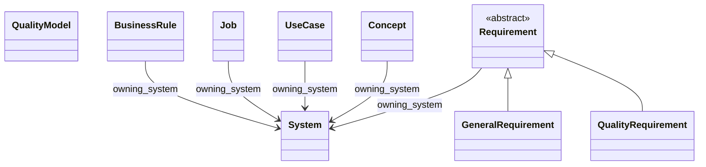
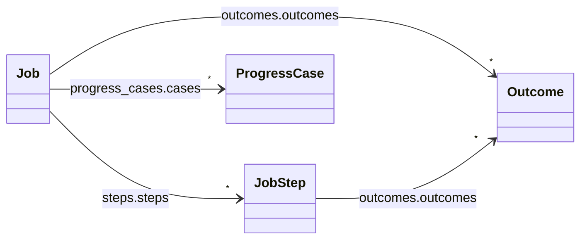
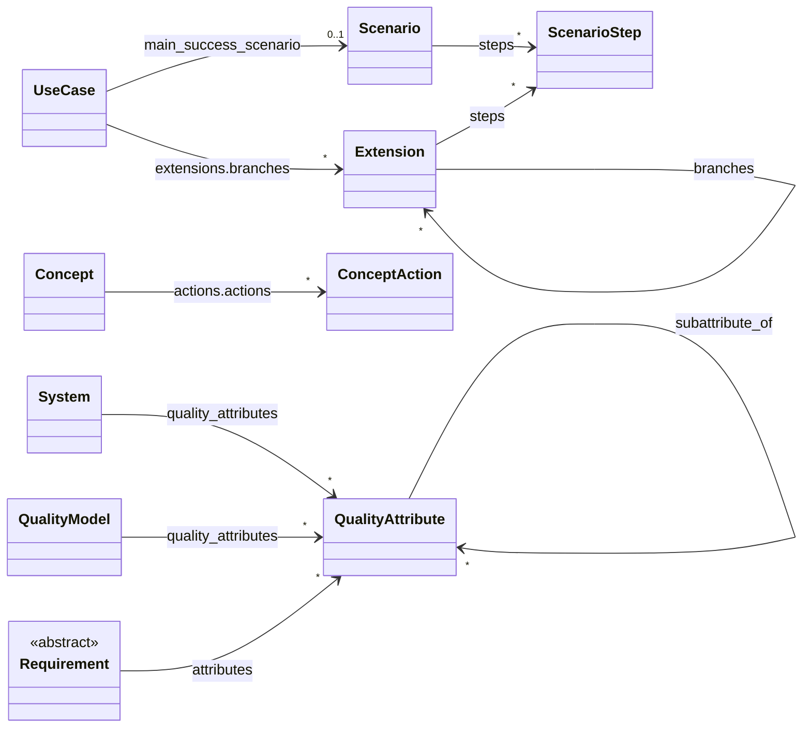
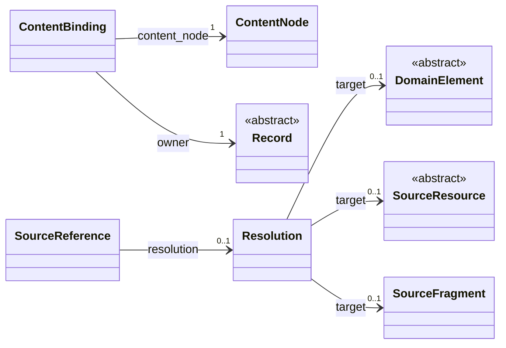

# Core domain model

Generated from [the canonical model](../../../model/dotspec.yaml) and [the view definition](../../../model/views/core-domain.yaml). Do not edit this file.

A focused reference for maintainers and authors understanding business requirements, user requirements, software requirements, and their traceability. Business rules describe business constraints independently of enforcement. Jobs describe user progress; use cases describe software interactions. Supporting and generic model machinery remains available in the complete reference.

Model version: `0.5.0-draft`. See the [complete reference](index.md) for all fields and constraints.

## Core subsets

| Subset | Responsibility | Selected types |
| --- | --- | --- |
| Business requirements (`core`) | Business objectives, scope, assumptions, and rules governing permissible business activity. | [System](index.md#system), [BusinessRule](index.md#businessrule) |
| User requirements (`core`) | The progress people seek, their circumstances, work, and desired outcomes. | [Job](index.md#job), [JobStep](index.md#jobstep), [Outcome](index.md#outcome), [ProgressCase](index.md#progresscase) |
| Software requirements (`core`) | Software interactions, concept behavior, obligations, quality classifications, and verification guidance. | [System](index.md#system), [UseCase](index.md#usecase), [Scenario](index.md#scenario), [ScenarioStep](index.md#scenariostep), [Extension](index.md#extension), [Concept](index.md#concept), [ConceptAction](index.md#conceptaction), [Requirement](index.md#requirement), [GeneralRequirement](index.md#generalrequirement), [QualityRequirement](index.md#qualityrequirement), [QualityModel](index.md#qualitymodel), [QualityAttribute](index.md#qualityattribute) |
| Specification traceability (`core`) | Explicit connections between specification meaning, authored occurrences, and resolved relationships. | [ContentBinding](index.md#contentbinding), [SourceReference](index.md#sourcereference), [Resolution](index.md#resolution) |

Subset membership organizes model definitions; it does not infer the level or importance of an authored instance. Shared types can appear in several subsets. Supporting and generic types appear as context where a diagram needs them.

## Relationships

Arrows name canonical field paths. Plain arrows represent references or embedded values; triangle arrows represent declared inheritance. Multiple edges with the same path show alternative target types; cardinality applies to the slot as a whole. Collection-wrapper paths are abbreviated, retaining the full field path in the label. `owning_system` is a directory-derived association, not a use-case boundary or inherited requirement. Contextual links to business rules, jobs, and concepts do not assert enforcement, fulfillment, or compliance.

### Specification kinds and system association

Eight concrete specification kinds describe repository intent. Quality models stand independently; other kinds can share optional system context. General and quality requirements share the abstract Requirement definition. BusinessRule is an independent specification; a contextual citation does not assert enforcement.

### User progress

Jobs contain ordered steps, overall or per-step outcomes, and progress cases.

### Software behavior and quality

Use cases contain scenarios and alternatives, concepts describe actions, and requirements can be classified by a system's declared quality attributes. Reusable models define separate attributes for copying into systems. Authored order does not by itself establish mandatory execution order.

### Traceability to authored content

Bindings associate model fields with content occurrences; references preserve authored targets and their resolution. Record and ContentNode provide context from the generic subsets. A resolved target does not prove compliance.

## Selected type reference

### System

The system described by a system document; subordinate systems retain their own boundaries and quality attributes.

Subsets: `business-requirements`, `software-requirements`. [System](index.md#system) contains the complete definition.

| Field | Range | Shape | Meaning |
| --- | --- | --- | --- |
| `purpose` | [RichContent](index.md#richcontent) | optional |  |
| `scope` | [RichContent](index.md#richcontent) | optional |  |
| `goals` | [GoalCollection](index.md#goalcollection) | optional |  |
| `constraints` | [ConstraintCollection](index.md#constraintcollection) | optional |  |
| `quality_attributes` | [QualityAttribute](index.md#qualityattribute) | optional; ordered list | Attributes declared by this system, in authored order. Absent means no declaration; a present empty list is distinct. Must be present together with quality_attributes_content. |
| `quality_attributes_content` | [RichContent](index.md#richcontent) | optional | Authored Quality attributes section content, including narrative and attribute subsections. Present even when the section is empty. |

### BusinessRule

A declarative business constraint independent of the software or process that enforces it.

Subsets: `business-requirements`. [BusinessRule](index.md#businessrule) contains the complete definition.

| Field | Range | Shape | Meaning |
| --- | --- | --- | --- |
| `statement` | [RichContent](index.md#richcontent) | optional | The rule expressed in business language, independently of enforcement. |
| `applies_to` | [Applicability](index.md#applicability) | optional |  |
| `rationale` | [RichContent](index.md#richcontent) | optional |  |
| `authority_and_evidence` | [RichContent](index.md#richcontent) | optional | Maps both Authority and Authority and evidence headings; retain original heading nodes. |
| `exceptions` | [RichContent](index.md#richcontent) | optional | Authored qualifications or references to exception rules; no inferred exemption. |
| `related_specifications` | [ContextualReferences](index.md#contextualreferences) | optional |  |

### Job

A performer seeks progress in a situation, independent of a chosen implementation.

Subsets: `user-requirements`. [Job](index.md#job) contains the complete definition.

| Field | Range | Shape | Meaning |
| --- | --- | --- | --- |
| `statement` | [RichContent](index.md#richcontent) | optional | The Job section, including existing job-statement phrasing. |
| `performer` | [RichContent](index.md#richcontent) | optional |  |
| `situation` | [RichContent](index.md#richcontent) | optional |  |
| `intended_progress` | [RichContent](index.md#richcontent) | optional |  |
| `steps` | [JobMap](index.md#jobmap) | optional |  |
| `outcomes` | [OutcomeCollection](index.md#outcomecollection) | optional |  |
| `progress_cases` | [ProgressCaseCollection](index.md#progresscasecollection) | optional |  |

### JobStep

A meaningful part of a job; repeated or custom stage labels are allowed.

Subsets: `user-requirements`. [JobStep](index.md#jobstep) contains the complete definition.

| Field | Range | Shape | Meaning |
| --- | --- | --- | --- |
| `stage` | [RichContent](index.md#richcontent) | optional | Authored stage value; unrestricted vocabulary and repeated labels are valid. |
| `description` | [RichContent](index.md#richcontent) | optional |  |
| `outcomes` | [OutcomeCollection](index.md#outcomecollection) | optional |  |

### Outcome

A desired outcome owned directly by a job or step. Ownership does not imply inheritance.

Subsets: `user-requirements`. [Outcome](index.md#outcome) contains the complete definition.

| Field | Range | Shape | Meaning |
| --- | --- | --- | --- |
| `statement` | [RichContent](index.md#richcontent) | optional |  |
| `supporting_content` | [RichContent](index.md#richcontent) | optional | Explicit support prose or nested bullets belonging to the outcome. |

### ProgressCase

An explicitly authored example or hypothesis about progress; do not invent cases from unsegmented prose.

Subsets: `user-requirements`. [ProgressCase](index.md#progresscase) contains the complete definition.

| Field | Range | Shape | Meaning |
| --- | --- | --- | --- |
| `current_approach` | [RichContent](index.md#richcontent) | optional |  |
| `desired_progress` | [RichContent](index.md#richcontent) | optional |  |
| `forces` | [ForceCollection](index.md#forcecollection) | optional |  |
| `timeline` | [Timeline](index.md#timeline) | optional |  |
| `evidence` | [EvidenceCollection](index.md#evidencecollection) | optional |  |

### UseCase

An actor goal and its interactions at a stated system boundary, with alternative paths and protections.

Subsets: `software-requirements`. [UseCase](index.md#usecase) contains the complete definition.

| Field | Range | Shape | Meaning |
| --- | --- | --- | --- |
| `goal` | [RichContent](index.md#richcontent) | optional |  |
| `system_boundary` | [RichContent](index.md#richcontent) | optional | Boundary description is independent of directory ownership. |
| `primary_actor` | [ActorMention](index.md#actormention) | optional |  |
| `preconditions` | [ConditionCollection](index.md#conditioncollection) | optional |  |
| `minimum_guarantees` | [ConditionCollection](index.md#conditioncollection) | optional |  |
| `main_success_scenario` | [Scenario](index.md#scenario) | optional |  |
| `extensions` | [ExtensionCollection](index.md#extensioncollection) | optional |  |
| `business_rules` | [ContextualReferences](index.md#contextualreferences) | optional | Contextual references to governing business rules; does not assert enforcement or compliance. |

### Scenario

An addressable scenario body and its explicitly authored ordered steps. Narrative-only scenarios remain valid.

Subsets: `software-requirements`. [Scenario](index.md#scenario) contains the complete definition.

| Field | Range | Shape | Meaning |
| --- | --- | --- | --- |
| `content` | [RichContent](index.md#richcontent) | required |  |
| `steps` | [ScenarioStep](index.md#scenariostep) | optional; ordered list | Source order only. Required sequencing belongs in SequenceStatement. |

### ScenarioStep

An explicitly distinguished interaction step, expressed as a label and narrative. Actor, action and result wording remains in the narrative.

Subsets: `software-requirements`. [ScenarioStep](index.md#scenariostep) contains the complete definition.

| Field | Range | Shape | Meaning |
| --- | --- | --- | --- |
| `authored_label` | `string` | optional | Original number or label; snapshot ID supplies addressability. |
| `content` | [RichContent](index.md#richcontent) | required |  |

### Extension

An explicitly distinguished alternative or failure branch. Full narrative is retained; condition, location and handling are optional decompositions. Condition-only entries are valid.

Subsets: `software-requirements`. [Extension](index.md#extension) contains the complete definition.

| Field | Range | Shape | Meaning |
| --- | --- | --- | --- |
| `content` | [RichContent](index.md#richcontent) | required |  |
| `condition` | [RichContent](index.md#richcontent) | optional |  |
| `location` | [RichContent](index.md#richcontent) | optional | Authored branch point, including free prose or labels; no automatic step-number interpretation. |
| `handling` | [RichContent](index.md#richcontent) | optional | Authored handling narrative, including any resumption, conclusion or unresolved question. |
| `steps` | [ScenarioStep](index.md#scenariostep) | optional; ordered list | Explicit handling steps in source order; no execution semantics are inferred. |
| `branches` | [Extension](index.md#extension) | optional; ordered list | Explicitly authored nested branches, in document order. |

### Concept

A behavior-bearing concept described by purpose, abstract state, actions and an operational principle.

Subsets: `software-requirements`. [Concept](index.md#concept) contains the complete definition.

| Field | Range | Shape | Meaning |
| --- | --- | --- | --- |
| `purpose` | [RichContent](index.md#richcontent) | optional |  |
| `abstract_state` | [StateDescription](index.md#statedescription) | optional |  |
| `actions` | [ActionCollection](index.md#actioncollection) | optional |  |
| `operational_principle` | [RichContent](index.md#richcontent) | optional |  |

### ConceptAction

An explicitly named concept action. Caller assumptions and enforced guards are different authored claims.

Subsets: `software-requirements`. [ConceptAction](index.md#conceptaction) contains the complete definition.

| Field | Range | Shape | Meaning |
| --- | --- | --- | --- |
| `inputs` | [RichContent](index.md#richcontent) | optional |  |
| `outputs` | [RichContent](index.md#richcontent) | optional |  |
| `caller_assumptions` | [ConditionCollection](index.md#conditioncollection) | optional |  |
| `guards` | [ConditionCollection](index.md#conditioncollection) | optional |  |
| `effects` | [RichContent](index.md#richcontent) | optional |  |
| `rejections` | [RichContent](index.md#richcontent) | optional |  |

### Requirement

Shared obligation content, applicability, rationale and source classification labels.

Subsets: `software-requirements`. [Requirement](index.md#requirement) contains the complete definition.

| Field | Range | Shape | Meaning |
| --- | --- | --- | --- |
| `applies_to` | [Applicability](index.md#applicability) | optional |  |
| `rationale` | [RichContent](index.md#richcontent) | optional |  |
| `attributes` | [QualityAttribute](index.md#qualityattribute) | optional; list | Only resolved classifications; original occurrences remain separately addressable. |
| `business_rules` | [ContextualReferences](index.md#contextualreferences) | optional | Contextual references to governing business rules; does not assert enforcement or compliance. |

### GeneralRequirement

A general obligation with authored verification guidance.

Subsets: `software-requirements`. [GeneralRequirement](index.md#generalrequirement) contains the complete definition.

| Field | Range | Shape | Meaning |
| --- | --- | --- | --- |
| `statement` | [RichContent](index.md#richcontent) | optional |  |
| `verification` | [VerificationPlan](index.md#verificationplan) | optional |  |

### QualityRequirement

A quality obligation with authored criterion and measurement guidance; quantitative targets are optional.

Subsets: `software-requirements`. [QualityRequirement](index.md#qualityrequirement) contains the complete definition.

| Field | Range | Shape | Meaning |
| --- | --- | --- | --- |
| `criterion` | [QualityCriterion](index.md#qualitycriterion) | optional |  |
| `measurement` | [MeasurementPlan](index.md#measurementplan) | optional |  |

### QualityModel

A standalone reusable set of quality attribute definitions. Copying creates independent system declarations; no live inheritance or synchronization.

Subsets: `software-requirements`. [QualityModel](index.md#qualitymodel) contains the complete definition.

| Field | Range | Shape | Meaning |
| --- | --- | --- | --- |
| `description` | [RichContent](index.md#richcontent) | optional |  |
| `edition` | [RichContent](index.md#richcontent) | optional |  |
| `sources` | [ContextualReferences](index.md#contextualreferences) | optional |  |
| `quality_attributes` | [QualityAttribute](index.md#qualityattribute) | optional; ordered list | Ordered model definitions; must be present together with quality_attributes_content. |
| `quality_attributes_content` | [RichContent](index.md#richcontent) | optional | Complete authored attribute section; absent and empty declarations remain distinct. |

### QualityAttribute

A named quality attribute owned by exactly one system or reusable quality model. Attributes may be organized under several other attributes within that owner. This acyclic grouping supports trees and overlapping classifications; it does not inherit obligations, thresholds, or satisfaction.

Subsets: `software-requirements`. [QualityAttribute](index.md#qualityattribute) contains the complete definition.

| Field | Range | Shape | Meaning |
| --- | --- | --- | --- |
| `definition` | [RichContent](index.md#richcontent) | optional |  |
| `subattribute_of` | [QualityAttribute](index.md#qualityattribute) | optional; list | Resolved attributes under which this attribute is directly organized, within the same declaring owner. Derive subattributes by reversing this relation; preserve authored labels and provenance. |

### ContentBinding

Auditable mapping from source syntax to a named domain field, metadata, structural support, unknown extension, or uninterpreted fallback.

Subsets: `specification-traceability`. [ContentBinding](index.md#contentbinding) contains the complete definition.

| Field | Range | Shape | Meaning |
| --- | --- | --- | --- |
| `owner` | [Record](index.md#record) | required | Owning Document, DomainElement, or other addressable record. |
| `field_path` | `string` | required | Model slot path relative to owner; graph check verifies it exists and points to the represented value. |
| `content_node` | [ContentNode](index.md#contentnode) | required |  |
| `mapping_rule` | `string` | required | Versioned mapping rule, including recognized heading alias. |

### SourceReference

An authored reference occurrence, independent of whether it resolves or carries semantic intent.

Subsets: `specification-traceability`. [SourceReference](index.md#sourcereference) contains the complete definition.

| Field | Range | Shape | Meaning |
| --- | --- | --- | --- |
| `authored_target` | `string` | required | Literal destination or label, including fragments; do not replace it with a normalized target. |
| `context_owner` | [DomainElement](index.md#domainelement) | optional |  |
| `context_field` | `string` | optional |  |
| `resolution` | [Resolution](index.md#resolution) | optional |  |

### Resolution

The recorded outcome of resolving one authored reference or label; targets need not be domain entities.

Subsets: `specification-traceability`. [Resolution](index.md#resolution) contains the complete definition.

| Field | Range | Shape | Meaning |
| --- | --- | --- | --- |
| `occurrence` | [SourceReference](index.md#sourcereference) or [LabelOccurrence](index.md#labeloccurrence) | required |  |
| `status` | `ResolutionStatus` | required |  |
| `target` | [DomainElement](index.md#domainelement) or [SourceResource](index.md#sourceresource) or [SourceFragment](index.md#sourcefragment) | optional | Only for resolved; target may be a domain element, source resource or source fragment. |
| `rule` | `string` | required |  |
