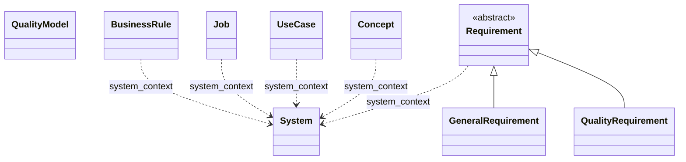
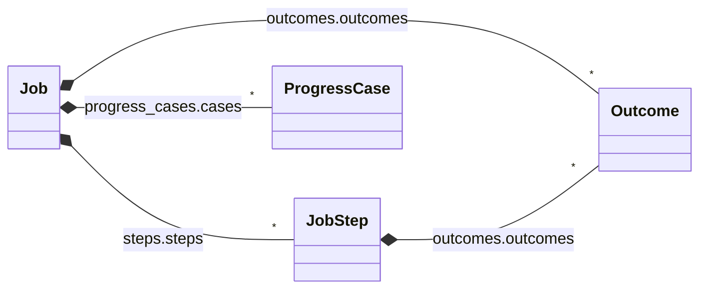
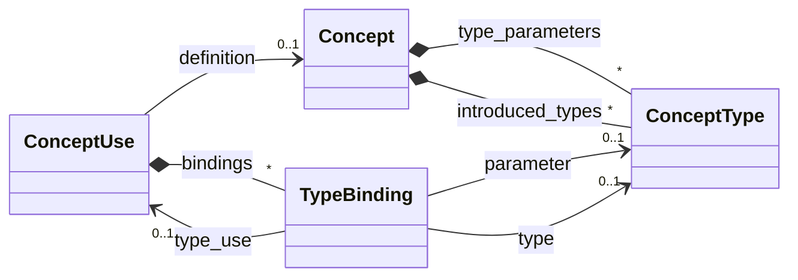
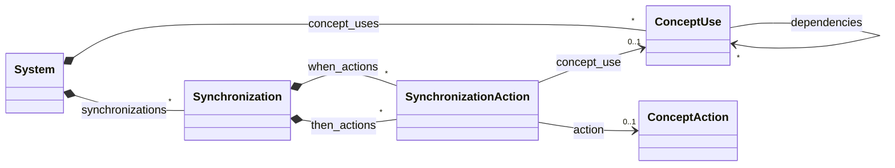
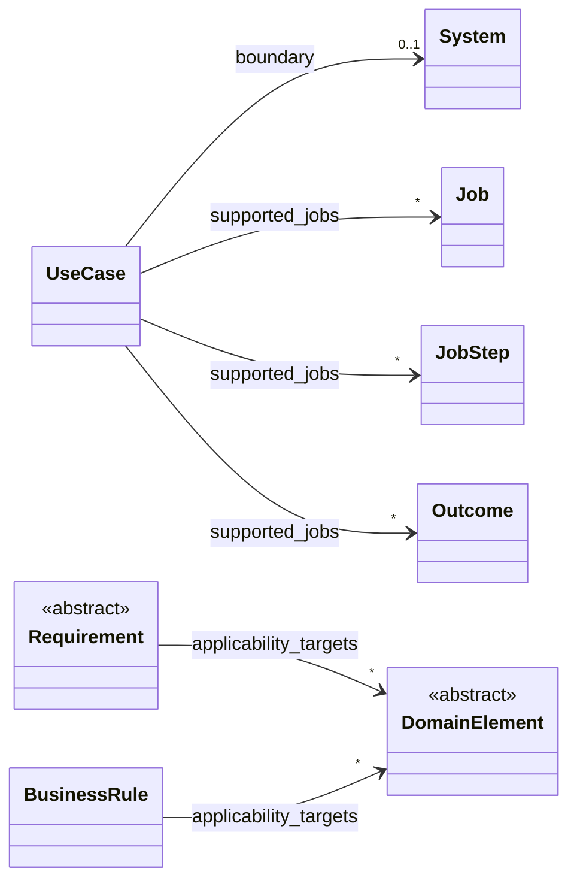
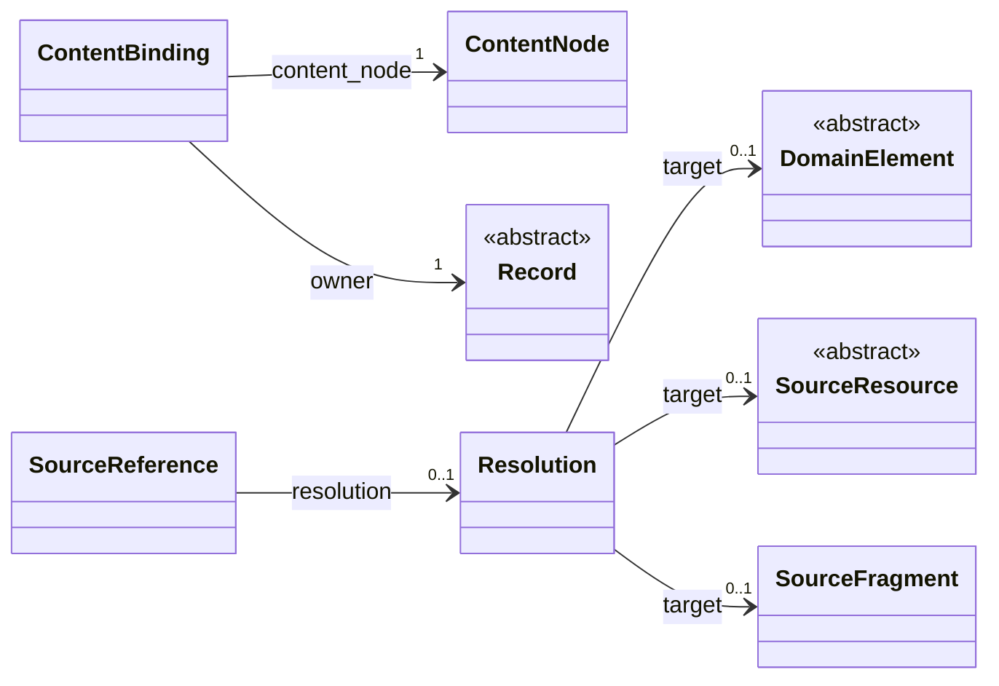
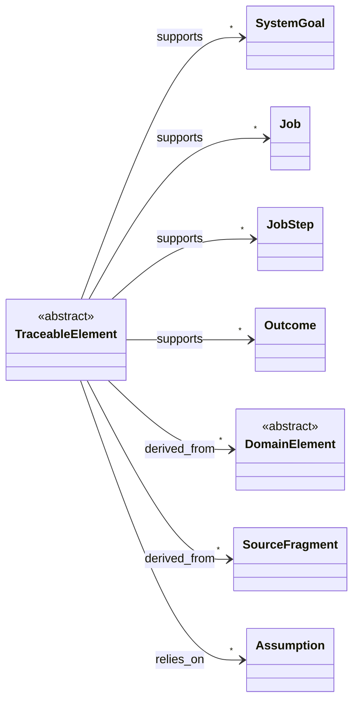
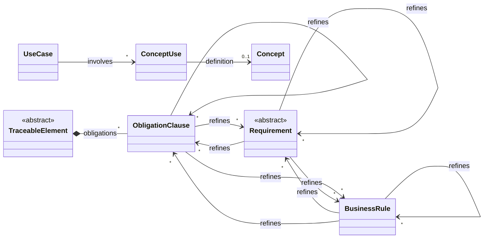

# Core domain model

Generated from [the canonical model](../../../model/dotspec.yaml) and [the view definition](../../../model/views/core-domain.yaml). Do not edit this file.

A focused reference for maintainers and authors understanding business requirements, user requirements, software requirements, and their traceability. Business rules describe business constraints independently of enforcement. Jobs describe user progress; use cases describe software interactions. Supporting and generic model machinery remains available in the complete reference.

Model version: `0.8.0-draft`. See the [complete reference](index.md) for all fields and constraints.

## Core subsets

| Subset | Responsibility | Selected types |
| --- | --- | --- |
| Business requirements (`core`) | Business objectives, scope, assumptions, and rules governing permissible business activity. | [TraceableElement](index.md#traceableelement), [SystemGoal](index.md#systemgoal), [Assumption](index.md#assumption), [Constraint](index.md#constraint), [ObligationClause](index.md#obligationclause), [System](index.md#system), [BusinessRule](index.md#businessrule) |
| User requirements (`core`) | The progress people seek, their circumstances, work, and desired outcomes. | [TraceableElement](index.md#traceableelement), [Job](index.md#job), [JobStep](index.md#jobstep), [Outcome](index.md#outcome), [ProgressCase](index.md#progresscase) |
| Software requirements (`core`) | Software interactions, concept behavior, obligations, quality classifications, and verification guidance. | [TraceableElement](index.md#traceableelement), [Assumption](index.md#assumption), [Constraint](index.md#constraint), [ObligationClause](index.md#obligationclause), [System](index.md#system), [UseCase](index.md#usecase), [Scenario](index.md#scenario), [ScenarioStep](index.md#scenariostep), [Extension](index.md#extension), [Concept](index.md#concept), [ConceptType](index.md#concepttype), [ConceptUse](index.md#conceptuse), [TypeBinding](index.md#typebinding), [Synchronization](index.md#synchronization), [SynchronizationAction](index.md#synchronizationaction), [StateDescription](index.md#statedescription), [StateElement](index.md#stateelement), [ActionParameter](index.md#actionparameter), [ConceptAction](index.md#conceptaction), [Requirement](index.md#requirement), [GeneralRequirement](index.md#generalrequirement), [QualityRequirement](index.md#qualityrequirement), [QualityModel](index.md#qualitymodel), [QualityAttribute](index.md#qualityattribute) |
| Specification traceability (`core`) | Explicit connections between specification meaning, authored occurrences, and resolved relationships. | [ContentBinding](index.md#contentbinding), [SourceReference](index.md#sourcereference), [Resolution](index.md#resolution) |

Subset membership organizes model definitions; it does not infer the level or importance of an authored instance. Shared types can appear in several subsets. Supporting and generic types appear as context where a diagram needs them.

## Relationships

See the [relationship reference](relationships.md) for the complete edge contracts.

Arrows name canonical field paths. Diamond arrows represent declaration containment, dashed arrows structural context and citations, and plain arrows semantic associations or provenance; triangle arrows represent declared inheritance. Multiple edges with the same path show alternative target types; cardinality applies to the slot as a whole. Collection-wrapper paths are abbreviated, retaining the full field path in the label. `system_context` is a directory-derived association, not a use-case boundary or inherited requirement. Contextual links to business rules, jobs, and concepts do not assert enforcement, fulfillment, or compliance.

### Specification kinds and system association

Eight concrete specification kinds describe repository intent. Quality models stand independently; other kinds can share optional system context. General and quality requirements share the abstract Requirement definition. BusinessRule is an independent specification; a contextual citation does not assert enforcement.

### User progress

Jobs contain ordered steps, overall or per-step outcomes, and progress cases.

### Software behavior and quality

Use cases contain scenarios and alternatives, concepts describe actions, and requirements can be classified by a system's declared quality attributes. Reusable models define separate attributes for copying into systems. Authored order does not by itself establish mandatory execution order.

### Concept definitions and type bindings

Explicit named uses reference reusable definitions. Bindings distinguish a type declaration from the use supplying its identities. Type parameters and introduced types share a declaration scope but play different roles.

### System coordination

Systems explicitly include named uses and own synchronization rules. Each referenced action is qualified by its use and must belong to that use's definition. Application dependencies are separately declared and may cycle. None of these relations implies execution, atomicity or behavioral completeness.

### Explicit requirements relationships

Explicit authoring distinguishes a use case boundary, support for user progress, and applicability from ordinary citations. Applicability may target any domain record; links do not establish enforcement, satisfaction or achieved outcomes.

### Traceability to authored content

Bindings associate model fields with content occurrences; references preserve authored targets and their resolution. Record and ContentNode provide context from the generic subsets. A resolved target does not prove compliance.

### Motivation, basis and assumptions

Concern subsets are independent of artifact kind and core/supporting/generic classification. Explicit support describes intended contribution; derivation records a basis rather than entailment. Requirements may link directly to a business rule or design decision without an intervening user record. Assumptions condition validity. These links do not impose authoring order or prove satisfaction.

### Obligations and complementary behavioral views

Requirement is the standalone obligation document family, not every normative expression. Explicit clauses identify obligations within existing specifications without duplicating them. Refinement preserves a parent commitment and must be acyclic; multiple parents are permitted. Use cases involve named concept uses many-to-many; neither view is the mandatory parent of the other.

## Selected type reference

### TraceableElement

An element with explicit motivation, derivation and assumptions. Concern subset, artifact kind and core/supporting/generic classification are independent; neither traceability nor document location confers normative authority.

Subsets: `business-requirements`, `user-requirements`, `software-requirements`. [TraceableElement](index.md#traceableelement) contains the complete definition.

| Field | Range | Shape | Meaning |
| --- | --- | --- | --- |
| `supports` | [SystemGoal](index.md#systemgoal) or [Job](index.md#job) or [JobStep](index.md#jobstep) or [Outcome](index.md#outcome) | optional; list | Intended contribution to a goal or user progress; does not assert achievement. |
| `derived_from` | [DomainElement](index.md#domainelement) or [SourceFragment](index.md#sourcefragment) | optional; list | Source or rationale for this element, including rules, decisions and obligations; not logical entailment. |
| `relies_on` | [Assumption](index.md#assumption) | optional; list | Assumptions on which the validity of this element depends. |
| `obligations` | [ObligationClause](index.md#obligationclause) | optional; ordered list |  |

### SystemGoal

An explicitly distinguished system goal.

Subsets: `business-requirements`. [SystemGoal](index.md#systemgoal) contains the complete definition.

| Field | Range | Shape | Meaning |
| --- | --- | --- | --- |
| `statement` | [RichContent](index.md#richcontent) | optional |  |
| `supports` | [SystemGoal](index.md#systemgoal) or [Job](index.md#job) or [JobStep](index.md#jobstep) or [Outcome](index.md#outcome) | optional; list | Intended contribution to a goal or user progress; does not assert achievement. |

### Assumption

An explicitly distinguished system assumption; no inferred truth assertion.

Subsets: `business-requirements`, `software-requirements`. [Assumption](index.md#assumption) contains the complete definition.

| Field | Range | Shape | Meaning |
| --- | --- | --- | --- |
| `statement` | [RichContent](index.md#richcontent) | optional |  |

### Constraint

An explicitly distinguished system constraint.

Subsets: `business-requirements`, `software-requirements`. [Constraint](index.md#constraint) contains the complete definition.

| Field | Range | Shape | Meaning |
| --- | --- | --- | --- |
| `statement` | [RichContent](index.md#richcontent) | optional |  |

### ObligationClause

An explicitly distinguished obligation within an existing specification or behavioral model. Its content is the authored expression, not a duplicate requirement document. Project authority determines acceptance; declaration alone does not.

Subsets: `business-requirements`, `software-requirements`. [ObligationClause](index.md#obligationclause) contains the complete definition.

| Field | Range | Shape | Meaning |
| --- | --- | --- | --- |
| `statement` | [RichContent](index.md#richcontent) | optional |  |
| `refines` | [Requirement](index.md#requirement) or [BusinessRule](index.md#businessrule) or [ObligationClause](index.md#obligationclause) | optional; list | Adds precision while preserving the referenced obligation; not replacement, duplication or proof. Multiple parents are permitted. |
| `applicability_targets` | [DomainElement](index.md#domainelement) | optional; list |  |
| `verification` | [VerificationPlan](index.md#verificationplan) | optional |  |

### System

The system described by a system document; subordinate systems retain their own boundaries and quality attributes.

Subsets: `business-requirements`, `software-requirements`. [System](index.md#system) contains the complete definition.

| Field | Range | Shape | Meaning |
| --- | --- | --- | --- |
| `purpose` | [RichContent](index.md#richcontent) | optional |  |
| `scope` | [RichContent](index.md#richcontent) | optional |  |
| `goals` | [GoalCollection](index.md#goalcollection) | optional |  |
| `constraints` | [ConstraintCollection](index.md#constraintcollection) | optional |  |
| `concept_uses` | [ConceptUse](index.md#conceptuse) | optional; ordered list |  |
| `synchronizations` | [Synchronization](index.md#synchronization) | optional; ordered list |  |
| `quality_attributes` | [QualityAttribute](index.md#qualityattribute) | optional; ordered list | Attributes declared by this system, in authored order. Absent means no declaration; a present empty list is distinct. Must be present together with quality_attributes_content. |

### BusinessRule

A declarative business constraint independent of the software or process that enforces it.

Subsets: `business-requirements`. [BusinessRule](index.md#businessrule) contains the complete definition.

| Field | Range | Shape | Meaning |
| --- | --- | --- | --- |
| `statement` | [RichContent](index.md#richcontent) | optional | The rule expressed in business language, independently of enforcement. |
| `applies_to` | [Applicability](index.md#applicability) | optional |  |
| `applicability_targets` | [DomainElement](index.md#domainelement) | optional; list |  |
| `rationale` | [RichContent](index.md#richcontent) | optional |  |
| `authority_and_evidence` | [RichContent](index.md#richcontent) | optional | Maps both Authority and Authority and evidence headings; retain original heading nodes. |
| `exceptions` | [RichContent](index.md#richcontent) | optional | Authored qualifications or references to exception rules; no inferred exemption. |
| `related_specifications` | [ContextualReferences](index.md#contextualreferences) | optional |  |

### Job

A performer seeks progress in a situation, independent of a chosen implementation.

Subsets: `user-requirements`. [Job](index.md#job) contains the complete definition.

| Field | Range | Shape | Meaning |
| --- | --- | --- | --- |
| `statement` | [RichContent](index.md#richcontent) | optional | The Job section, including existing job-statement phrasing. |
| `performer` | [RichContent](index.md#richcontent) | optional |  |
| `situation` | [RichContent](index.md#richcontent) | optional |  |
| `intended_progress` | [RichContent](index.md#richcontent) | optional |  |
| `steps` | [JobMap](index.md#jobmap) | optional |  |
| `outcomes` | [OutcomeCollection](index.md#outcomecollection) | optional |  |
| `progress_cases` | [ProgressCaseCollection](index.md#progresscasecollection) | optional |  |

### JobStep

A meaningful part of a job; repeated or custom stage labels are allowed.

Subsets: `user-requirements`. [JobStep](index.md#jobstep) contains the complete definition.

| Field | Range | Shape | Meaning |
| --- | --- | --- | --- |
| `stage` | [RichContent](index.md#richcontent) | optional | Authored stage value; unrestricted vocabulary and repeated labels are valid. |
| `description` | [RichContent](index.md#richcontent) | optional |  |
| `outcomes` | [OutcomeCollection](index.md#outcomecollection) | optional |  |

### Outcome

A desired outcome owned directly by a job or step. Ownership does not imply inheritance.

Subsets: `user-requirements`. [Outcome](index.md#outcome) contains the complete definition.

| Field | Range | Shape | Meaning |
| --- | --- | --- | --- |
| `statement` | [RichContent](index.md#richcontent) | optional |  |
| `supporting_content` | [RichContent](index.md#richcontent) | optional | Explicit support prose or nested bullets belonging to the outcome. |

### ProgressCase

An explicitly authored example or hypothesis about progress; do not invent cases from unsegmented prose.

Subsets: `user-requirements`. [ProgressCase](index.md#progresscase) contains the complete definition.

| Field | Range | Shape | Meaning |
| --- | --- | --- | --- |
| `current_approach` | [RichContent](index.md#richcontent) | optional |  |
| `desired_progress` | [RichContent](index.md#richcontent) | optional |  |
| `forces` | [ForceCollection](index.md#forcecollection) | optional |  |
| `timeline` | [Timeline](index.md#timeline) | optional |  |
| `evidence` | [EvidenceCollection](index.md#evidencecollection) | optional |  |

### UseCase

An actor goal and its interactions at a stated system boundary, with alternative paths and protections.

Subsets: `software-requirements`. [UseCase](index.md#usecase) contains the complete definition.

| Field | Range | Shape | Meaning |
| --- | --- | --- | --- |
| `involves` | [ConceptUse](index.md#conceptuse) | optional; list | Named concept uses participating in this actor-goal interaction; not a service boundary or mandatory execution order. |
| `obligations` | [ObligationClause](index.md#obligationclause) | optional; ordered list |  |
| `goal` | [RichContent](index.md#richcontent) | optional |  |
| `system_boundary` | [RichContent](index.md#richcontent) | optional | Boundary description is independent of directory ownership. |
| `boundary` | [System](index.md#system) | optional |  |
| `supported_jobs` | [Job](index.md#job) or [JobStep](index.md#jobstep) or [Outcome](index.md#outcome) | optional; list |  |
| `primary_actor` | [ActorMention](index.md#actormention) | optional |  |
| `preconditions` | [ConditionCollection](index.md#conditioncollection) | optional |  |
| `minimum_guarantees` | [ConditionCollection](index.md#conditioncollection) | optional |  |
| `main_success_scenario` | [Scenario](index.md#scenario) | optional |  |
| `extensions` | [ExtensionCollection](index.md#extensioncollection) | optional |  |
| `business_rules` | [ContextualReferences](index.md#contextualreferences) | optional | Contextual references to governing business rules; does not assert enforcement or compliance. |

### Scenario

An addressable scenario body and its explicitly authored ordered steps. Narrative-only scenarios remain valid.

Subsets: `software-requirements`. [Scenario](index.md#scenario) contains the complete definition.

| Field | Range | Shape | Meaning |
| --- | --- | --- | --- |
| `content` | [RichContent](index.md#richcontent) | required |  |
| `steps` | [ScenarioStep](index.md#scenariostep) | optional; ordered list | Source order only. Required sequencing belongs in SequenceStatement. |

### ScenarioStep

An explicitly distinguished interaction step, expressed as a label and narrative. Actor, action and result wording remains in the narrative.

Subsets: `software-requirements`. [ScenarioStep](index.md#scenariostep) contains the complete definition.

| Field | Range | Shape | Meaning |
| --- | --- | --- | --- |
| `authored_label` | `string` | optional | Original number or label; snapshot ID supplies addressability. |
| `content` | [RichContent](index.md#richcontent) | required |  |

### Extension

An explicitly distinguished alternative or failure branch. Full narrative is retained; condition, location and handling are optional decompositions. Condition-only entries are valid.

Subsets: `software-requirements`. [Extension](index.md#extension) contains the complete definition.

| Field | Range | Shape | Meaning |
| --- | --- | --- | --- |
| `content` | [RichContent](index.md#richcontent) | required |  |
| `condition` | [RichContent](index.md#richcontent) | optional |  |
| `location` | [RichContent](index.md#richcontent) | optional | Authored branch point, including free prose or labels; no automatic step-number interpretation. |
| `handling` | [RichContent](index.md#richcontent) | optional | Authored handling narrative, including any resumption, conclusion or unresolved question. |
| `steps` | [ScenarioStep](index.md#scenariostep) | optional; ordered list | Explicit handling steps in source order; no execution semantics are inferred. |
| `branches` | [Extension](index.md#extension) | optional; ordered list | Explicitly authored nested branches, in document order. |

### Concept

A behavior-bearing concept described by purpose, abstract state, actions and an operational principle.

Subsets: `software-requirements`. [Concept](index.md#concept) contains the complete definition.

| Field | Range | Shape | Meaning |
| --- | --- | --- | --- |
| `purpose` | [RichContent](index.md#richcontent) | optional |  |
| `operational_principle` | [RichContent](index.md#richcontent) | optional |  |
| `type_parameters` | [ConceptType](index.md#concepttype) | optional; ordered list |  |
| `introduced_types` | [ConceptType](index.md#concepttype) | optional; ordered list |  |
| `abstract_state` | [StateDescription](index.md#statedescription) | optional |  |
| `actions` | [ActionCollection](index.md#actioncollection) | optional |  |

### ConceptType

A type parameter or introduced identity type, scoped to one concept definition. Membership distinguishes its role.

Subsets: `software-requirements`. [ConceptType](index.md#concepttype) contains the complete definition.

| Field | Range | Shape | Meaning |
| --- | --- | --- | --- |
| `content` | [RichContent](index.md#richcontent) | required |  |

### ConceptUse

An explicitly named design-time inclusion of a concept in a system. Multiple uses of one definition remain distinct; directory association creates no use.

Subsets: `software-requirements`. [ConceptUse](index.md#conceptuse) contains the complete definition.

| Field | Range | Shape | Meaning |
| --- | --- | --- | --- |
| `definition` | [Concept](index.md#concept) | optional |  |
| `bindings` | [TypeBinding](index.md#typebinding) | optional; ordered list |  |
| `configuration` | [RichContent](index.md#richcontent) | optional |  |
| `dependencies` | [ConceptUse](index.md#conceptuse) | optional; ordered list |  |

### TypeBinding

An explicit binding of a definition parameter to a primitive or a type introduced by a named concept use. Unresolved links remain authored references.

Subsets: `software-requirements`. [TypeBinding](index.md#typebinding) contains the complete definition.

| Field | Range | Shape | Meaning |
| --- | --- | --- | --- |
| `parameter` | [ConceptType](index.md#concepttype) | optional |  |
| `type` | [ConceptType](index.md#concepttype) | optional |  |
| `type_use` | [ConceptUse](index.md#conceptuse) | optional |  |
| `primitive` | `string` | optional |  |

### Synchronization

A system-owned composition rule. Narrative and action references describe coordination; no atomicity, execution or completeness is inferred.

Subsets: `software-requirements`. [Synchronization](index.md#synchronization) contains the complete definition.

| Field | Range | Shape | Meaning |
| --- | --- | --- | --- |
| `when` | [RichContent](index.md#richcontent) | optional |  |
| `where` | [RichContent](index.md#richcontent) | optional |  |
| `then` | [RichContent](index.md#richcontent) | optional |  |
| `semantics` | [RichContent](index.md#richcontent) | optional |  |
| `when_actions` | [SynchronizationAction](index.md#synchronizationaction) | optional; ordered list |  |
| `then_actions` | [SynchronizationAction](index.md#synchronizationaction) | optional; ordered list |  |

### SynchronizationAction

An authored action occurrence or invocation within a synchronization, qualified by a concept use. Conditions and arguments remain authored content.

Subsets: `software-requirements`. [SynchronizationAction](index.md#synchronizationaction) contains the complete definition.

| Field | Range | Shape | Meaning |
| --- | --- | --- | --- |
| `concept_use` | [ConceptUse](index.md#conceptuse) | optional |  |
| `action` | [ConceptAction](index.md#conceptaction) | optional |  |
| `arguments` | [RichContent](index.md#richcontent) | optional |  |
| `result` | [RichContent](index.md#richcontent) | optional |  |

### StateDescription

The State section as narrative and optional explicitly named state components/invariants; no reverse-engineered implementation model.

Subsets: `software-requirements`. [StateDescription](index.md#statedescription) contains the complete definition.

| Field | Range | Shape | Meaning |
| --- | --- | --- | --- |
| `content` | [RichContent](index.md#richcontent) | required |  |
| `initial_state` | [RichContent](index.md#richcontent) | optional |  |
| `elements` | [StateElement](index.md#stateelement) | optional; ordered list |  |
| `invariants` | [Condition](index.md#condition) | optional; ordered list |  |

### StateElement

An explicitly named abstract state component.

Subsets: `software-requirements`. [StateElement](index.md#stateelement) contains the complete definition.

| Field | Range | Shape | Meaning |
| --- | --- | --- | --- |
| `name` | [RichContent](index.md#richcontent) | optional |  |
| `description` | [RichContent](index.md#richcontent) | optional |  |
| `value_description` | [RichContent](index.md#richcontent) | optional |  |
| `derivation` | [RichContent](index.md#richcontent) | optional |  |

### ActionParameter

An explicitly named input or result. Type descriptions can remain prose; linked types and primitive names are optional.

Subsets: `software-requirements`. [ActionParameter](index.md#actionparameter) contains the complete definition.

| Field | Range | Shape | Meaning |
| --- | --- | --- | --- |
| `content` | [RichContent](index.md#richcontent) | required |  |
| `type` | [ConceptType](index.md#concepttype) | optional |  |
| `primitive` | `string` | optional |  |
| `type_description` | [RichContent](index.md#richcontent) | optional |  |

### ConceptAction

An explicitly named concept action. Caller assumptions and enforced guards are different authored claims.

Subsets: `software-requirements`. [ConceptAction](index.md#conceptaction) contains the complete definition.

| Field | Range | Shape | Meaning |
| --- | --- | --- | --- |
| `inputs` | [RichContent](index.md#richcontent) | optional |  |
| `outputs` | [RichContent](index.md#richcontent) | optional |  |
| `input_parameters` | [ActionParameter](index.md#actionparameter) | optional; ordered list |  |
| `output_parameters` | [ActionParameter](index.md#actionparameter) | optional; ordered list |  |
| `initiation` | [RichContent](index.md#richcontent) | optional | Authored initiation conditions, including user or system actions; no scheduler or caller is inferred. |
| `caller_assumptions` | [ConditionCollection](index.md#conditioncollection) | optional |  |
| `guards` | [ConditionCollection](index.md#conditioncollection) | optional |  |
| `effects` | [RichContent](index.md#richcontent) | optional |  |
| `rejections` | [RichContent](index.md#richcontent) | optional |  |

### Requirement

A standalone obligation specification. Obligations can also be expressed in use cases and concept contracts; this document family is not the superclass of every normative expression.

Subsets: `software-requirements`. [Requirement](index.md#requirement) contains the complete definition.

| Field | Range | Shape | Meaning |
| --- | --- | --- | --- |
| `refines` | [Requirement](index.md#requirement) or [BusinessRule](index.md#businessrule) or [ObligationClause](index.md#obligationclause) | optional; list | Adds precision while preserving the referenced obligation; not replacement, duplication or proof. Multiple parents are permitted. |
| `derived_from` | [DomainElement](index.md#domainelement) or [SourceFragment](index.md#sourcefragment) | optional; list | Source or rationale for this element, including rules, decisions and obligations; not logical entailment. |
| `supports` | [SystemGoal](index.md#systemgoal) or [Job](index.md#job) or [JobStep](index.md#jobstep) or [Outcome](index.md#outcome) | optional; list | Intended contribution to a goal or user progress; does not assert achievement. |
| `relies_on` | [Assumption](index.md#assumption) | optional; list | Assumptions on which the validity of this element depends. |
| `applies_to` | [Applicability](index.md#applicability) | optional |  |
| `applicability_targets` | [DomainElement](index.md#domainelement) | optional; list |  |
| `rationale` | [RichContent](index.md#richcontent) | optional |  |
| `attributes` | [QualityAttribute](index.md#qualityattribute) | optional; list | Only resolved classifications; original occurrences remain separately addressable. |
| `business_rules` | [ContextualReferences](index.md#contextualreferences) | optional | Contextual references to governing business rules; does not assert enforcement or compliance. |

### GeneralRequirement

A general obligation with authored verification guidance.

Subsets: `software-requirements`. [GeneralRequirement](index.md#generalrequirement) contains the complete definition.

| Field | Range | Shape | Meaning |
| --- | --- | --- | --- |
| `statement` | [RichContent](index.md#richcontent) | optional |  |
| `verification` | [VerificationPlan](index.md#verificationplan) | optional |  |

### QualityRequirement

A quality obligation with authored criterion and measurement guidance; quantitative targets are optional.

Subsets: `software-requirements`. [QualityRequirement](index.md#qualityrequirement) contains the complete definition.

| Field | Range | Shape | Meaning |
| --- | --- | --- | --- |
| `criterion` | [QualityCriterion](index.md#qualitycriterion) | optional |  |
| `measurement` | [MeasurementPlan](index.md#measurementplan) | optional |  |

### QualityModel

A standalone reusable set of quality attribute definitions. Copying creates independent system declarations; no live inheritance or synchronization.

Subsets: `software-requirements`. [QualityModel](index.md#qualitymodel) contains the complete definition.

| Field | Range | Shape | Meaning |
| --- | --- | --- | --- |
| `description` | [RichContent](index.md#richcontent) | optional |  |
| `edition` | [RichContent](index.md#richcontent) | optional |  |
| `sources` | [ContextualReferences](index.md#contextualreferences) | optional |  |
| `quality_attributes` | [QualityAttribute](index.md#qualityattribute) | optional; ordered list | Ordered model definitions; must be present together with quality_attributes_content. |
| `quality_attributes_content` | [RichContent](index.md#richcontent) | optional | Complete authored attribute section; absent and empty declarations remain distinct. |

### QualityAttribute

A named quality attribute owned by exactly one system or reusable quality model. Attributes may be organized under several other attributes within that owner. This acyclic grouping supports trees and overlapping classifications; it does not inherit obligations, thresholds, or satisfaction.

Subsets: `software-requirements`. [QualityAttribute](index.md#qualityattribute) contains the complete definition.

| Field | Range | Shape | Meaning |
| --- | --- | --- | --- |
| `definition` | [RichContent](index.md#richcontent) | optional |  |
| `subattribute_of` | [QualityAttribute](index.md#qualityattribute) | optional; list | Resolved attributes under which this attribute is directly organized, within the same declaring owner. Derive subattributes by reversing this relation; preserve authored labels and provenance. |

### ContentBinding

Auditable mapping from source syntax to a named domain field, metadata, structural support, unknown extension, or uninterpreted fallback.

Subsets: `specification-traceability`. [ContentBinding](index.md#contentbinding) contains the complete definition.

| Field | Range | Shape | Meaning |
| --- | --- | --- | --- |
| `owner` | [Record](index.md#record) | required | Owning Document, DomainElement, or other addressable record. |
| `field_path` | `string` | required | Model slot path relative to owner; graph check verifies it exists and points to the represented value. |
| `content_node` | [ContentNode](index.md#contentnode) | required |  |
| `mapping_rule` | `string` | required | Versioned mapping rule, including recognized heading alias. |

### SourceReference

An authored reference occurrence, independent of whether it resolves or carries semantic intent.

Subsets: `specification-traceability`. [SourceReference](index.md#sourcereference) contains the complete definition.

| Field | Range | Shape | Meaning |
| --- | --- | --- | --- |
| `authored_target` | `string` | required | Literal destination or label, including fragments; do not replace it with a normalized target. |
| `context_owner` | [DomainElement](index.md#domainelement) | optional |  |
| `context_field` | `string` | optional |  |
| `resolution` | [Resolution](index.md#resolution) | optional |  |

### Resolution

The recorded outcome of resolving one authored reference or label; targets need not be domain entities.

Subsets: `specification-traceability`. [Resolution](index.md#resolution) contains the complete definition.

| Field | Range | Shape | Meaning |
| --- | --- | --- | --- |
| `occurrence` | [SourceReference](index.md#sourcereference) or [LabelOccurrence](index.md#labeloccurrence) | required |  |
| `status` | `ResolutionStatus` | required |  |
| `target` | [DomainElement](index.md#domainelement) or [SourceResource](index.md#sourceresource) or [SourceFragment](index.md#sourcefragment) | optional | Only for resolved; target may be a domain element, source resource or source fragment. |
| `rule` | `string` | required |  |
