# Core domain model

Generated from [the canonical model](../../../model/metamodel.yaml) and [the view definition](../../../model/views/core-domain.yaml). Do not edit this file.

A focused reference for maintainers and authors understanding business requirements, user requirements, software requirements, and their traceability. Business rules describe business constraints independently of enforcement. Jobs describe user progress; use cases describe software interactions. Supporting and generic model machinery remains available in the complete reference.

Model version: `0.34.0-draft`. See the [complete reference](index.md) for all fields and constraints.

## Core subsets

| Subset | Responsibility | Selected types |
| --- | --- | --- |
| Business requirements (`core`) | Business objectives, scope, assumptions, and rules governing permissible business activity. | [DomainElement](index.md#domainelement), [Specification](index.md#specification), [TraceableElement](index.md#traceableelement), [Goal](index.md#goal), [SystemStakeholderRole](index.md#systemstakeholderrole), [Assumption](index.md#assumption), [System](index.md#system), [BusinessRule](index.md#businessrule), [Applicability](index.md#applicability), [RequirementCriterion](index.md#requirementcriterion), [Capability](index.md#capability), [OpenQuestion](index.md#openquestion) |
| User requirements (`core`) | The progress people seek, their circumstances, work, and desired outcomes. | [DomainElement](index.md#domainelement), [Specification](index.md#specification), [TraceableElement](index.md#traceableelement), [Job](index.md#job), [JobStep](index.md#jobstep), [DesiredOutcome](index.md#desiredoutcome), [Applicability](index.md#applicability), [RequirementCriterion](index.md#requirementcriterion), [OpenQuestion](index.md#openquestion) |
| Software requirements (`core`) | Software interactions, concept behavior, requirements, quality classifications and satisfaction criteria. | [DomainElement](index.md#domainelement), [Specification](index.md#specification), [TraceableElement](index.md#traceableelement), [Assumption](index.md#assumption), [System](index.md#system), [UseCase](index.md#usecase), [Scenario](index.md#scenario), [ScenarioStep](index.md#scenariostep), [UseCaseExtension](index.md#usecaseextension), [Concept](index.md#concept), [ConceptUse](index.md#conceptuse), [Synchronization](index.md#synchronization), [ConceptAction](index.md#conceptaction), [Requirement](index.md#requirement), [QualityModel](index.md#qualitymodel), [QualityAttribute](index.md#qualityattribute), [Applicability](index.md#applicability), [RequirementCriterion](index.md#requirementcriterion), [Component](index.md#component), [Feature](index.md#feature), [Capability](index.md#capability), [OpenQuestion](index.md#openquestion), [Interface](index.md#interface) |
| Specification traceability (`core`) | Explicit connections between specification meaning, authored occurrences, and resolved relationships. | [SourceReference](index.md#sourcereference), [Resolution](index.md#resolution) |

Subset membership organizes model definitions; it does not infer the level or importance of an authored instance. Shared types can appear in several subsets. Supporting and generic types appear as context where a diagram needs them.

## Relationships

See the [relationship reference](relationships.md) for the complete edge contracts.

Arrows use schema-owned relationship labels; reference tables retain exact canonical field paths. Diamond arrows represent declaration containment, dashed arrows structural context and citations, and plain arrows semantic associations or provenance; triangle arrows represent declared inheritance. Multiple edges with the same path show alternative target types; cardinality applies to the slot as a whole. Embedded values are omitted from diagrams; exact paths remain in the reference tables. `specification_system` is a grouping association, not a use-case boundary or inherited requirement. Contextual links to related specifications do not assert enforcement, fulfillment, or compliance.

### Specification and reference roots

Each authored document has one primary domain subject. A specification root records product intent and owns the elements declared within its file. A quality model is a reference root that owns reusable definitions.

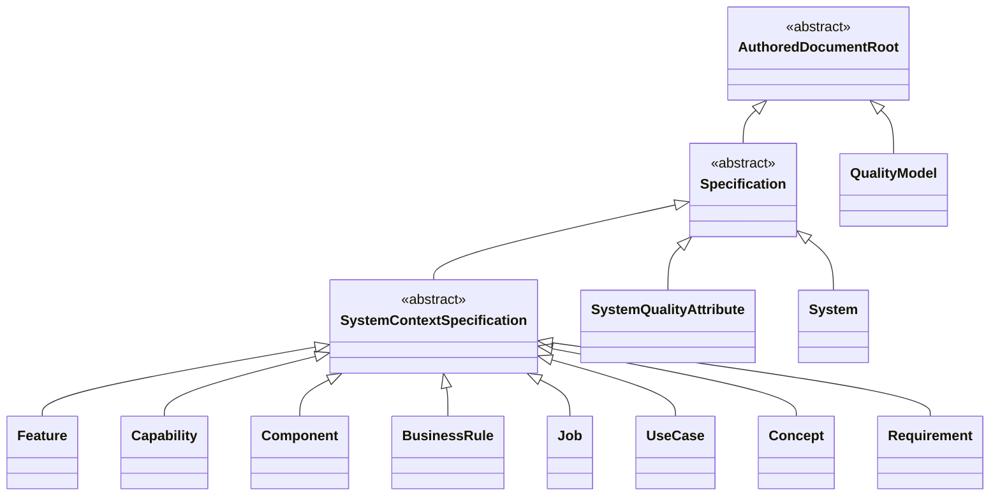

### Elements declared in system and component specifications

Components link to their structural parents. Systems and components can each declare concept uses, synchronizations, and interfaces.

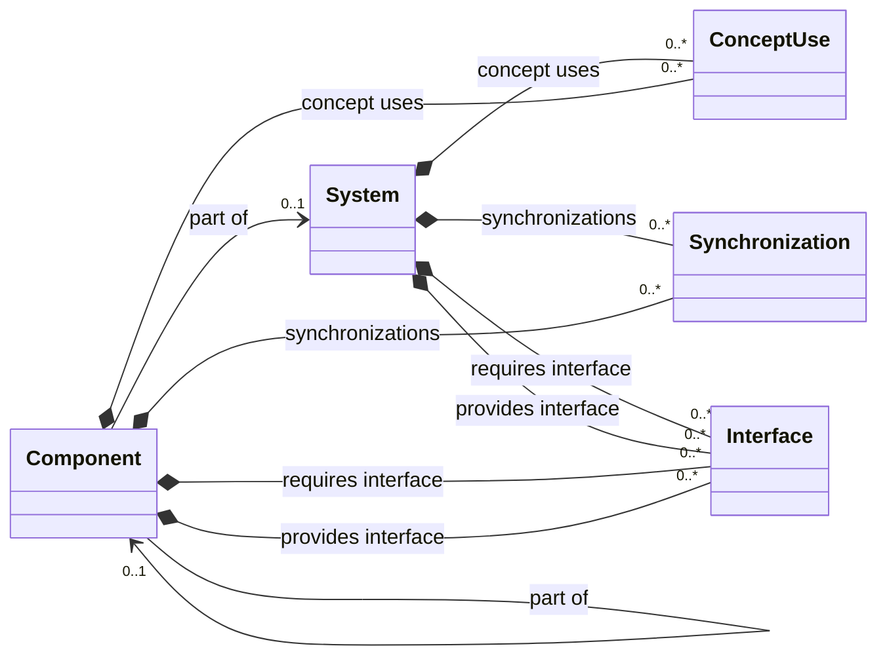

### Specification system association

A local specification records its owning component and effective system. Component parent links identify the default system. Quality models are project-wide.

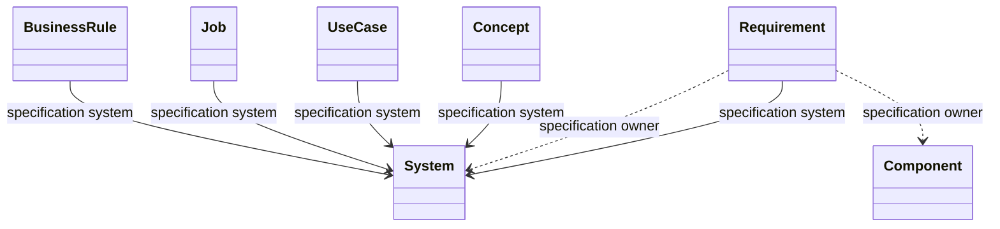

### Boundary interfaces

Required and provided are relative to the declaring System or Component. Each Interface is an addressable element with one declaration membership. Requirements can apply to it through explicit applicability. Native contract references do not establish implementation or compatibility.

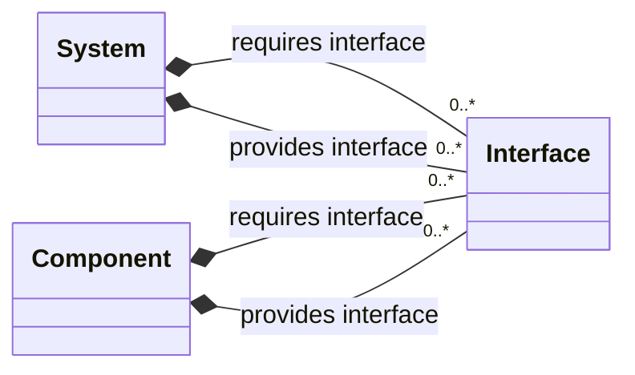

### System structure and feature grouping

Declaration membership identifies where records are authored. Explicit part_of identifies structural parents independently of directories. Features group specifications without owning them. Applicability identifies subjects; no implementation, allocation, inheritance or satisfaction is inferred. Interacts with identifies boundary partners, independently of structural parentage.

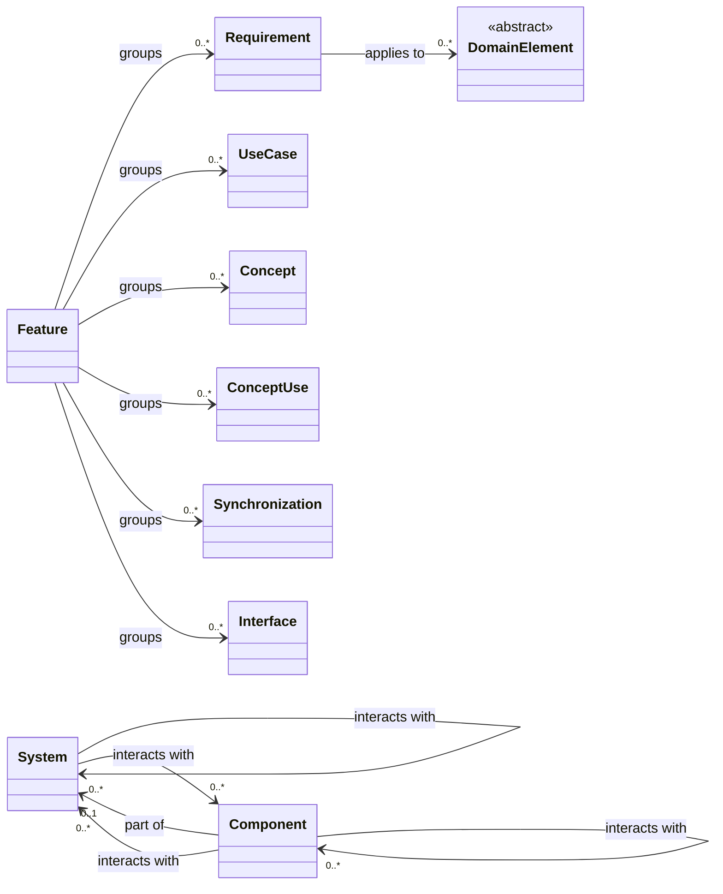

### User progress

Jobs optionally declare functional steps and outcomes. These edges describe declaration ownership; step order is presentation order.

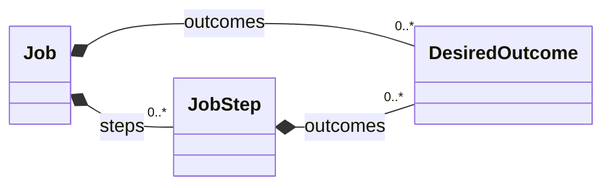

### Outcome applicability

An outcome can explicitly apply to several jobs or steps independently of its single declaration owner. Applicability does not assert achievement.

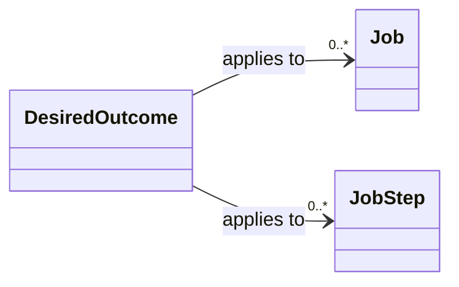

### Software behavior

Use cases describe interactions and alternatives; concepts describe purposeful state and actions. These are complementary views, with no mandatory authoring or execution order. Steps may explicitly illustrate requirements, business rules or actions; this does not prove completeness.

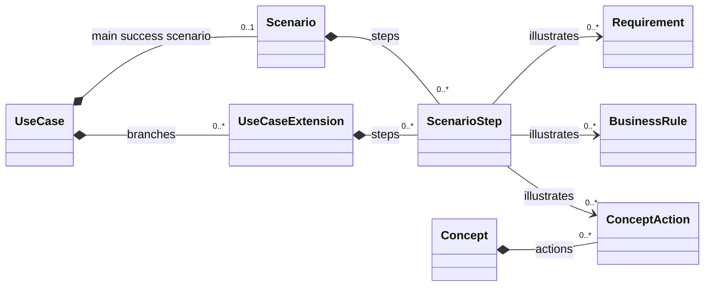

### Quality classification

A quality model owns reusable definitions. Independent system quality attributes classify requirements within their effective system. Both kinds support acyclic grouping within their own scope.

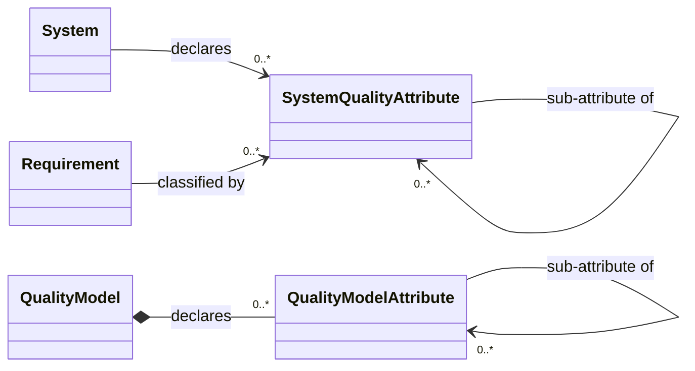

### System coordination

Systems declare concept uses, dependencies, and coordination rules.

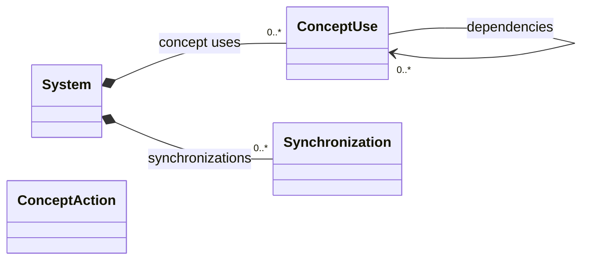

### Explicit requirements relationships

Explicit authoring distinguishes a use case boundary, support for user progress, and applicability from ordinary citations. Applicability may target any domain record; links do not establish enforcement, satisfaction or achieved outcomes.

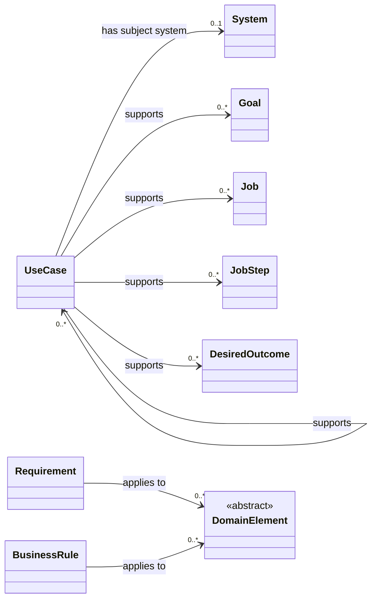

### Motivation, basis and assumptions

Concern subsets are independent of artifact kind and core/supporting/generic classification. Explicit support describes intended contribution; derivation records a basis rather than entailment. Requirements may link directly to a business rule or design decision without an intervening user record. Assumptions condition validity. These links do not impose authoring order or prove satisfaction.

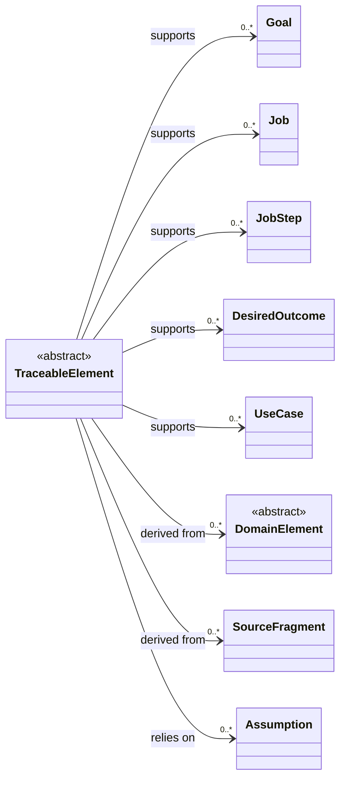

### Requirements and use cases

A requirement file specifies one general property. Use cases describe interactions that exercise it. Refinement preserves a parent commitment and must be acyclic; multiple parents are permitted. A business rule refines only another business rule. Use cases involve named concept uses many-to-many; neither view is the mandatory parent of the other.

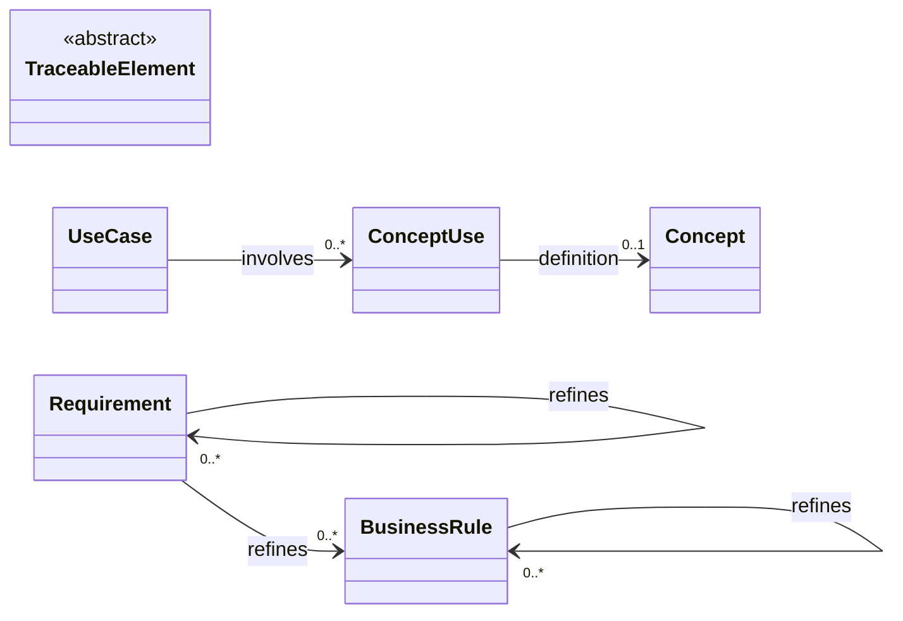

### Traceability to authored content

References preserve authored targets and their resolution. Source ranges locate each field in the acquired Markdown.

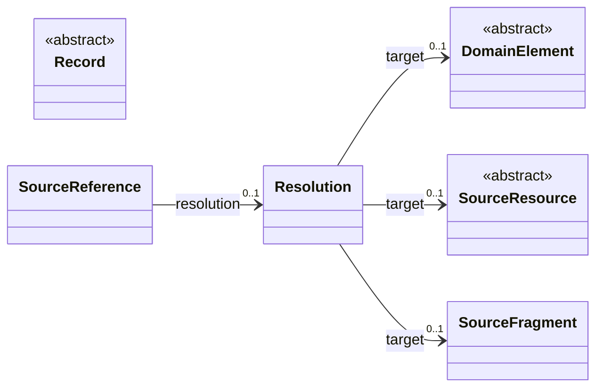

### Enabling capabilities

Capabilities connect user needs to enabling abilities and explicit system or component providers. Dependency is not structural containment; providers are optional and non-exhaustive.

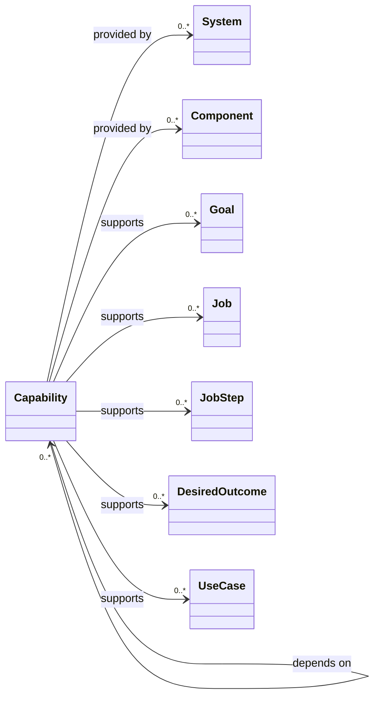

## Selected type reference

### DomainElement

A source-backed semantic record. Snapshot IDs are required; authored IDs remain optional except where the source format requires them.

Subsets: `business-requirements`, `user-requirements`, `software-requirements`. [DomainElement](index.md#domainelement) contains the complete definition.

| Field | Range | Shape | Meaning |
| --- | --- | --- | --- |
| `name` | [RichContent](index.md#richcontent) | optional | Authored title or item name, if present. |
| `authored_id` | `string` | optional | An explicitly authored ID when present; no manufactured global identifier. |
| `open_questions` | [OpenQuestion](index.md#openquestion) | optional; ordered list | Explicitly distinguished questions, in authored order. |

### Specification

An independently maintained aggregate of product intent. Each authored specification file declares one root and can contain addressable parts. The specifications in product scope and their relationships compose the product specification.

Subsets: `business-requirements`, `user-requirements`, `software-requirements`. [Specification](index.md#specification) contains the complete definition.

| Field | Range | Shape | Meaning |
| --- | --- | --- | --- |
| `slug` | `string` | optional | Path-derived current slug where applicable. |
| `preamble` | [RichContent](index.md#richcontent) | optional | Authored content between the title and the first named section. |
| `evidence` | [RichContent](index.md#richcontent) | optional |  |
| `authority_and_evidence` | [RichContent](index.md#richcontent) | optional | Authored authority for the specification. |
| `related_specifications` | [ContextualReferences](index.md#contextualreferences) | optional | Contextual citations of related specifications of any type, with their explanation; no implicit support, refinement, enforcement or compliance relation. |

### TraceableElement

An element with explicit motivation, derivation and assumptions. Concern subset, artifact kind and core/supporting/generic classification are independent; neither traceability nor document location confers normative authority.

Subsets: `business-requirements`, `user-requirements`, `software-requirements`. [TraceableElement](index.md#traceableelement) contains the complete definition.

| Field | Range | Shape | Meaning |
| --- | --- | --- | --- |
| `supports` | [Goal](index.md#goal) or [Job](index.md#job) or [JobStep](index.md#jobstep) or [DesiredOutcome](index.md#desiredoutcome) or [UseCase](index.md#usecase) | optional; list | Intended contribution to a goal, user progress or a higher-level use case; does not assert achievement. |
| `derived_from` | [DomainElement](index.md#domainelement) or [SourceFragment](index.md#sourcefragment) | optional; list | Source or rationale for this element, including rules, decisions and requirements; not logical entailment. |
| `relies_on` | [Assumption](index.md#assumption) | optional; list | Assumptions on which the validity of this element depends. |

### Goal

An explicitly distinguished goal: a result that an organization or stakeholder wants the system to help achieve.

Subsets: `business-requirements`. [Goal](index.md#goal) contains the complete definition.

| Field | Range | Shape | Meaning |
| --- | --- | --- | --- |
| `statement` | [RichContent](index.md#richcontent) | optional |  |
| `supports` | [Goal](index.md#goal) or [Job](index.md#job) or [JobStep](index.md#jobstep) or [DesiredOutcome](index.md#desiredoutcome) or [UseCase](index.md#usecase) | optional; list | Intended contribution to a goal, user progress or a higher-level use case; does not assert achievement. |

### SystemStakeholderRole

A named capacity in which people or organizations have an interest in a particular system.

Subsets: `business-requirements`. [SystemStakeholderRole](index.md#systemstakeholderrole) contains the complete definition.

| Field | Range | Shape | Meaning |
| --- | --- | --- | --- |
| `owner` | [System](index.md#system) | required |  |
| `description` | [RichContent](index.md#richcontent) | optional | What people or organizations in this role care about, depend on, or decide. |

### Assumption

An explicitly distinguished premise about the environment on which the specification relies; no inferred truth assertion.

Subsets: `business-requirements`, `software-requirements`. [Assumption](index.md#assumption) contains the complete definition.

| Field | Range | Shape | Meaning |
| --- | --- | --- | --- |
| `statement` | [RichContent](index.md#richcontent) | optional | The premise relied on, expressed so a reader can recognize a case in which it fails. |
| `basis` | [RichContent](index.md#richcontent) | optional | Why reliance on this statement is justified, including cited evidence. |
| `applicability` | [RichContent](index.md#richcontent) | optional | Conditions, locations or periods in which this assumption is expected to hold. |

### System

The system described by a system document; subordinate systems retain their own boundaries and quality attributes.

Subsets: `business-requirements`, `software-requirements`. [System](index.md#system) contains the complete definition.

| Field | Range | Shape | Meaning |
| --- | --- | --- | --- |
| `purpose` | [RichContent](index.md#richcontent) | optional | Why the system exists, including the situation it addresses and its intended benefit. |
| `overview` | [RichContent](index.md#richcontent) | optional | An explanation of what this system is and how its parts fit together, for a reader new to it. It explains without committing; verifiable obligations remain requirements. |
| `scope` | [RichContent](index.md#richcontent) | optional | The work this system covers, whom it serves and the situations for which it takes responsibility. |
| `goals` | [Goal](index.md#goal) | optional; ordered list | Explicitly authored goals, in authored order. |
| `environment` | [RichContent](index.md#richcontent) | optional | Conditions in the surrounding world that matter to understanding this system’s requirements. These may concern how people work, the physical setting or the technology around the system. |
| `stakeholder_roles` | [SystemStakeholderRole](index.md#systemstakeholderrole) | optional; ordered list | Stakeholder roles declared by this system, in authored order. |
| `assumptions` | [Assumption](index.md#assumption) | optional; ordered list | Named premises this system’s specification relies on, in declaration order. Each premise can identify the basis for relying on it and the circumstances in which it is expected to hold. |
| `constraints` | [RichContent](index.md#richcontent) | optional | Externally imposed limits on the solutions available for this system. The narrative can identify the source of a limit and link to the Requirement or BusinessRule that states it authoritatively. |
| `glossary` | [GlossaryTerm](index.md#glossaryterm) | optional; ordered list | Explicitly named terms, in authored order. |
| `concept_uses` | [ConceptUse](index.md#conceptuse) | optional; ordered list |  |
| `synchronizations` | [Synchronization](index.md#synchronization) | optional; ordered list |  |
| `quality_attributes` | [SystemQualityAttribute](index.md#systemqualityattribute) | optional; ordered list | Attributes declared by this system, in authored order. Absent means no declaration; a present empty list is distinct. |
| `part_of` | [System](index.md#system) | optional | Optional explicit parent System. Directory context does not supply this relationship. |
| `out_of_scope` | [RichContent](index.md#richcontent) | optional | Work, users or situations explicitly excluded from this system’s responsibility. Omission leaves scope unspecified. |
| `interacts_with` | [System](index.md#system) or [Component](index.md#component) | optional; list | Explicit interaction partners across this subject boundary; does not establish structural containment. |
| `required_interfaces` | [Interface](index.md#interface) | optional; ordered list | Services this subject expects from its environment. |
| `provided_interfaces` | [Interface](index.md#interface) | optional; ordered list | Services this subject exposes to its environment. |
| `project_references` | [ContextualReferences](index.md#contextualreferences) | optional | Plans, responsibilities, risks and delivery decisions that affect this system, with prose explaining their relevance and links to the records the team maintains. |

### BusinessRule

A declarative business constraint independent of the software or process that enforces it.

Subsets: `business-requirements`. [BusinessRule](index.md#businessrule) contains the complete definition.

| Field | Range | Shape | Meaning |
| --- | --- | --- | --- |
| `statement` | [RichContent](index.md#richcontent) | optional | The rule expressed in business language, independently of enforcement. |
| `applicability` | [Applicability](index.md#applicability) | optional |  |
| `applies_to` | [DomainElement](index.md#domainelement) | optional; list |  |
| `rationale` | [RichContent](index.md#richcontent) | optional |  |
| `authority_and_evidence` | [RichContent](index.md#richcontent) | optional | Authored authority for the specification. |
| `exceptions` | [RichContent](index.md#richcontent) | optional | Authored qualifications or references to exception rules; no inferred exemption. |
| `related_specifications` | [ContextualReferences](index.md#contextualreferences) | optional | Contextual citations of related specifications of any type, with their explanation; no implicit support, refinement, enforcement or compliance relation. |

### Job

What a performer seeks to accomplish or change in particular circumstances, independent of the chosen solution. Functional maps and job-story phrasing are optional complementary perspectives.

Subsets: `user-requirements`. [Job](index.md#job) contains the complete definition.

| Field | Range | Shape | Meaning |
| --- | --- | --- | --- |
| `statement` | [RichContent](index.md#richcontent) | optional | The Job section, including existing job-statement phrasing. |
| `performer` | [RichContent](index.md#richcontent) | optional |  |
| `situation` | [RichContent](index.md#richcontent) | optional |  |
| `intended_progress` | [RichContent](index.md#richcontent) | optional |  |
| `steps` | [JobStep](index.md#jobstep) | optional; ordered list | Document order, not a universal lifecycle or required process sequence. |
| `outcomes` | [DesiredOutcome](index.md#desiredoutcome) | optional; ordered list | Outcomes declared here, in authored order. Shared outcomes are declared once and have explicit applicability references. |

### JobStep

A meaningful accomplishment within a functional job map; not a prescribed software interaction or execution sequence.

Subsets: `user-requirements`. [JobStep](index.md#jobstep) contains the complete definition.

| Field | Range | Shape | Meaning |
| --- | --- | --- | --- |
| `stage` | [RichContent](index.md#richcontent) | optional | Authored stage value; unrestricted vocabulary and repeated labels are valid. |
| `description` | [RichContent](index.md#richcontent) | optional |  |
| `outcomes` | [DesiredOutcome](index.md#desiredoutcome) | optional; ordered list | Outcomes declared here, in authored order. Shared outcomes are declared once and have explicit applicability references. |

### DesiredOutcome

A desired result or criterion by which a person judges success. Declaration ownership, explicit applicability and evidence of achievement are distinct. ODI measurable wording is optional authoring guidance.

Subsets: `user-requirements`. [DesiredOutcome](index.md#desiredoutcome) contains the complete definition.

| Field | Range | Shape | Meaning |
| --- | --- | --- | --- |
| `statement` | [RichContent](index.md#richcontent) | optional |  |
| `supporting_content` | [RichContent](index.md#richcontent) | optional | Explicit support prose or nested bullets belonging to the outcome. |
| `name` | [RichContent](index.md#richcontent) | optional | Authored title or item name, if present. |
| `owner` | [Job](index.md#job) or [JobStep](index.md#jobstep) | required |  |
| `applies_to` | [Job](index.md#job) or [JobStep](index.md#jobstep) | optional; list | Jobs and steps for which this outcome is a criterion for success. Explicit, many-to-many applicability, independent of its single declaration owner; no inherited applicability or achievement is inferred. |

### UseCase

An actor goal and its interactions at a stated system boundary, with alternative paths and protections.

Subsets: `software-requirements`. [UseCase](index.md#usecase) contains the complete definition.

| Field | Range | Shape | Meaning |
| --- | --- | --- | --- |
| `involves` | [ConceptUse](index.md#conceptuse) | optional; list | Named concept uses participating in this actor-goal interaction; not a service boundary or mandatory execution order. |
| `goal` | [RichContent](index.md#richcontent) | optional |  |
| `boundary_description` | [RichContent](index.md#richcontent) | optional | Boundary description is independent of directory ownership. |
| `subject_system` | [System](index.md#system) | optional |  |
| `supports` | [Goal](index.md#goal) or [Job](index.md#job) or [JobStep](index.md#jobstep) or [DesiredOutcome](index.md#desiredoutcome) or [UseCase](index.md#usecase) | optional; list | Intended contribution to a goal, user progress or a higher-level use case; does not assert achievement. |
| `primary_actor` | [RichContent](index.md#richcontent) | optional |  |
| `goal_level` | [RichContent](index.md#richcontent) | optional |  |
| `preconditions` | [RichContent](index.md#richcontent) | optional |  |
| `minimal_guarantees` | [RichContent](index.md#richcontent) | optional |  |
| `success_guarantees` | [RichContent](index.md#richcontent) | optional |  |
| `main_success_scenario` | [Scenario](index.md#scenario) | optional |  |
| `extensions` | [UseCaseExtension](index.md#usecaseextension) | optional; ordered list | Explicitly authored alternative or failure branches, in authored order. |
| `sequence` | [RichContent](index.md#richcontent) | optional | Authored statement about which ordering is representative or required; scenario step order alone creates no constraint. |

### Scenario

An addressable scenario body and its explicitly authored ordered steps. Narrative-only scenarios remain valid.

Subsets: `software-requirements`. [Scenario](index.md#scenario) contains the complete definition.

| Field | Range | Shape | Meaning |
| --- | --- | --- | --- |
| `content` | [RichContent](index.md#richcontent) | required |  |
| `steps` | [ScenarioStep](index.md#scenariostep) | optional; ordered list | Source order only. Required sequencing belongs in the Sequence section. |

### ScenarioStep

An explicitly distinguished interaction step, expressed as a label and narrative. Actor, action and result wording remains in the narrative.

Subsets: `software-requirements`. [ScenarioStep](index.md#scenariostep) contains the complete definition.

| Field | Range | Shape | Meaning |
| --- | --- | --- | --- |
| `authored_label` | `string` | optional | Original number or label; snapshot ID supplies addressability. |
| `content` | [RichContent](index.md#richcontent) | required |  |
| `illustrates` | [Requirement](index.md#requirement) or [BusinessRule](index.md#businessrule) or [ConceptAction](index.md#conceptaction) | optional; list | Requirements, business rules or actions explicitly illustrated by this step. No completeness or execution assertion. |

### UseCaseExtension

A named alternative or failure branch of a use case. Its narrative can include separate Condition and Handling sections. A condition can be recorded before handling is decided.

Subsets: `software-requirements`. [UseCaseExtension](index.md#usecaseextension) contains the complete definition.

| Field | Range | Shape | Meaning |
| --- | --- | --- | --- |
| `content` | [RichContent](index.md#richcontent) | required |  |
| `condition` | [RichContent](index.md#richcontent) | optional |  |
| `handling` | [RichContent](index.md#richcontent) | optional | Authored handling narrative, including any resumption, conclusion or unresolved question. |
| `steps` | [ScenarioStep](index.md#scenariostep) | optional; ordered list | Explicit handling steps in source order; no execution semantics are inferred. |

### Concept

A behavior-bearing concept described by purpose, abstract state, actions and an operational principle.

Subsets: `software-requirements`. [Concept](index.md#concept) contains the complete definition.

| Field | Range | Shape | Meaning |
| --- | --- | --- | --- |
| `purpose` | [RichContent](index.md#richcontent) | optional |  |
| `operational_principles` | [RichContent](index.md#richcontent) | optional |  |
| `abstract_state` | [RichContent](index.md#richcontent) | optional |  |
| `actions` | [ConceptAction](index.md#conceptaction) | optional; ordered list | Explicitly named actions, in authored order. |
| `effects_table` | [RichContent](index.md#richcontent) | optional |  |

### ConceptUse

An explicitly named design-time inclusion of a concept in a system or component specification. Multiple uses of one definition remain distinct; directory association creates no use.

Subsets: `software-requirements`. [ConceptUse](index.md#conceptuse) contains the complete definition.

| Field | Range | Shape | Meaning |
| --- | --- | --- | --- |
| `definition` | [Concept](index.md#concept) | optional |  |
| `configuration` | [RichContent](index.md#richcontent) | optional |  |
| `dependencies` | [ConceptUse](index.md#conceptuse) | optional; ordered list |  |

### Synchronization

A composition rule declared in a system or component specification. Narrative and action references describe coordination; no atomicity, execution or completeness is inferred.

Subsets: `software-requirements`. [Synchronization](index.md#synchronization) contains the complete definition.

| Field | Range | Shape | Meaning |
| --- | --- | --- | --- |
| `when` | [RichContent](index.md#richcontent) | optional |  |
| `where` | [RichContent](index.md#richcontent) | optional |  |
| `then` | [RichContent](index.md#richcontent) | optional |  |
| `semantics` | [RichContent](index.md#richcontent) | optional |  |

### ConceptAction

An explicitly named concept action. Caller assumptions and enforced guards are different authored claims.

Subsets: `software-requirements`. [ConceptAction](index.md#conceptaction) contains the complete definition.

| Field | Range | Shape | Meaning |
| --- | --- | --- | --- |
| `inputs` | [RichContent](index.md#richcontent) | optional |  |
| `outputs` | [RichContent](index.md#richcontent) | optional |  |
| `initiation` | [RichContent](index.md#richcontent) | optional | Authored initiation conditions, including user or system actions; no scheduler or caller is inferred. |
| `caller_assumptions` | [RichContent](index.md#richcontent) | optional |  |
| `guards` | [RichContent](index.md#richcontent) | optional |  |
| `effects` | [RichContent](index.md#richcontent) | optional |  |
| `rejections` | [RichContent](index.md#richcontent) | optional |  |

### Requirement

One required property or behavior, declared in its own requirement specification. Functional and quality requirements share this type. Either can reference a system quality attribute.

Subsets: `software-requirements`. [Requirement](index.md#requirement) contains the complete definition.

| Field | Range | Shape | Meaning |
| --- | --- | --- | --- |
| `statement` | [RichContent](index.md#richcontent) | optional |  |
| `refines` | [Requirement](index.md#requirement) or [BusinessRule](index.md#businessrule) | optional; list | Adds precision while preserving the referenced requirement or business rule; not replacement, duplication or proof. Multiple parents are permitted. |
| `derived_from` | [DomainElement](index.md#domainelement) or [SourceFragment](index.md#sourcefragment) | optional; list | Source or rationale for this element, including rules, decisions and requirements; not logical entailment. |
| `supports` | [Goal](index.md#goal) or [Job](index.md#job) or [JobStep](index.md#jobstep) or [DesiredOutcome](index.md#desiredoutcome) or [UseCase](index.md#usecase) | optional; list | Intended contribution to a goal, user progress or a higher-level use case; does not assert achievement. |
| `relies_on` | [Assumption](index.md#assumption) | optional; list | Assumptions on which the validity of this element depends. |
| `applicability` | [Applicability](index.md#applicability) | optional |  |
| `applies_to` | [DomainElement](index.md#domainelement) | optional; list |  |
| `rationale` | [RichContent](index.md#richcontent) | optional |  |
| `quality_attributes` | [SystemQualityAttribute](index.md#systemqualityattribute) | optional; list | Only resolved classifications; original occurrences remain separately addressable. |
| `criterion` | [RequirementCriterion](index.md#requirementcriterion) | optional | Optional explicit satisfaction rule, defining or referencing the required bounds once. The criterion can cite an authoritative source. |

### QualityModel

A reference vocabulary of reusable quality attribute definitions. Copying creates independent system declarations; no live inheritance or synchronization.

Subsets: `software-requirements`. [QualityModel](index.md#qualitymodel) contains the complete definition.

| Field | Range | Shape | Meaning |
| --- | --- | --- | --- |
| `description` | [RichContent](index.md#richcontent) | optional |  |
| `edition` | [RichContent](index.md#richcontent) | optional |  |
| `sources` | [ContextualReferences](index.md#contextualreferences) | optional |  |
| `quality_attributes` | [QualityModelAttribute](index.md#qualitymodelattribute) | optional; ordered list | Definitions in declaration order. |

### QualityAttribute

A named quality definition with acyclic grouping within its declaring model or effective system.

Subsets: `software-requirements`. [QualityAttribute](index.md#qualityattribute) contains the complete definition.

| Field | Range | Shape | Meaning |
| --- | --- | --- | --- |
| `definition` | [RichContent](index.md#richcontent) | optional |  |
| `subattribute_of` | [QualityAttribute](index.md#qualityattribute) | optional; list | Resolved attributes under which this attribute is directly organized, within the same declaring owner. Derive subattributes by reversing this relation; preserve authored labels and provenance. |

### SourceReference

An authored reference occurrence, independent of whether it resolves or carries semantic intent.

Subsets: `specification-traceability`. [SourceReference](index.md#sourcereference) contains the complete definition.

| Field | Range | Shape | Meaning |
| --- | --- | --- | --- |
| `authored_target` | `string` | required | Literal destination or label, including fragments; do not replace it with a normalized target. |
| `context_owner` | [DomainElement](index.md#domainelement) | optional |  |
| `context_field` | `string` | optional |  |
| `resolution` | [Resolution](index.md#resolution) | optional |  |

### Resolution

The recorded outcome of resolving one authored reference or label; targets need not be domain entities.

Subsets: `specification-traceability`. [Resolution](index.md#resolution) contains the complete definition.

| Field | Range | Shape | Meaning |
| --- | --- | --- | --- |
| `status` | `ResolutionStatus` | required |  |
| `target` | [DomainElement](index.md#domainelement) or [SourceResource](index.md#sourceresource) or [SourceFragment](index.md#sourcefragment) | optional | Only for resolved; target may be a domain element, source resource or source fragment. |
| `rule` | `string` | required |  |

### Applicability

Operating context covered by an requirement or business rule, with optional explicit dimensions. For outcomes of use, identify users, tasks, equipment or assistance, and environment. Record the required operating context here.

Subsets: `business-requirements`, `user-requirements`, `software-requirements`. [Applicability](index.md#applicability) contains the complete definition.

| Field | Range | Shape | Meaning |
| --- | --- | --- | --- |
| `content` | [RichContent](index.md#richcontent) | required |  |
| `conditions` | [RichContent](index.md#richcontent) | optional |  |
| `workload` | [RichContent](index.md#richcontent) | optional |  |
| `population` | [RichContent](index.md#richcontent) | optional |  |
| `exclusions` | [RichContent](index.md#richcontent) | optional |  |

### RequirementCriterion

Optional explicit rule for satisfaction of an requirement, qualitative or measured. Define each bound once or reference its authoritative statement or source. Operating context belongs to the requirement's applicability. A criterion is not a measurement procedure or an observation, and quality classification does not supply a criterion.

Subsets: `business-requirements`, `user-requirements`, `software-requirements`. [RequirementCriterion](index.md#requirementcriterion) contains the complete definition.

| Field | Range | Shape | Meaning |
| --- | --- | --- | --- |
| `content` | [RichContent](index.md#richcontent) | required |  |
| `measure` | [RichContent](index.md#richcontent) | optional | Property observed and its operational definition or reference, including units, calculation, aggregation and observation window where needed. |
| `target` | [RichContent](index.md#richcontent) | optional | Required value, bound or acceptable range, including the comparison. Preferred targets belong in Rationale and should be identified as preferences. |

### Component

A named part of a system with a described responsibility and boundary. Neither its declaration nor code location establishes structural parentage.

Subsets: `software-requirements`. [Component](index.md#component) contains the complete definition.

| Field | Range | Shape | Meaning |
| --- | --- | --- | --- |
| `purpose` | [RichContent](index.md#richcontent) | optional | Benefit or reason for this component to exist. |
| `overview` | [RichContent](index.md#richcontent) | optional | An explanation of what this component is and how its parts fit together, for a reader new to it. It explains without committing; verifiable obligations remain requirements. |
| `responsibilities` | [RichContent](index.md#richcontent) | optional | Authored responsibilities identifying what this component is expected to do. |
| `boundary_description` | [RichContent](index.md#richcontent) | optional | What the component includes, excludes and delegates; normative commitments remain requirements. |
| `part_of` | [System](index.md#system) or [Component](index.md#component) | optional | System or Component identified by the required Part of link, when resolved. The parent chain must be acyclic. |
| `contracts` | [ContextualReferences](index.md#contextualreferences) | optional | Links and narrative; external native artifacts remain authoritative. No implementation or satisfaction claim is inferred. |
| `architecture` | [ContextualReferences](index.md#contextualreferences) | optional | Links and narrative; external native artifacts remain authoritative. No implementation or satisfaction claim is inferred. |
| `implementation` | [ContextualReferences](index.md#contextualreferences) | optional | Links and narrative; external native artifacts remain authoritative. No implementation or satisfaction claim is inferred. |
| `out_of_scope` | [RichContent](index.md#richcontent) | optional | Explicit boundary exclusions; absence is not a statement of scope. |
| `interacts_with` | [System](index.md#system) or [Component](index.md#component) | optional; list | Explicit interaction partners across this subject boundary; does not establish structural containment. |
| `required_interfaces` | [Interface](index.md#interface) | optional; ordered list | Services this subject expects from its environment. |
| `provided_interfaces` | [Interface](index.md#interface) | optional; ordered list | Services this subject exposes to its environment. |

### Feature

A recognizable grouping of specified product behavior valued by stakeholders, independent of component structure. Membership does not duplicate or own requirements.

Subsets: `software-requirements`. [Feature](index.md#feature) contains the complete definition.

| Field | Range | Shape | Meaning |
| --- | --- | --- | --- |
| `purpose` | [RichContent](index.md#richcontent) | optional | Stakeholder benefit expressed by this feature. |
| `overview` | [RichContent](index.md#richcontent) | optional | An explanation of how the grouped behavior works together for stakeholders, for a reader new to it. It explains without committing; verifiable obligations remain requirements. |
| `specification_owner` | [System](index.md#system) or [Component](index.md#component) | optional | Nearest system or component used for source lookup within the project. |
| `groups` | [Requirement](index.md#requirement) or [UseCase](index.md#usecase) or [Concept](index.md#concept) or [ConceptUse](index.md#conceptuse) or [Synchronization](index.md#synchronization) or [Interface](index.md#interface) | optional; list | Non-owning specification membership; the same record may participate in several features. |

### Capability

An ability needed to deliver value, potentially combining people, procedures and technology. Distinct from a product feature or structural component; its declaration does not establish a provider.

Subsets: `business-requirements`, `software-requirements`. [Capability](index.md#capability) contains the complete definition.

| Field | Range | Shape | Meaning |
| --- | --- | --- | --- |
| `purpose` | [RichContent](index.md#richcontent) | optional | What this ability enables and why it matters. |
| `supports` | [Goal](index.md#goal) or [Job](index.md#job) or [JobStep](index.md#jobstep) or [DesiredOutcome](index.md#desiredoutcome) or [UseCase](index.md#usecase) | optional; list | Intended contribution to a goal, user progress or a higher-level use case; does not assert achievement. |
| `depends_on` | [Capability](index.md#capability) | optional; list | Capabilities required by this capability; many-to-many dependencies may be cyclic. Not structural containment or an inferred execution sequence. |
| `provided_by` | [System](index.md#system) or [Component](index.md#component) | optional; list | Explicitly identified system or component providers. Optional and non-exhaustive: human and procedural providers can be described in enablers. Does not assert verified implementation or satisfaction. |
| `enablers` | [RichContent](index.md#richcontent) | optional | Human, procedural or other enabling context, including external references. Typed providers describe only explicitly linked systems and components. |

### OpenQuestion

An explicitly authored unresolved question; do not infer every omitted field to be an open question.

Subsets: `business-requirements`, `user-requirements`, `software-requirements`. [OpenQuestion](index.md#openquestion) contains the complete definition.

| Field | Range | Shape | Meaning |
| --- | --- | --- | --- |
| `question` | [RichContent](index.md#richcontent) | optional |  |

### Interface

An independently addressable description of interaction at a System or Component boundary, declared by that System or Component. Required or provided membership states direction relative to the declaring subject. Native protocol contracts retain their authority; neither declaration nor citation proves implementation or compatibility.

Subsets: `software-requirements`. [Interface](index.md#interface) contains the complete definition.

| Field | Range | Shape | Meaning |
| --- | --- | --- | --- |
| `owner` | [System](index.md#system) or [Component](index.md#component) | required |  |
| `name` | [RichContent](index.md#richcontent) | optional | Authored title or item name, if present. |
| `description` | [RichContent](index.md#richcontent) | optional | Introductory description of the boundary interaction. |
| `contracts` | [ContextualReferences](index.md#contextualreferences) | optional | References to authoritative native contracts; no conformance claim is inferred. |
| `counterpart` | [ContextualReferences](index.md#contextualreferences) | optional | Contextual references to participants or corresponding interfaces; no compatibility claim is inferred. |
