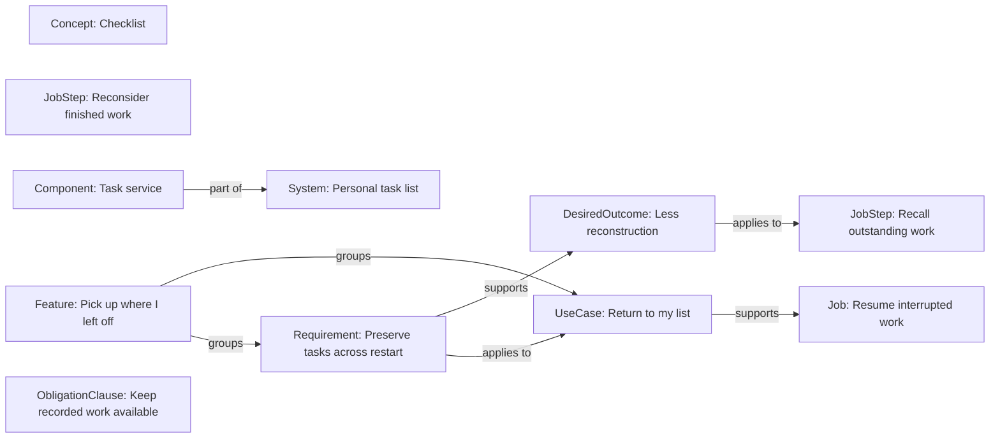

# Needs and specification map

Specification project: **todo**. Project membership does not imply a System relationship.

Generated from authored specifications. Regenerate this view instead of editing it.

Model `0.19.0-draft`; mapping `dotspec-markdown/14`. Only acquired records and explicit relationships are shown. Missing links do not establish missing needs, capabilities or implementation.

`declares` locates a record; `applies to` identifies its explicit scope. For an outcome, that scope identifies where it is a success criterion; for an obligation, where the commitment applies. `supports` records intended contribution, not achievement. Capability dependencies are distinct from structural `part of` links. Providers are optional and non-exhaustive; human and procedural enablers remain in the descriptions. Step order and switching timelines are not dependency edges. The diagram focuses on semantic relationships; declaration ownership and progress cases appear in the table and definitions below.

## Relationships

| From | Relationship | To |
| --- | --- | --- |
| [Resume interrupted work](<../../examples/todo/specs/jobs/resume.job.spec.md#resume-interrupted-work>) | declares | [Recall outstanding work](<../../examples/todo/specs/jobs/resume.job.spec.md#recall-outstanding-work>) |
| [Resume interrupted work](<../../examples/todo/specs/jobs/resume.job.spec.md#resume-interrupted-work>) | declares | [Reconsider finished work](<../../examples/todo/specs/jobs/resume.job.spec.md#reconsider-finished-work>) |
| [Less reconstruction](<../../examples/todo/specs/jobs/resume.job.spec.md#less-reconstruction>) | applies to | [Recall outstanding work](<../../examples/todo/specs/jobs/resume.job.spec.md#recall-outstanding-work>) |
| [Resume interrupted work](<../../examples/todo/specs/jobs/resume.job.spec.md#resume-interrupted-work>) | declares | [Less reconstruction](<../../examples/todo/specs/jobs/resume.job.spec.md#less-reconstruction>) |
| [Preserve tasks across restart](<../../examples/todo/specs/requirements/restart.requirement.spec.md#preserve-tasks-across-restart>) | supports | [Less reconstruction](<../../examples/todo/specs/jobs/resume.job.spec.md#less-reconstruction>) |
| [Preserve tasks across restart](<../../examples/todo/specs/requirements/restart.requirement.spec.md#preserve-tasks-across-restart>) | applies to | [Return to my list](<../../examples/todo/specs/use-cases/resume-list.use-case.spec.md#return-to-my-list>) |
| [Task service](<../../examples/todo/specs/system.spec.md#task-service>) | part of | [Personal task list](<../../examples/todo/specs/system.spec.md#personal-task-list>) |
| [Personal task list](<../../examples/todo/specs/system.spec.md#personal-task-list>) | declares | [Task service](<../../examples/todo/specs/system.spec.md#task-service>) |
| [Pick up where I left off](<../../examples/todo/specs/system.spec.md#pick-up-where-i-left-off>) | groups | [Return to my list](<../../examples/todo/specs/use-cases/resume-list.use-case.spec.md#return-to-my-list>) |
| [Pick up where I left off](<../../examples/todo/specs/system.spec.md#pick-up-where-i-left-off>) | groups | [Preserve tasks across restart](<../../examples/todo/specs/requirements/restart.requirement.spec.md#preserve-tasks-across-restart>) |
| [Personal task list](<../../examples/todo/specs/system.spec.md#personal-task-list>) | declares | [Pick up where I left off](<../../examples/todo/specs/system.spec.md#pick-up-where-i-left-off>) |
| [Return to my list](<../../examples/todo/specs/use-cases/resume-list.use-case.spec.md#return-to-my-list>) | supports | [Resume interrupted work](<../../examples/todo/specs/jobs/resume.job.spec.md#resume-interrupted-work>) |

## Definitions and evidence

Short diagram labels do not replace full statements. Evidence describes its source and limits; importance, satisfaction and opportunity assessments belong to dated research about a population, not to the outcome itself. Requirements express commitments, separately from desired user results.

### Concept: Checklist

Source: [Checklist](<../../examples/todo/specs/concepts/checklist.concept.spec.md#checklist>)

#### Purpose

Keep track of which commitments still need attention.

### Job: Resume interrupted work

Source: [Resume interrupted work](<../../examples/todo/specs/jobs/resume.job.spec.md#resume-interrupted-work>)

#### Statement

When I put work down, I want to remember what remains so I can pick it up again.

#### Performer

A person managing their own errands or work.

#### Supports

[Resume unfinished work](../../examples/todo/specs/system.spec.md#resume-unfinished-work).

### JobStep: Recall outstanding work

Source: [Recall outstanding work](<../../examples/todo/specs/jobs/resume.job.spec.md#recall-outstanding-work>)

#### Description

Identify the commitments that still need attention.

### JobStep: Reconsider finished work

Source: [Reconsider finished work](<../../examples/todo/specs/jobs/resume.job.spec.md#reconsider-finished-work>)

#### Description

Recognize when a previously finished commitment needs another action.

### DesiredOutcome: Less reconstruction

Source: [Less reconstruction](<../../examples/todo/specs/jobs/resume.job.spec.md#less-reconstruction>)

#### Statement

Minimize the time spent reconstructing outstanding commitments after an interruption.

#### Applies to

[Recall outstanding work](../../examples/todo/specs/jobs/resume.job.spec.md#recall).

### Requirement: Preserve tasks across restart

Source: [Preserve tasks across restart](<../../examples/todo/specs/requirements/restart.requirement.spec.md#preserve-tasks-across-restart>)

#### Statement

After the service acknowledges a change, stopping and restarting it on the same
database must preserve each surviving entry's identity, title and completion state.
Deleted entries must stay absent.

#### Supports

[Less reconstruction](../../examples/todo/specs/jobs/resume.job.spec.md#less-reconstruction).

### System: Personal task list

Source: [Personal task list](<../../examples/todo/specs/system.spec.md#personal-task-list>)

#### Purpose

Help a person pick up unfinished work after an interruption.

### Component: Task service

Source: [Task service](<../../examples/todo/specs/system.spec.md#task-service>)

### Feature: Pick up where I left off

Source: [Pick up where I left off](<../../examples/todo/specs/system.spec.md#pick-up-where-i-left-off>)

### UseCase: Return to my list

Source: [Return to my list](<../../examples/todo/specs/use-cases/resume-list.use-case.spec.md#return-to-my-list>)

#### Supports

[Resume interrupted work](../../examples/todo/specs/jobs/resume.job.spec.md).

### ObligationClause: Keep recorded work available

Source: [Keep recorded work available](<../../examples/todo/specs/use-cases/resume-list.use-case.spec.md#keep-recorded-work-available>)

#### Statement

The list must make previously recorded entries available when the person returns.
