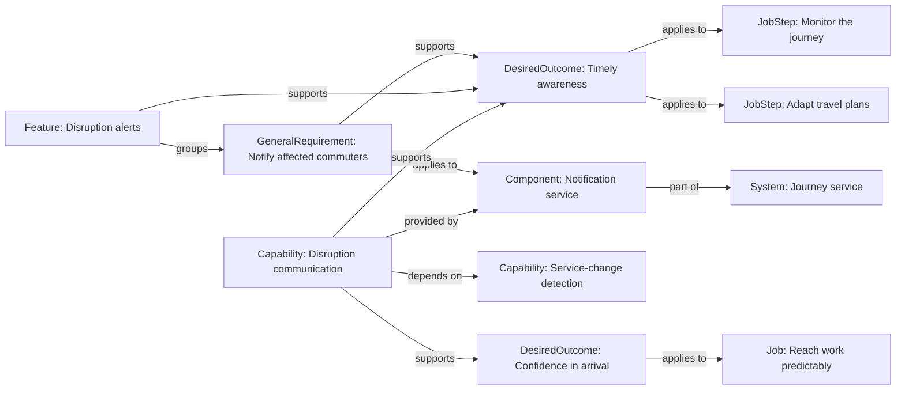

# Needs and specification map

Specification project: **user-needs**. Project membership does not imply a System relationship.

Generated from authored specifications. Regenerate this view instead of editing it.

Model `0.15.0-draft`; mapping `dotspec-markdown/13`. Only acquired records and explicit relationships are shown. Missing links do not establish missing needs, capabilities or implementation.

`declares` locates a record; `applies to` identifies its explicit scope. For an outcome, that scope identifies where it is a success criterion; for an obligation, where the commitment applies. `supports` records intended contribution, not achievement. Capability dependencies are distinct from structural `part of` links. Providers are optional and non-exhaustive; human and procedural enablers remain in the descriptions. Step order and switching timelines are not dependency edges. The diagram focuses on semantic relationships; declaration ownership and progress cases appear in the table and definitions below.

## Relationships

| From | Relationship | To |
| --- | --- | --- |
| [Reach work predictably](<../../examples/user-needs/specs/jobs/reach-work.job.spec.md#reach-work-predictably>) | declares | [Monitor the journey](<../../examples/user-needs/specs/jobs/reach-work.job.spec.md#monitor-the-journey>) |
| [Reach work predictably](<../../examples/user-needs/specs/jobs/reach-work.job.spec.md#reach-work-predictably>) | declares | [Adapt travel plans](<../../examples/user-needs/specs/jobs/reach-work.job.spec.md#adapt-travel-plans>) |
| [Timely awareness](<../../examples/user-needs/specs/jobs/reach-work.job.spec.md#timely-awareness>) | applies to | [Monitor the journey](<../../examples/user-needs/specs/jobs/reach-work.job.spec.md#monitor-the-journey>) |
| [Timely awareness](<../../examples/user-needs/specs/jobs/reach-work.job.spec.md#timely-awareness>) | applies to | [Adapt travel plans](<../../examples/user-needs/specs/jobs/reach-work.job.spec.md#adapt-travel-plans>) |
| [Reach work predictably](<../../examples/user-needs/specs/jobs/reach-work.job.spec.md#reach-work-predictably>) | declares | [Timely awareness](<../../examples/user-needs/specs/jobs/reach-work.job.spec.md#timely-awareness>) |
| [Confidence in arrival](<../../examples/user-needs/specs/jobs/reach-work.job.spec.md#confidence-in-arrival>) | applies to | [Reach work predictably](<../../examples/user-needs/specs/jobs/reach-work.job.spec.md#reach-work-predictably>) |
| [Reach work predictably](<../../examples/user-needs/specs/jobs/reach-work.job.spec.md#reach-work-predictably>) | declares | [Confidence in arrival](<../../examples/user-needs/specs/jobs/reach-work.job.spec.md#confidence-in-arrival>) |
| [Reach work predictably](<../../examples/user-needs/specs/jobs/reach-work.job.spec.md#reach-work-predictably>) | declares | [Repeated late arrivals](<../../examples/user-needs/specs/jobs/reach-work.job.spec.md#repeated-late-arrivals>) |
| [Notify affected commuters](<../../examples/user-needs/specs/requirements/notify-commuters.requirement.spec.md#notify-affected-commuters>) | supports | [Timely awareness](<../../examples/user-needs/specs/jobs/reach-work.job.spec.md#timely-awareness>) |
| [Notify affected commuters](<../../examples/user-needs/specs/requirements/notify-commuters.requirement.spec.md#notify-affected-commuters>) | applies to | [Notification service](<../../examples/user-needs/specs/system.spec.md#notification-service>) |
| [Journey service](<../../examples/user-needs/specs/system.spec.md#journey-service>) | declares | [Service-change detection](<../../examples/user-needs/specs/system.spec.md#service-change-detection>) |
| [Notification service](<../../examples/user-needs/specs/system.spec.md#notification-service>) | part of | [Journey service](<../../examples/user-needs/specs/system.spec.md#journey-service>) |
| [Journey service](<../../examples/user-needs/specs/system.spec.md#journey-service>) | declares | [Notification service](<../../examples/user-needs/specs/system.spec.md#notification-service>) |
| [Disruption alerts](<../../examples/user-needs/specs/system.spec.md#disruption-alerts>) | supports | [Timely awareness](<../../examples/user-needs/specs/jobs/reach-work.job.spec.md#timely-awareness>) |
| [Disruption alerts](<../../examples/user-needs/specs/system.spec.md#disruption-alerts>) | groups | [Notify affected commuters](<../../examples/user-needs/specs/requirements/notify-commuters.requirement.spec.md#notify-affected-commuters>) |
| [Journey service](<../../examples/user-needs/specs/system.spec.md#journey-service>) | declares | [Disruption alerts](<../../examples/user-needs/specs/system.spec.md#disruption-alerts>) |
| [Disruption communication](<../../examples/user-needs/specs/system.spec.md#disruption-communication>) | supports | [Timely awareness](<../../examples/user-needs/specs/jobs/reach-work.job.spec.md#timely-awareness>) |
| [Disruption communication](<../../examples/user-needs/specs/system.spec.md#disruption-communication>) | supports | [Confidence in arrival](<../../examples/user-needs/specs/jobs/reach-work.job.spec.md#confidence-in-arrival>) |
| [Disruption communication](<../../examples/user-needs/specs/system.spec.md#disruption-communication>) | depends on | [Service-change detection](<../../examples/user-needs/specs/system.spec.md#service-change-detection>) |
| [Disruption communication](<../../examples/user-needs/specs/system.spec.md#disruption-communication>) | provided by | [Notification service](<../../examples/user-needs/specs/system.spec.md#notification-service>) |
| [Journey service](<../../examples/user-needs/specs/system.spec.md#journey-service>) | declares | [Disruption communication](<../../examples/user-needs/specs/system.spec.md#disruption-communication>) |

## Definitions and evidence

Short diagram labels do not replace full statements. Evidence describes its source and limits; importance, satisfaction and opportunity assessments belong to dated research about a population, not to the outcome itself. Requirements express commitments, separately from desired user results.

### Job: Reach work predictably

Source: [Reach work predictably](<../../examples/user-needs/specs/jobs/reach-work.job.spec.md#reach-work-predictably>)

#### Statement

Reach work reliably when travel conditions change.

#### Performer

A commuter. A purchaser of employer travel benefits may be a different person.

#### Situation

The commuter has a time-sensitive commitment and uncertain travel conditions.

#### Motivation

Keep commitments without repeatedly checking every possible source of travel information.

#### Intended progress

Feel prepared to respond to disruptions and be dependable to colleagues.

### JobStep: Monitor the journey

Source: [Monitor the journey](<../../examples/user-needs/specs/jobs/reach-work.job.spec.md#monitor-the-journey>)

#### Description

Recognize changes that could prevent timely arrival.

### JobStep: Adapt travel plans

Source: [Adapt travel plans](<../../examples/user-needs/specs/jobs/reach-work.job.spec.md#adapt-travel-plans>)

#### Description

Choose an appropriate response when conditions change.

### DesiredOutcome: Timely awareness

Source: [Timely awareness](<../../examples/user-needs/specs/jobs/reach-work.job.spec.md#timely-awareness>)

#### Statement

Minimize the time between a relevant service disruption and awareness that the travel plan needs attention.

#### Supporting content

This criterion spans two steps and is declared once. A notification delivery target is a separate software commitment.

#### Applies to

[Monitor the journey](../../examples/user-needs/specs/jobs/reach-work.job.spec.md#monitor-journey)
[Adapt travel plans](../../examples/user-needs/specs/jobs/reach-work.job.spec.md#adapt-plans)

### DesiredOutcome: Confidence in arrival

Source: [Confidence in arrival](<../../examples/user-needs/specs/jobs/reach-work.job.spec.md#confidence-in-arrival>)

#### Statement

Feel confident about the ability to keep the commitment despite uncertain travel conditions.

#### Applies to

[Reach work predictably](../../examples/user-needs/specs/jobs/reach-work.job.spec.md#reach-work)

### ProgressCase: Repeated late arrivals

Source: [Repeated late arrivals](<../../examples/user-needs/specs/jobs/reach-work.job.spec.md#repeated-late-arrivals>)

#### Current approach

Manually check several sources before departure.

#### Desired progress

Know when to adjust plans without constant checking.

#### Circumstances

A recurring morning commitment coincides with unreliable transport information.

#### Struggling moment

Another unexpected cancellation makes the current checking routine feel inadequate.

#### Participants

The commuter performs the job and chooses a travel-information service. Their employer purchases a travel benefit but does not make this choice.

#### Alternatives considered

Continue manual checking, leave much earlier, or try disruption alerts.

#### Tradeoffs and selection criteria

Accept some notifications in exchange for timely information, but reject irrelevant interruptions.

#### Forces

- Push: Repeated surprises undermine confidence.
- Pull: Relevant alerts could reduce checking.
- Anxiety: Alerts may arrive late or be inaccurate.
- Habit: Manual checking is familiar.

#### Timeline

A cancellation prompts consideration of alternatives; no actual purchase or switching date is asserted.

#### Evidence

##### Research basis

Illustrative hypothesis for this example, not an interview finding or validated customer segment.

##### Limitations

No interviews or outcome survey have been conducted. Importance, satisfaction and opportunity assessments would need a dated study and a defined population.

### GeneralRequirement: Notify affected commuters

Source: [Notify affected commuters](<../../examples/user-needs/specs/requirements/notify-commuters.requirement.spec.md#notify-affected-commuters>)

#### Statement

The notification service must submit a disruption notification for each affected subscribed commuter within 30 seconds of receiving the disruption event.

#### Supports

[Timely awareness](../../examples/user-needs/specs/jobs/reach-work.job.spec.md#timely-awareness)

### System: Journey service

Source: [Journey service](<../../examples/user-needs/specs/system.spec.md#journey-service>)

#### Purpose

Help commuters respond to changing travel conditions.

### Capability: Service-change detection

Source: [Service-change detection](<../../examples/user-needs/specs/system.spec.md#service-change-detection>)

#### Purpose

Recognize changes that could affect a planned journey.

#### Enablers

Transport operations staff and external information feeds. No software provider is specified here.

### Component: Notification service

Source: [Notification service](<../../examples/user-needs/specs/system.spec.md#notification-service>)

### Feature: Disruption alerts

Source: [Disruption alerts](<../../examples/user-needs/specs/system.spec.md#disruption-alerts>)

#### Purpose

Help a commuter discover that their travel plan needs attention.

#### Supports

[Timely awareness](../../examples/user-needs/specs/jobs/reach-work.job.spec.md#timely-awareness)

### Capability: Disruption communication

Source: [Disruption communication](<../../examples/user-needs/specs/system.spec.md#disruption-communication>)

#### Purpose

Make relevant changes understandable and available to affected travelers.

#### Enablers

Transport staff interpret ambiguous reports and provide explanations. The software provider link is non-exhaustive.

#### Supports

[Timely awareness](../../examples/user-needs/specs/jobs/reach-work.job.spec.md#timely-awareness)
[Confidence in arrival](../../examples/user-needs/specs/jobs/reach-work.job.spec.md#arrival-confidence)

#### Depends on

[Service-change detection](../../examples/user-needs/specs/system.spec.md#change-detection)

#### Provided by

[Notification service](../../examples/user-needs/specs/system.spec.md#notification-service)

## Inspection findings

- **advice** `requirement.rationale`: Explain why this obligation is needed and reference its source or governing goal.
