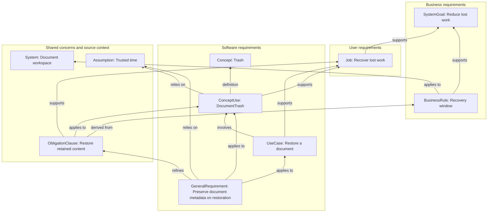

# Requirements traceability

Specification project: **requirements-traceability**. Project membership does not imply a System relationship.

Generated from authored specifications. Regenerate this view instead of editing it.

Model `0.16.0-draft`; mapping `dotspec-markdown/13`. Business/user/software subsets describe concerns; core/supporting/generic classifies model subsets. Artifact kinds and relationships have separate meanings.

This view covers only acquired records and resolved explicit relationships within the export's discovery and direct-reference boundary. Missing links do not establish missing behavior. Review candidates are not proven impacts; paths do not establish satisfaction, achieved outcomes, completeness or normative authority.

## Why: motivation and basis

| Element | Relationship | Basis or subject |
| --- | --- | --- |
| [Recovery window](<../../examples/requirements-traceability/specs/business-rules/retention.business-rule.spec.md#recovery-window>) | supports | [Reduce lost work](<../../examples/requirements-traceability/specs/system.spec.md#reduce-lost-work>) |
| [Recovery window](<../../examples/requirements-traceability/specs/business-rules/retention.business-rule.spec.md#recovery-window>) | applies to | [Document workspace](<../../examples/requirements-traceability/specs/system.spec.md#document-workspace>) |
| [Recover lost work](<../../examples/requirements-traceability/specs/jobs/recover.job.spec.md#recover-lost-work>) | supports | [Reduce lost work](<../../examples/requirements-traceability/specs/system.spec.md#reduce-lost-work>) |
| [Preserve document metadata on restoration](<../../examples/requirements-traceability/specs/requirements/restoration.requirement.spec.md#preserve-document-metadata-on-restoration>) | refines | [Restore retained content](<../../examples/requirements-traceability/specs/use-cases/restore.use-case.spec.md#restore-retained-content>) |
| [Preserve document metadata on restoration](<../../examples/requirements-traceability/specs/requirements/restoration.requirement.spec.md#preserve-document-metadata-on-restoration>) | relies on | [Trusted time](<../../examples/requirements-traceability/specs/system.spec.md#trusted-time>) |
| [Preserve document metadata on restoration](<../../examples/requirements-traceability/specs/requirements/restoration.requirement.spec.md#preserve-document-metadata-on-restoration>) | applies to | [Restore a document](<../../examples/requirements-traceability/specs/use-cases/restore.use-case.spec.md#restore-a-document>) |
| [Preserve document metadata on restoration](<../../examples/requirements-traceability/specs/requirements/restoration.requirement.spec.md#preserve-document-metadata-on-restoration>) | applies to | [DocumentTrash](<../../examples/requirements-traceability/specs/system.spec.md#documenttrash>) |
| [DocumentTrash](<../../examples/requirements-traceability/specs/system.spec.md#documenttrash>) | supports | [Recover lost work](<../../examples/requirements-traceability/specs/jobs/recover.job.spec.md#recover-lost-work>) |
| [DocumentTrash](<../../examples/requirements-traceability/specs/system.spec.md#documenttrash>) | relies on | [Trusted time](<../../examples/requirements-traceability/specs/system.spec.md#trusted-time>) |
| [DocumentTrash](<../../examples/requirements-traceability/specs/system.spec.md#documenttrash>) | definition | [Trash](<../../examples/requirements-traceability/specs/concepts/trash.concept.spec.md#trash>) |
| [Restore a document](<../../examples/requirements-traceability/specs/use-cases/restore.use-case.spec.md#restore-a-document>) | supports | [Recover lost work](<../../examples/requirements-traceability/specs/jobs/recover.job.spec.md#recover-lost-work>) |
| [Restore a document](<../../examples/requirements-traceability/specs/use-cases/restore.use-case.spec.md#restore-a-document>) | involves | [DocumentTrash](<../../examples/requirements-traceability/specs/system.spec.md#documenttrash>) |
| [Restore retained content](<../../examples/requirements-traceability/specs/use-cases/restore.use-case.spec.md#restore-retained-content>) | supports | [Recover lost work](<../../examples/requirements-traceability/specs/jobs/recover.job.spec.md#recover-lost-work>) |
| [Restore retained content](<../../examples/requirements-traceability/specs/use-cases/restore.use-case.spec.md#restore-retained-content>) | derived from | [Recovery window](<../../examples/requirements-traceability/specs/business-rules/retention.business-rule.spec.md#recovery-window>) |
| [Restore retained content](<../../examples/requirements-traceability/specs/use-cases/restore.use-case.spec.md#restore-retained-content>) | applies to | [DocumentTrash](<../../examples/requirements-traceability/specs/system.spec.md#documenttrash>) |

## Layered relationship diagram

Arrows read from the declaring element to its named target. They do not impose authoring order.

## Behavior: use cases and concept uses

Use cases and concepts are complementary views. Participation is many-to-many and identifies a named use, not a reusable definition alone.

| Use case | Participating concept uses | Explicit obligations applying to this use case |
| --- | --- | --- |
| [Restore a document](<../../examples/requirements-traceability/specs/use-cases/restore.use-case.spec.md#restore-a-document>) | [DocumentTrash](<../../examples/requirements-traceability/specs/system.spec.md#documenttrash>) | [Restore retained content](<../../examples/requirements-traceability/specs/use-cases/restore.use-case.spec.md#restore-retained-content>) (declared here); [Preserve document metadata on restoration](<../../examples/requirements-traceability/specs/requirements/restoration.requirement.spec.md#preserve-document-metadata-on-restoration>) |

## Change review

Reverse navigation is generated from the same typed fields. Each direct candidate declares the displayed relationship to the changed record. Further candidates follow those links transitively; they require human review, not automatic changes. Containment and general citations are excluded.

| Changed record | Direct review candidates and reasons | Further review candidates |
| --- | --- | --- |
| [Recovery window](<../../examples/requirements-traceability/specs/business-rules/retention.business-rule.spec.md#recovery-window>) | [Restore retained content](<../../examples/requirements-traceability/specs/use-cases/restore.use-case.spec.md#restore-retained-content>) (derived from) | [Preserve document metadata on restoration](<../../examples/requirements-traceability/specs/requirements/restoration.requirement.spec.md#preserve-document-metadata-on-restoration>) |
| [Trash](<../../examples/requirements-traceability/specs/concepts/trash.concept.spec.md#trash>) | [DocumentTrash](<../../examples/requirements-traceability/specs/system.spec.md#documenttrash>) (definition) | [Preserve document metadata on restoration](<../../examples/requirements-traceability/specs/requirements/restoration.requirement.spec.md#preserve-document-metadata-on-restoration>); [Restore a document](<../../examples/requirements-traceability/specs/use-cases/restore.use-case.spec.md#restore-a-document>); [Restore retained content](<../../examples/requirements-traceability/specs/use-cases/restore.use-case.spec.md#restore-retained-content>) |
| [Recover lost work](<../../examples/requirements-traceability/specs/jobs/recover.job.spec.md#recover-lost-work>) | [DocumentTrash](<../../examples/requirements-traceability/specs/system.spec.md#documenttrash>) (supports); [Restore a document](<../../examples/requirements-traceability/specs/use-cases/restore.use-case.spec.md#restore-a-document>) (supports); [Restore retained content](<../../examples/requirements-traceability/specs/use-cases/restore.use-case.spec.md#restore-retained-content>) (supports) | [Preserve document metadata on restoration](<../../examples/requirements-traceability/specs/requirements/restoration.requirement.spec.md#preserve-document-metadata-on-restoration>) |
| [Document workspace](<../../examples/requirements-traceability/specs/system.spec.md#document-workspace>) | [Recovery window](<../../examples/requirements-traceability/specs/business-rules/retention.business-rule.spec.md#recovery-window>) (applies to) | [Restore retained content](<../../examples/requirements-traceability/specs/use-cases/restore.use-case.spec.md#restore-retained-content>); [Preserve document metadata on restoration](<../../examples/requirements-traceability/specs/requirements/restoration.requirement.spec.md#preserve-document-metadata-on-restoration>) |
| [DocumentTrash](<../../examples/requirements-traceability/specs/system.spec.md#documenttrash>) | [Preserve document metadata on restoration](<../../examples/requirements-traceability/specs/requirements/restoration.requirement.spec.md#preserve-document-metadata-on-restoration>) (applies to); [Restore a document](<../../examples/requirements-traceability/specs/use-cases/restore.use-case.spec.md#restore-a-document>) (involves); [Restore retained content](<../../examples/requirements-traceability/specs/use-cases/restore.use-case.spec.md#restore-retained-content>) (applies to) | None recorded in acquired scope |
| [Reduce lost work](<../../examples/requirements-traceability/specs/system.spec.md#reduce-lost-work>) | [Recovery window](<../../examples/requirements-traceability/specs/business-rules/retention.business-rule.spec.md#recovery-window>) (supports); [Recover lost work](<../../examples/requirements-traceability/specs/jobs/recover.job.spec.md#recover-lost-work>) (supports) | [Restore retained content](<../../examples/requirements-traceability/specs/use-cases/restore.use-case.spec.md#restore-retained-content>); [DocumentTrash](<../../examples/requirements-traceability/specs/system.spec.md#documenttrash>); [Restore a document](<../../examples/requirements-traceability/specs/use-cases/restore.use-case.spec.md#restore-a-document>); [Preserve document metadata on restoration](<../../examples/requirements-traceability/specs/requirements/restoration.requirement.spec.md#preserve-document-metadata-on-restoration>) |
| [Trusted time](<../../examples/requirements-traceability/specs/system.spec.md#trusted-time>) | [Preserve document metadata on restoration](<../../examples/requirements-traceability/specs/requirements/restoration.requirement.spec.md#preserve-document-metadata-on-restoration>) (relies on); [DocumentTrash](<../../examples/requirements-traceability/specs/system.spec.md#documenttrash>) (relies on) | [Restore a document](<../../examples/requirements-traceability/specs/use-cases/restore.use-case.spec.md#restore-a-document>); [Restore retained content](<../../examples/requirements-traceability/specs/use-cases/restore.use-case.spec.md#restore-retained-content>) |
| [Restore a document](<../../examples/requirements-traceability/specs/use-cases/restore.use-case.spec.md#restore-a-document>) | [Preserve document metadata on restoration](<../../examples/requirements-traceability/specs/requirements/restoration.requirement.spec.md#preserve-document-metadata-on-restoration>) (applies to) | None recorded in acquired scope |
| [Restore retained content](<../../examples/requirements-traceability/specs/use-cases/restore.use-case.spec.md#restore-retained-content>) | [Preserve document metadata on restoration](<../../examples/requirements-traceability/specs/requirements/restoration.requirement.spec.md#preserve-document-metadata-on-restoration>) (refines) | None recorded in acquired scope |

## System verification planning

This inventory covers standalone requirements and explicitly distinguished obligation clauses. Other normative prose is not automatically decomposed. Guidance plans assessment of realizations against obligations; it is not an executed check or requirements-quality review. Revision-bound executions, satisfaction claims and evidence verdicts are not represented by this view.

| Obligation | Authored check guidance | Execution evidence |
| --- | --- | --- |
| [Preserve document metadata on restoration](<../../examples/requirements-traceability/specs/requirements/restoration.requirement.spec.md#preserve-document-metadata-on-restoration>) | Recorded in source (verification plan) | Not evaluated |
| [Restore retained content](<../../examples/requirements-traceability/specs/use-cases/restore.use-case.spec.md#restore-retained-content>) | Recorded in source (verification plan) | Not evaluated |

## Review findings

Unresolved or invalid declarations remain in the source-backed snapshot, even when omitted from the resolved graph. Missing justification or check guidance is advisory.

No inspection findings in this acquired scope.
