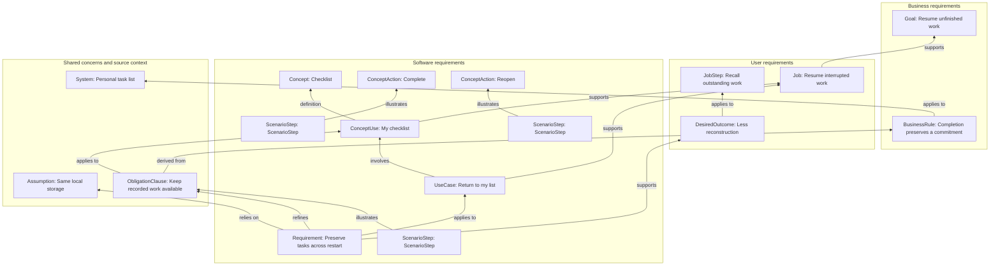

# Requirements traceability

Specification project: **todo**. Project membership does not imply a System relationship.

Generated from authored specifications. Regenerate this view instead of editing it.

Model `0.19.0-draft`; mapping `dotspec-markdown/14`. Business/user/software subsets describe concerns; core/supporting/generic classifies model subsets. Artifact kinds and relationships have separate meanings.

This view covers only acquired records and resolved explicit relationships within the export's discovery and direct-reference boundary. Missing links do not establish missing behavior. Review candidates are not proven impacts; paths do not establish satisfaction, achieved outcomes, completeness or normative authority.

## Why: motivation and basis

| Element | Relationship | Basis or subject |
| --- | --- | --- |
| [Completion preserves a commitment](<../../examples/todo/specs/business-rules/completion.business-rule.spec.md#completion-preserves-a-commitment>) | applies to | [Personal task list](<../../examples/todo/specs/system.spec.md#personal-task-list>) |
| [Less reconstruction](<../../examples/todo/specs/jobs/resume.job.spec.md#less-reconstruction>) | applies to | [Recall outstanding work](<../../examples/todo/specs/jobs/resume.job.spec.md#recall-outstanding-work>) |
| [Resume interrupted work](<../../examples/todo/specs/jobs/resume.job.spec.md#resume-interrupted-work>) | supports | [Resume unfinished work](<../../examples/todo/specs/system.spec.md#resume-unfinished-work>) |
| [Preserve tasks across restart](<../../examples/todo/specs/requirements/restart.requirement.spec.md#preserve-tasks-across-restart>) | supports | [Less reconstruction](<../../examples/todo/specs/jobs/resume.job.spec.md#less-reconstruction>) |
| [Preserve tasks across restart](<../../examples/todo/specs/requirements/restart.requirement.spec.md#preserve-tasks-across-restart>) | refines | [Keep recorded work available](<../../examples/todo/specs/use-cases/resume-list.use-case.spec.md#keep-recorded-work-available>) |
| [Preserve tasks across restart](<../../examples/todo/specs/requirements/restart.requirement.spec.md#preserve-tasks-across-restart>) | relies on | [Same local storage](<../../examples/todo/specs/system.spec.md#same-local-storage>) |
| [Preserve tasks across restart](<../../examples/todo/specs/requirements/restart.requirement.spec.md#preserve-tasks-across-restart>) | applies to | [Return to my list](<../../examples/todo/specs/use-cases/resume-list.use-case.spec.md#return-to-my-list>) |
| [My checklist](<../../examples/todo/specs/system.spec.md#my-checklist>) | supports | [Resume interrupted work](<../../examples/todo/specs/jobs/resume.job.spec.md#resume-interrupted-work>) |
| [My checklist](<../../examples/todo/specs/system.spec.md#my-checklist>) | definition | [Checklist](<../../examples/todo/specs/concepts/checklist.concept.spec.md#checklist>) |
| [ScenarioStep](<../../examples/todo/specs/use-cases/resume-list.use-case.spec.md>) | illustrates | [Complete](<../../examples/todo/specs/concepts/checklist.concept.spec.md#complete>) |
| [ScenarioStep](<../../examples/todo/specs/use-cases/resume-list.use-case.spec.md>) | illustrates | [Keep recorded work available](<../../examples/todo/specs/use-cases/resume-list.use-case.spec.md#keep-recorded-work-available>) |
| [ScenarioStep](<../../examples/todo/specs/use-cases/resume-list.use-case.spec.md>) | illustrates | [Reopen](<../../examples/todo/specs/concepts/checklist.concept.spec.md#reopen>) |
| [Keep recorded work available](<../../examples/todo/specs/use-cases/resume-list.use-case.spec.md#keep-recorded-work-available>) | derived from | [Completion preserves a commitment](<../../examples/todo/specs/business-rules/completion.business-rule.spec.md#completion-preserves-a-commitment>) |
| [Keep recorded work available](<../../examples/todo/specs/use-cases/resume-list.use-case.spec.md#keep-recorded-work-available>) | applies to | [My checklist](<../../examples/todo/specs/system.spec.md#my-checklist>) |
| [Return to my list](<../../examples/todo/specs/use-cases/resume-list.use-case.spec.md#return-to-my-list>) | supports | [Resume interrupted work](<../../examples/todo/specs/jobs/resume.job.spec.md#resume-interrupted-work>) |
| [Return to my list](<../../examples/todo/specs/use-cases/resume-list.use-case.spec.md#return-to-my-list>) | involves | [My checklist](<../../examples/todo/specs/system.spec.md#my-checklist>) |

## Layered relationship diagram

Arrows read from the declaring element to its named target. They do not impose authoring order.

## Behavior: use cases and concept uses

Use cases and concepts are complementary views. Participation is many-to-many and identifies a named use, not a reusable definition alone.

| Use case | Participating concept uses | Explicit obligations applying to this use case |
| --- | --- | --- |
| [Return to my list](<../../examples/todo/specs/use-cases/resume-list.use-case.spec.md#return-to-my-list>) | [My checklist](<../../examples/todo/specs/system.spec.md#my-checklist>) | [Keep recorded work available](<../../examples/todo/specs/use-cases/resume-list.use-case.spec.md#keep-recorded-work-available>) (declared here); [Preserve tasks across restart](<../../examples/todo/specs/requirements/restart.requirement.spec.md#preserve-tasks-across-restart>) |

## Change review

Reverse navigation is generated from the same typed fields. Each direct candidate declares the displayed relationship to the changed record. Further candidates follow those links transitively; they require human review, not automatic changes. Containment and general citations are excluded.

| Changed record | Direct review candidates and reasons | Further review candidates |
| --- | --- | --- |
| [Completion preserves a commitment](<../../examples/todo/specs/business-rules/completion.business-rule.spec.md#completion-preserves-a-commitment>) | [Keep recorded work available](<../../examples/todo/specs/use-cases/resume-list.use-case.spec.md#keep-recorded-work-available>) (derived from) | [Preserve tasks across restart](<../../examples/todo/specs/requirements/restart.requirement.spec.md#preserve-tasks-across-restart>); [ScenarioStep](<../../examples/todo/specs/use-cases/resume-list.use-case.spec.md>) |
| [Checklist](<../../examples/todo/specs/concepts/checklist.concept.spec.md#checklist>) | [My checklist](<../../examples/todo/specs/system.spec.md#my-checklist>) (definition) | [Keep recorded work available](<../../examples/todo/specs/use-cases/resume-list.use-case.spec.md#keep-recorded-work-available>); [Return to my list](<../../examples/todo/specs/use-cases/resume-list.use-case.spec.md#return-to-my-list>); [Preserve tasks across restart](<../../examples/todo/specs/requirements/restart.requirement.spec.md#preserve-tasks-across-restart>); [ScenarioStep](<../../examples/todo/specs/use-cases/resume-list.use-case.spec.md>) |
| [Complete](<../../examples/todo/specs/concepts/checklist.concept.spec.md#complete>) | [ScenarioStep](<../../examples/todo/specs/use-cases/resume-list.use-case.spec.md>) (illustrates) | None recorded in acquired scope |
| [Reopen](<../../examples/todo/specs/concepts/checklist.concept.spec.md#reopen>) | [ScenarioStep](<../../examples/todo/specs/use-cases/resume-list.use-case.spec.md>) (illustrates) | None recorded in acquired scope |
| [Less reconstruction](<../../examples/todo/specs/jobs/resume.job.spec.md#less-reconstruction>) | [Preserve tasks across restart](<../../examples/todo/specs/requirements/restart.requirement.spec.md#preserve-tasks-across-restart>) (supports) | None recorded in acquired scope |
| [Recall outstanding work](<../../examples/todo/specs/jobs/resume.job.spec.md#recall-outstanding-work>) | [Less reconstruction](<../../examples/todo/specs/jobs/resume.job.spec.md#less-reconstruction>) (applies to) | [Preserve tasks across restart](<../../examples/todo/specs/requirements/restart.requirement.spec.md#preserve-tasks-across-restart>) |
| [Resume interrupted work](<../../examples/todo/specs/jobs/resume.job.spec.md#resume-interrupted-work>) | [My checklist](<../../examples/todo/specs/system.spec.md#my-checklist>) (supports); [Return to my list](<../../examples/todo/specs/use-cases/resume-list.use-case.spec.md#return-to-my-list>) (supports) | [Keep recorded work available](<../../examples/todo/specs/use-cases/resume-list.use-case.spec.md#keep-recorded-work-available>); [Preserve tasks across restart](<../../examples/todo/specs/requirements/restart.requirement.spec.md#preserve-tasks-across-restart>); [ScenarioStep](<../../examples/todo/specs/use-cases/resume-list.use-case.spec.md>) |
| [My checklist](<../../examples/todo/specs/system.spec.md#my-checklist>) | [Keep recorded work available](<../../examples/todo/specs/use-cases/resume-list.use-case.spec.md#keep-recorded-work-available>) (applies to); [Return to my list](<../../examples/todo/specs/use-cases/resume-list.use-case.spec.md#return-to-my-list>) (involves) | [Preserve tasks across restart](<../../examples/todo/specs/requirements/restart.requirement.spec.md#preserve-tasks-across-restart>); [ScenarioStep](<../../examples/todo/specs/use-cases/resume-list.use-case.spec.md>) |
| [Personal task list](<../../examples/todo/specs/system.spec.md#personal-task-list>) | [Completion preserves a commitment](<../../examples/todo/specs/business-rules/completion.business-rule.spec.md#completion-preserves-a-commitment>) (applies to) | [Keep recorded work available](<../../examples/todo/specs/use-cases/resume-list.use-case.spec.md#keep-recorded-work-available>); [Preserve tasks across restart](<../../examples/todo/specs/requirements/restart.requirement.spec.md#preserve-tasks-across-restart>); [ScenarioStep](<../../examples/todo/specs/use-cases/resume-list.use-case.spec.md>) |
| [Resume unfinished work](<../../examples/todo/specs/system.spec.md#resume-unfinished-work>) | [Resume interrupted work](<../../examples/todo/specs/jobs/resume.job.spec.md#resume-interrupted-work>) (supports) | [My checklist](<../../examples/todo/specs/system.spec.md#my-checklist>); [Return to my list](<../../examples/todo/specs/use-cases/resume-list.use-case.spec.md#return-to-my-list>); [Keep recorded work available](<../../examples/todo/specs/use-cases/resume-list.use-case.spec.md#keep-recorded-work-available>); [Preserve tasks across restart](<../../examples/todo/specs/requirements/restart.requirement.spec.md#preserve-tasks-across-restart>); [ScenarioStep](<../../examples/todo/specs/use-cases/resume-list.use-case.spec.md>) |
| [Same local storage](<../../examples/todo/specs/system.spec.md#same-local-storage>) | [Preserve tasks across restart](<../../examples/todo/specs/requirements/restart.requirement.spec.md#preserve-tasks-across-restart>) (relies on) | None recorded in acquired scope |
| [Keep recorded work available](<../../examples/todo/specs/use-cases/resume-list.use-case.spec.md#keep-recorded-work-available>) | [Preserve tasks across restart](<../../examples/todo/specs/requirements/restart.requirement.spec.md#preserve-tasks-across-restart>) (refines); [ScenarioStep](<../../examples/todo/specs/use-cases/resume-list.use-case.spec.md>) (illustrates) | None recorded in acquired scope |
| [Return to my list](<../../examples/todo/specs/use-cases/resume-list.use-case.spec.md#return-to-my-list>) | [Preserve tasks across restart](<../../examples/todo/specs/requirements/restart.requirement.spec.md#preserve-tasks-across-restart>) (applies to) | None recorded in acquired scope |

## System verification planning

This inventory covers standalone requirements and explicitly distinguished obligation clauses. Other normative prose is not automatically decomposed. Guidance plans assessment of realizations against obligations; it is not an executed check or requirements-quality review. Revision-bound executions, satisfaction claims and evidence verdicts are not represented by this view.

| Obligation | Authored check guidance | Execution evidence |
| --- | --- | --- |
| [Preserve tasks across restart](<../../examples/todo/specs/requirements/restart.requirement.spec.md#preserve-tasks-across-restart>) | Recorded in source (verification plan) | Not evaluated |
| [Keep recorded work available](<../../examples/todo/specs/use-cases/resume-list.use-case.spec.md#keep-recorded-work-available>) | Recorded in source (verification plan) | Not evaluated |

## Review findings

Unresolved or invalid declarations remain in the source-backed snapshot, even when omitted from the resolved graph. Missing justification or check guidance is advisory.

No inspection findings in this acquired scope.
