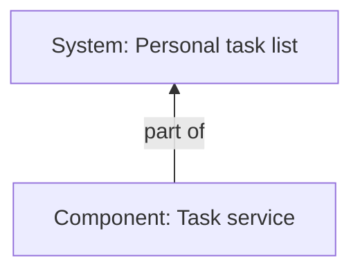

# System specification overview

Specification project: **todo**. Project membership does not imply a System relationship.

Generated from authored specifications. Regenerate this view instead of editing it.

Model `0.19.0-draft`; mapping `dotspec-markdown/14`. This view covers only acquired records within the export's discovery and direct-reference boundary. Missing links do not establish missing behavior or missing implementation.

## System structure

Arrows read **part of**, from a component or subsystem to its explicit structural parent. Declaration location and directory nesting do not create these edges. No requirements are inherited down the structure.

| Subject | Explicit parent | Declared in |
| --- | --- | --- |
| [Personal task list](<../../examples/todo/specs/system.spec.md#personal-task-list>) | Unresolved or undeclared | System document |
| [Task service](<../../examples/todo/specs/system.spec.md#task-service>) | [Personal task list](<../../examples/todo/specs/system.spec.md#personal-task-list>) | [Personal task list](<../../examples/todo/specs/system.spec.md#personal-task-list>) |

## Interfaces

Required and provided are relative to the declaring subject. Each entry is an addressable element; native contract references do not prove implementation or compatibility.

| Subject | Direction | Interface |
| --- | --- | --- |
| [Personal task list](<../../examples/todo/specs/system.spec.md#personal-task-list>) | provided | [Task list forms](<../../examples/todo/specs/system.spec.md#task-list-forms>) |

## Features

Feature membership is many-to-many and does not own the grouped records. Component involvement below is derived only from the direct `applies_to` targets of grouped requirements or obligation clauses. It is not an implementation or allocation claim.

| Feature | System | Grouped specifications | Components involved (derived) |
| --- | --- | --- | --- |
| [Pick up where I left off](<../../examples/todo/specs/system.spec.md#pick-up-where-i-left-off>) | [Personal task list](<../../examples/todo/specs/system.spec.md#personal-task-list>) | [Return to my list](<../../examples/todo/specs/use-cases/resume-list.use-case.spec.md#return-to-my-list>), [Preserve tasks across restart](<../../examples/todo/specs/requirements/restart.requirement.spec.md#preserve-tasks-across-restart>) | None resolved |

## Applicable obligations

Only explicit applicability to acquired systems and components is listed. Declaration inside a component does not implicitly supply an applicability target. Plans describe intended system verification; their presence does not prove satisfaction.

| Obligation | Subjects | Verification plan | Criterion |
| --- | --- | --- | --- |

## Specification association and discovery context

An explicit specification system overrides the directory default. These associations do not establish structural parentage.

| Specification | System | Origin |
| --- | --- | --- |
| [Completion preserves a commitment](<../../examples/todo/specs/business-rules/completion.business-rule.spec.md#completion-preserves-a-commitment>) | [Personal task list](<../../examples/todo/specs/system.spec.md#personal-task-list>) | directory |
| [Checklist](<../../examples/todo/specs/concepts/checklist.concept.spec.md#checklist>) | [Personal task list](<../../examples/todo/specs/system.spec.md#personal-task-list>) | directory |
| [Resume interrupted work](<../../examples/todo/specs/jobs/resume.job.spec.md#resume-interrupted-work>) | [Personal task list](<../../examples/todo/specs/system.spec.md#personal-task-list>) | directory |
| [Preserve tasks across restart](<../../examples/todo/specs/requirements/restart.requirement.spec.md#preserve-tasks-across-restart>) | [Personal task list](<../../examples/todo/specs/system.spec.md#personal-task-list>) | directory |
| [Return to my list](<../../examples/todo/specs/use-cases/resume-list.use-case.spec.md#return-to-my-list>) | [Personal task list](<../../examples/todo/specs/system.spec.md#personal-task-list>) | directory |

## Concept uses

| System | Named use | Concept definition |
| --- | --- | --- |
| [Personal task list](<../../examples/todo/specs/system.spec.md#personal-task-list>) | [My checklist](<../../examples/todo/specs/system.spec.md#my-checklist>) | [Checklist](<../../examples/todo/specs/concepts/checklist.concept.spec.md#checklist>) |

## Descriptions and native references

Linked contracts, architecture decisions, and implementation artifacts retain their own authority. Normative commitments belong in requirements or obligation clauses.

### System: Personal task list

[Personal task list](<../../examples/todo/specs/system.spec.md#personal-task-list>)

#### Purpose

Help a person pick up unfinished work after an interruption.

#### Scope

One person's list on one computer. The browser submits forms to a local service.

#### Validation plan

##### Subject

A person returning to unfinished work using this build.

##### Method

Invite someone to record two real errands and mark one finished. After a break,
restart the app with the same database. Ask what still needs attention. Then tell
them that the finished errand needs a follow-up and ask them to resume it.
Let them choose the controls without coaching.

##### Success criteria

The participant identifies the outstanding errand and resumes the other without
entering it again. Ask what they expected to find on returning.

##### Evidence to retain

With consent, record the build, task outcome, any help given and the participant's
explanation. Review mismatches before deciding whether the workflow meets the need.

### Feature: Pick up where I left off

[Pick up where I left off](<../../examples/todo/specs/system.spec.md#pick-up-where-i-left-off>)

#### Groups

[Return to my list](../../examples/todo/specs/use-cases/resume-list.use-case.spec.md) and
[Preserve tasks across restart](../../examples/todo/specs/requirements/restart.requirement.spec.md).

### Interface: Task list forms

[Task list forms](<../../examples/todo/specs/system.spec.md#task-list-forms>)

#### Description

The browser presents open and completed tasks and accepts changes through HTML forms.

#### Contracts

[Form template](../../examples/todo/app/list.html) supplies the actions and fields.

### Component: Task service

[Task service](<../../examples/todo/specs/system.spec.md#task-service>)

#### Responsibilities

Accept browser changes and commit them to the local database before confirming them.

#### Contracts

- The browser uses the [HTML forms](../../examples/todo/app/list.html) to submit changes.

#### Implementation

The [Go server](../../examples/todo/app/main.go) owns form handling and storage.

#### Part of

[Personal task list](../../examples/todo/specs/system.spec.md#personal-task-list).

## Environment and boundaries

Operating conditions and constraints describe what the solution must accommodate. Assumptions are assessed separately for evidence and justified reliance. Explicit exclusions delimit scope. External partners are separate from structural parents.

### BusinessRule: [Completion preserves a commitment](<../../examples/todo/specs/business-rules/completion.business-rule.spec.md#completion-preserves-a-commitment>)

**Statement**

A finished commitment stays on the person's list until they explicitly delete it.

**Applicability**

**Targets:** [Personal task list](../../examples/todo/specs/system.spec.md).

### System: [Personal task list](<../../examples/todo/specs/system.spec.md#personal-task-list>)

**Environment**

The person may close the browser or stop the service between work sessions.

**Out of scope**

Sharing lists, synchronizing devices and recovering from loss of the database file.

**Provided interfaces**

#### Task list forms

The browser presents open and completed tasks and accepts changes through HTML forms.

##### Contracts

[Form template](../../examples/todo/app/list.html) supplies the actions and fields.

### Component: [Task service](<../../examples/todo/specs/system.spec.md#task-service>)

## Assumptions: evidence and justified reliance

Assess both empirical support in the stated conditions and whether relying on the premise is appropriate for intended use. An observation supports a bounded claim, not a guarantee that the premise always holds.

### [Same local storage](<../../examples/todo/specs/system.spec.md#same-local-storage>)

**Statement**

The person returns to the same writable database file.

Review required: no Basis, Applicability, Validation plan recorded.
