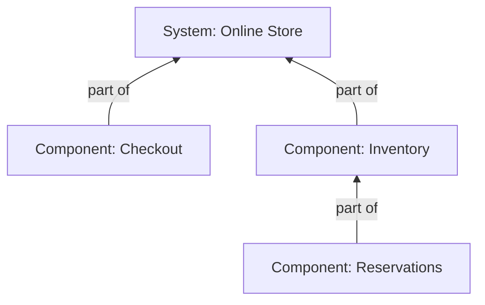

# System specification overview

Generated from authored specifications. Regenerate this view instead of editing it.

Model `0.12.0-draft`; mapping `dotspec-markdown/11`. This view covers only acquired records within the export's discovery and direct-reference boundary. Missing links do not establish missing behavior or missing implementation.

## System structure

Arrows read **part of**, from a component or subsystem to its explicit structural parent. Declaration location and directory nesting do not create these edges. No requirements are inherited down the structure.

| Subject | Explicit parent | Declared in |
| --- | --- | --- |
| [Checkout](<../../examples/system-structure/specs/system.spec.md#checkout>) | [Online Store](<../../examples/system-structure/specs/system.spec.md#online-store>) | [Online Store](<../../examples/system-structure/specs/system.spec.md#online-store>) |
| [Inventory](<../../examples/system-structure/specs/system.spec.md#inventory>) | [Online Store](<../../examples/system-structure/specs/system.spec.md#online-store>) | [Online Store](<../../examples/system-structure/specs/system.spec.md#online-store>) |
| [Online Store](<../../examples/system-structure/specs/system.spec.md#online-store>) | Unresolved or undeclared | System document |
| [Reservations](<../../examples/system-structure/specs/system.spec.md#reservations>) | [Inventory](<../../examples/system-structure/specs/system.spec.md#inventory>) | [Online Store](<../../examples/system-structure/specs/system.spec.md#online-store>) |

## Features

Feature membership is many-to-many and does not own the grouped records. Component involvement below is derived only from the direct `applies_to` targets of grouped requirements or obligation clauses. It is not an implementation or allocation claim.

| Feature | System | Grouped specifications | Components involved (derived) |
| --- | --- | --- | --- |
| [Place an order](<../../examples/system-structure/specs/system.spec.md#place-an-order>) | [Online Store](<../../examples/system-structure/specs/system.spec.md#online-store>) | [Reserve purchased stock](<../../examples/system-structure/specs/requirements/reserve-stock.requirement.spec.md#reserve-purchased-stock>) | [Reservations](<../../examples/system-structure/specs/system.spec.md#reservations>) |
| [Prevent overselling](<../../examples/system-structure/specs/system.spec.md#prevent-overselling>) | [Online Store](<../../examples/system-structure/specs/system.spec.md#online-store>) | [Reserve purchased stock](<../../examples/system-structure/specs/requirements/reserve-stock.requirement.spec.md#reserve-purchased-stock>) | [Reservations](<../../examples/system-structure/specs/system.spec.md#reservations>) |

## Applicable obligations

Only explicit applicability to acquired systems and components is listed. Declaration inside a component does not implicitly supply an applicability target. Plans describe intended verification; their presence does not prove satisfaction.

| Obligation | Subjects | Verification guidance | Measurement guidance |
| --- | --- | --- | --- |
| [Reserve purchased stock](<../../examples/system-structure/specs/requirements/reserve-stock.requirement.spec.md#reserve-purchased-stock>) | [Reservations](<../../examples/system-structure/specs/system.spec.md#reservations>) | Recorded in source | Not recorded |

## Specification association and discovery context

An explicit specification system overrides the directory default. These associations do not establish structural parentage.

| Specification | Selected system | Selection origin | Directory context |
| --- | --- | --- | --- |
| [Reservation](<../../examples/system-structure/specs/concepts/reservation.concept.spec.md#reservation>) | [Online Store](<../../examples/system-structure/specs/system.spec.md#online-store>) | directory | [Online Store](<../../examples/system-structure/specs/system.spec.md#online-store>) |
| [Reserve purchased stock](<../../examples/system-structure/specs/requirements/reserve-stock.requirement.spec.md#reserve-purchased-stock>) | [Online Store](<../../examples/system-structure/specs/system.spec.md#online-store>) | explicit | [Online Store](<../../examples/system-structure/specs/system.spec.md#online-store>) |

## Concept uses

| System | Named use | Concept definition |
| --- | --- | --- |
| [Online Store](<../../examples/system-structure/specs/system.spec.md#online-store>) | [Stock holds](<../../examples/system-structure/specs/system.spec.md#stock-holds>) | [Reservation](<../../examples/system-structure/specs/concepts/reservation.concept.spec.md#reservation>) |

## Descriptions and native references

Linked contracts, architecture decisions, and implementation artifacts retain their own authority. Normative commitments belong in requirements or obligation clauses.

### GeneralRequirement: Reserve purchased stock

[Reserve purchased stock](<../../examples/system-structure/specs/requirements/reserve-stock.requirement.spec.md#reserve-purchased-stock>)

#### Statement

An accepted order must reserve its purchased quantities before confirmation.

#### Verification plan

Submit concurrent orders against limited stock and verify that accepted quantities never exceed stock.

### Component: Checkout

[Checkout](<../../examples/system-structure/specs/system.spec.md#checkout>)

#### Purpose

Accept and price customer orders.

#### Responsibilities

Calculate totals and coordinate order submission.

#### Boundary description

Owns order submission; stock availability remains Inventory's responsibility.

#### Contracts

[Order submission contract](../../examples/system-structure/order-contract.md)

#### Architecture

[Order coordination decision](../../examples/system-structure/order-coordination.md)

#### Implementation

Implementation locations can be linked here when they exist.

#### Part of

[Online Store](../../examples/system-structure/specs/system.spec.md#store)

### Component: Inventory

[Inventory](<../../examples/system-structure/specs/system.spec.md#inventory>)

#### Purpose

Track available stock.

#### Part of

[Online Store](../../examples/system-structure/specs/system.spec.md#store)

### System: Online Store

[Online Store](<../../examples/system-structure/specs/system.spec.md#online-store>)

#### Purpose

Let customers buy available products.

#### Scope

Order placement, stock reservation, and confirmation. Payment processing is external.

### Feature: Place an order

[Place an order](<../../examples/system-structure/specs/system.spec.md#place-an-order>)

#### Purpose

Let a customer purchase products with confidence that stock is reserved.

#### Groups

- [Reserve purchased stock](../../examples/system-structure/specs/requirements/reserve-stock.requirement.spec.md)

### Feature: Prevent overselling

[Prevent overselling](<../../examples/system-structure/specs/system.spec.md#prevent-overselling>)

#### Purpose

Keep accepted orders within available stock.

#### Groups

- [Reserve purchased stock](../../examples/system-structure/specs/requirements/reserve-stock.requirement.spec.md)

### Component: Reservations

[Reservations](<../../examples/system-structure/specs/system.spec.md#reservations>)

#### Purpose

Hold stock for orders awaiting confirmation.

#### Part of

[Inventory](../../examples/system-structure/specs/system.spec.md#inventory)

## Environment and boundaries

Operating conditions and constraints describe what the solution must accommodate. Assumptions are premises relied upon and require a justified basis and validation. Explicit exclusions delimit scope. External partners are separate from structural parents.

### System: [Online Store](<../../examples/system-structure/specs/system.spec.md#online-store>)

### Component: [Checkout](<../../examples/system-structure/specs/system.spec.md#checkout>)

### Component: [Inventory](<../../examples/system-structure/specs/system.spec.md#inventory>)

### Component: [Reservations](<../../examples/system-structure/specs/system.spec.md#reservations>)
