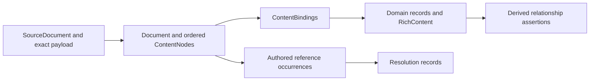

# Specification model

Dotspec exports the specification layer as a source-backed JSON snapshot. Use it
when another tool needs the complete documents and their domain structure,
including content that the type-specific `show` commands expose only as prose.
The snapshot describes what dotspec read and how it interpreted that material.
It does not establish that stakeholders agree with it or that a requirement is
satisfied.

The [core domain reference](reference/model/core.md) groups the principal types
by business, user, and software requirements, with generated relationship diagrams.
The canonical [LinkML model](../model/dotspec.yaml) defines the records and their
relationships. The [generated reference](reference/model/index.md) describes
every field. The [Markdown mapping profile](../model/markdown-mapping.md) defines
how authored syntax becomes those records. The current model is experimental:
`model_version` is `0.4.0-draft`, `representation_version` is `0.1.0`, and
`mapping_profile` is `dotspec-markdown/3`.

## Export and validate a snapshot

```sh
dotspec model export --path . > snapshot.json
dotspec model schema > snapshot.schema.json
dotspec model validate snapshot.json
dotspec model validate snapshot.json --json
cat snapshot.json | dotspec model validate - --json
```

`export` and `schema` write JSON directly. `validate` reads one JSON snapshot
from a filename or `-` for standard input and reports contract findings; its
normal report is text, with `--json` for a machine-readable report. Validation
checks the saved snapshot without reading its source paths or retrieving URLs.
A snapshot can therefore be checked after its source files change or become
unavailable. The JSON validation report contains `valid` and a `findings` array;
findings identify a stable code, snapshot path and message. Validation returns
`0` for conformance, `1` for invalid JSON or model findings, and `2` for an
invocation or operational error, including an unreadable snapshot file.

Export uses the selected directory, supported specification layouts, enclosing
system context and direct reference boundary used by the existing inspection
commands. In a Git repository, discovery follows Git ignore rules. Filesystem
discovery is used outside Git. Symlinks and nested repositories remain outside
the discovery boundary. Ordinary referenced Markdown receives a content model;
other acquired files retain their bytes and media type. Directory references
identify directories without recursively scanning their contents. External
addresses are recorded without fetching them.

The snapshot is the primary result even when it contains authoring findings or
an incomplete scan. Exit status distinguishes a completed export without
structural findings (`0`), specification findings (`1`), and invocation or
operational failure (`2`). Keep the JSON and inspect its diagnostics and scope
flags when an export returns a nonzero status. An unusable invocation can fail
before a snapshot exists.

## Three connected representations

| Layer | What it represents | Why it is separate |
| --- | --- | --- |
| Source | Locators, read state and exact acquired payloads | Formatting, comments and malformed text survive interpretation. |
| Document content | Ordered Markdown and YAML syntax, original-byte spans, references and fragments | Consumers can examine a document's structure without accepting a domain interpretation. |
| Domain | Business rules, systems, jobs, steps, outcomes, progress cases, use cases, scenarios, concepts, requirements, reusable quality models and quality attributes | Named fields and records make domain meaning addressable and checkable. |



A use case's `minimum_guarantees`, a concept's `operational_principle`, and a
requirement's `rationale` are named domain values even when each remains a
paragraph. `RichContent` points to ordered content nodes instead of maintaining
an independent editable copy of that prose. Explicit structures also receive
records: job-step headings identify `JobStep` records, ordered scenario items
identify `ScenarioStep` records, and named concept actions identify
`ConceptAction` records. An `OpenDecisionCollection` retains a decision section's
full narrative and its explicit question/evidence entries; an omitted field does
not automatically become an open decision.

For example, a quality requirement's Measurement section may contain a
procedure, exclusions, evidence instructions and links. Its complete content
belongs to `MeasurementPlan.content`; recognized explicit subsections also
populate the corresponding fields. An exporter cannot discard those instructions
because they do not fit a measure-and-threshold pair.

### Exact source and content structure

Successfully read files contain an inline base64 payload, SHA-256 digest and
byte count. Decoding that payload recovers the original bytes, including a UTF-8
BOM, CRLF line endings, trailing spaces, YAML comments and the final newline.
Original bytes are retained even when decoding or metadata parsing fails.
An unreadable source has an identity, locator, failed read state and diagnostic;
it has no invented payload.

Every content span is a half-open interval `[start, end)` in the original file's
bytes. Parsing may normalize a BOM and CRLF, but the document records the offset
mapping and exported spans refer to the retained original. The content tree
preserves source order and nesting. It includes paragraphs, lists, headings,
code, GFM tables and task markers, links and images, footnotes, YAML entries,
comments and syntax trivia. Unsupported regions use an `opaque` node with a
reason. Code and diagrams retain their literal content; Markdown-looking text
inside code does not become a live reference.

Exact byte recovery uses the source payload. A consumer rendering domain fields
or reconstructing Markdown from the syntax tree is producing another view and
must not claim that the rendered text is byte-identical to the original.

### Identity and provenance

Snapshot record IDs distinguish occurrences and supply cross-record references.
Source IDs derive from normalized absolute locators; content IDs additionally
identify source positions and syntax kinds. These are snapshot identities,
not durable authored names. Moving a file or changing its content can change
IDs. The same acquired inputs, scope and mapping profile produce deterministic
records and output ordering. An explicitly authored `id` is retained separately
as `authored_id`;
fragment targets and system-local attribute IDs keep their own scopes.

`ContentBinding` records identify the owning record, model field path, source
node, mapping rule and binding role. A narrative field can have complete named
mapping while optional finer decomposition remains `unsegmented`. Source spans
can nest: a scenario body and one of its steps legitimately refer to overlapping
parent and descendant content. Ordered roots within an individual `RichContent`
value remain distinct and non-overlapping.

### References and semantic relationships

A `SourceReference` records an authored occurrence before resolution. A
`Resolution` records what inspection established: a resolved target, undefined
label, unbound quality attribute label, ambiguity, unresolved target, external address,
out-of-scope target or resolution not attempted. A file reference can target a
source record; a fragment can identify a source fragment or a domain element.
The literal destination or label remains available independently of that result.

Selected specifications and their enclosing context can cause direct targets
to be read. Links in those targets do not recursively expand the scan. Their
occurrences remain represented, with resolution limited to already available
context or explicitly marked as not attempted.

Directory ownership does not set a use case's system boundary. An enclosing
system does not silently supply inherited requirements, assumptions or quality
attributes through another system. Each `QualityAttribute` belongs directly to
its declaring `System` or standalone `QualityModel`. Model definitions can be
copied into systems as independent declarations with ordinary source links. Classification labels retain their authored occurrences
and `system_context`; resolved targets populate the corresponding typed fields.
Sub-attribute references stay within their declaring owner. Reusable-model
grouping labels use `quality_model_context`; requirement labels use system context.
The system's
`quality_attributes_content` preserves the section narrative and subsections;
`quality_attributes` preserves the ordered attribute references. An absent
section and an explicitly empty section remain distinct.

Assertions are typed relationship views with provenance. The exporter derives
membership and classification assertions from canonical fields using model
annotations. A Related jobs link, verification citation or authority paragraph
remains authored context; the link alone does not prove support, satisfaction,
authority or execution evidence.

### Quality attribute grouping

`QualityAttribute.subattribute_of` is an optional, multi-valued reference to other
attributes under the same declaring system or model. It means **this attribute
is organized under these attributes**. Markdown authors write `Sub-attribute of`.
The resulting structure is a directed acyclic graph: a tree is supported, but a
quality can appear under several groupings. Root attributes omit the Markdown
field. CLI attribute JSON represents their references as an empty array.

This choice supports the starter models with one relationship:

- [ISO/IEC 25010:2023](https://www.iso.org/standard/78176.html) groups its nine
  characteristics into sub-characteristics; these use one immediate grouping each.
- [RUP's FURPS categories](https://galileo.softlab.ntua.gr/rup/process/workflow/requirem/co_req.htm)
  include accuracy under reliability and performance. One attribute can retain
  both placements without duplicating its identity.
- [Q42](https://quality.arc42.org/articles/arc42-quality-model) uses overlapping
  dimension tags instead of a fixed tree. For example, resilience belongs under
  reliable and secure. Dotspec represents those tags with the same grouping
  relation; this does not reinterpret them as exclusive decomposition.

**Decision rationale:** restricting each attribute to one parent would lose
legitimate groupings or require duplicate attributes. Introducing a second
classification relationship would add authoring and navigation complexity for
these same groupings. A single multi-valued relation keeps the model small while
preserving the source frameworks. `Sub-attribute of` expresses the relationship
in the author's domain language; the former `Broader` terminology came from
knowledge-organization conventions but was less clear to requirements authors.

References must be distinct, resolve within the same declaring owner, and form
no cycles. Direct sub-attributes are derived by reversing the references;
ancestors are derived by traversal. Neither is a second authored source of truth.
The exporter preserves each authored label and its resolution separately and
projects `SubattributeOf` assertions from the resolved references.

Grouping supports discovery and classification. It does **not** imply inherited
requirements, thresholds, satisfaction, equivalence, or exclusive membership.
A requirement's authored attribute labels remain unchanged when filtering finds
it through an ancestor. Copying a selected attribute includes all its grouping
ancestors once so references remain valid; it does not select every descendant.

## Read the independent status fields

| Question | Evidence in the snapshot |
| --- | --- |
| Were the bytes acquired? | `SourceDocument.read_status` and `payload` |
| Was the syntax interpreted? | Document parse states, opaque nodes and diagnostics |
| Were supported domain roles mapped? | Document and snapshot `coverage` |
| Was finer structure extracted? | Domain and rich-content `decomposition` |
| Did the selected operation finish? | Scope discovery, read and inspection completion flags |
| Does the exported representation conform? | `model validate` findings |

`complete_for_profile` means that known roles under the declared mapping profile
are accounted for. The coverage report still lists extension sections and
uninterpreted syntax. Unknown sections are preserved with their original
headings and content, including unfamiliar detail sections within structured
items. They attach to the nearest addressable owner and do not acquire an
invented domain meaning. Missing
known mappings and unbound content prevent a complete coverage claim.

A malformed specification can retain its complete source and syntax while its
authoring parser rejects the domain object. Other files still export. A readable
draft can retain empty fields, paragraphs instead of numbered scenarios, or an
explicitly unresolved branch. Absence, an authored empty section, an unresolved
author decision, and an extraction failure are different states.

Snapshot validation combines generated JSON Schema with Go checks for IDs,
typed reference ranges, ownership, cycles, source payloads and spans, syntax
order, bindings, resolutions and assertion consistency. A well-formed snapshot
can correctly describe a malformed source or incomplete scan. Passing snapshot
validation therefore makes no claim about source acceptance, stakeholder
adequacy or requirement satisfaction. The schema also permits externally stored
payloads with immutable locators and digests; offline validation checks their
structure, not whether the external bytes are retrievable. The exporter writes
inline payloads.

## Model maintenance and evidence

Python and LinkML are needed only to regenerate the committed model projections.
The CLI embeds the JSON Schema and class/range catalog and runs entirely in Go.
See [model generation](../model/README.md#regeneration) for the pinned environment
and generation checks. Changes to the canonical model, projections, mapping
profile and native checks must agree.

The [source-fidelity requirement](../specs/requirements/model-source-fidelity.requirement.spec.md)
and [export use case](../specs/use-cases/export-specification-model.use-case.spec.md)
state the product behavior. The [content tests](../internal/model/content_test.go),
[export tests](../internal/model/export_test.go),
[export conformance tests](../internal/model/export_conformance_test.go), and
[CLI tests](../internal/cli/model_test.go) provide evidence for their exercised
cases. The [model command examples](../internal/integration/testdata/model.txtar)
exercise the installed CLI, including validation after the source files are
removed, retained authoring errors, invalid JSON and I/O failures. Their success does not establish every semantic claim in the input.
