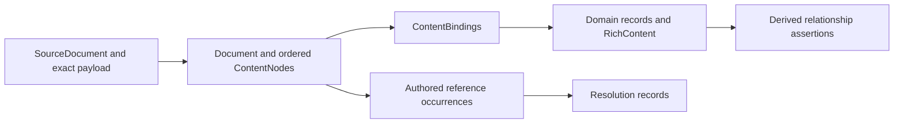

# Specification model

Dotspec exports the specification layer as a source-backed JSON snapshot. Use it
when another tool needs the complete documents and their domain structure,
including content that the type-specific `show` commands expose only as prose.
The snapshot describes what dotspec read and how it interpreted that material.
It does not establish that stakeholders agree with it or that a requirement is
satisfied.

The [core domain reference](reference/model/core.md) groups the principal types
by business, user, and software requirements, with generated relationship diagrams.
The canonical [LinkML model](../model/metamodel.yaml) defines the records and their
relationships. The [generated reference](reference/model/index.md) describes
every field. The [relationship reference](reference/model/relationships.md) describes edge categories, scopes, inverses, cycle policies and projections. The [Markdown mapping profile](../model/markdown-mapping.md) defines
how authored syntax becomes those records. The current model is experimental:
`model_version` is `0.16.0-draft`, `representation_version` is `0.1.0`, and
`mapping_profile` is `dotspec-markdown/13`.

The [verification and validation vocabulary](verification-and-validation.md)
distinguishes requirements quality, requirements fitness, system conformance and
system fitness. Shared AssessmentPlan/AssessmentCase values keep those plan roles
separate through their owning fields and explicit subject and basis.

## Specification kinds and document placement

`Specification` is the abstract base for a cohesive definition of a subject,
behavior, obligation or classification scheme. It includes System, Feature,
Component, Capability, Job, UseCase, Concept, ConceptUse, Synchronization,
Interface, BusinessRule, Requirement and QualityModel. GeneralRequirement and
QualityRequirement specialize Requirement.

A System record describes the system within the specification; it is not a
running system or deployment inventory. The same distinction applies to a
Component, Feature or Interface record. We do not require a second
“SystemSpecification” record to repeat that definition.

Specification kind, concern subset, and document placement are independent:

- The existing eight document families provide document roots.
- Component, Feature, Capability, ConceptUse and Synchronization are named inline
  specifications in a System document. Interface is declared under a System or
  Component's Required interfaces or Provided interfaces section.
- All inherit common notes, evidence, contextual references and validation
  planning, alongside traceability. Heading anchors and optional introductory
  `**ID:**` fields make inline specifications addressable without separate files.
- Business/user/software subsets describe concerns. Core/supporting/generic
  classifies those subsets; neither classification follows from inheritance.

Goals, assumptions, quality attributes, scenario steps and action parameters
remain constituent domain elements. Plans, evidence and open questions support
specification work without becoming specification kinds themselves. An unknown
section remains preserved as extension content.

An Interface specifies a boundary interaction. Its declaration has one owner and
one direction relative to that owner; requirements can apply to it, features can
group it, and it can own obligation clauses. References to counterpart interfaces
or native contracts do not assert compatibility or implementation. Separate
required and provided declarations may cite the same native contract without
claiming they are the same specification. See [boundary authoring](review-requirements.md#delimit-the-boundary-and-its-interfaces)
and the [generated kind hierarchy](reference/model/core.md#specification-kinds).

## Specification projects and workspace exports

A registered specification project bounds discovery and implicit System context;
it is tooling metadata, not a Specification subclass. `scope.project` identifies
the selected project and acquired sources record their registered project. The
workspace manifest is retained as source context. Explicit cross-project links
remain context acquisition rather than recursive discovery.

`model export --all` returns a workspace envelope containing separate snapshots.
`model validate` accepts this envelope as well as a single snapshot;
`model schema --workspace` describes complete workspace exports. Reading views
identify project scope and any acquired domain context from other projects.
See [workspaces](workspaces.md) for selection, boundary and output rules.

## Export and validate a snapshot

```sh
dotspec model export --path . > snapshot.json
dotspec model schema > snapshot.schema.json
dotspec model validate snapshot.json
dotspec model validate snapshot.json --json
cat snapshot.json | dotspec model validate - --json
```

`export` and `schema` write JSON directly. `validate` reads one JSON snapshot
from a filename or `-` for standard input and reports contract findings; its
normal report is text, with `--json` for a machine-readable report. Validation
checks the saved snapshot without reading its source paths or retrieving URLs.
A snapshot can therefore be checked after its source files change or become
unavailable. The JSON validation report contains `valid` and a `findings` array;
findings identify a stable code, snapshot path and message. Validation returns
`0` for conformance, `1` for invalid JSON or model findings, and `2` for an
invocation or operational error, including an unreadable snapshot file.

Export uses the selected directory, supported specification layouts, enclosing
system context and direct reference boundary used by the existing inspection
commands. Registered child projects are excluded from the selected partition. In a Git repository, discovery follows Git ignore rules. Filesystem
discovery is used outside Git. Symlinks and nested repositories remain outside
the discovery boundary. Ordinary referenced Markdown receives a content model;
other acquired files retain their bytes and media type. Directory references
identify directories without recursively scanning their contents. External
addresses are recorded without fetching them.

The snapshot is the primary result even when it contains authoring findings or
an incomplete scan. Exit status distinguishes a completed export without
structural findings (`0`), specification findings (`1`), and invocation or
operational failure (`2`). Keep the JSON and inspect its diagnostics and scope
flags when an export returns a nonzero status. An unusable invocation can fail
before a snapshot exists.

## Layered requirements traceability

Business, user and software subsets describe concerns, not development stages or
normative authority. Core/supporting/generic describes the role of model subsets.
Artifact kinds and relationship categories remain separate axes. A software
obligation can derive directly from a business rule; no intermediate record is
required to complete a hierarchy. See [Requirements layers](requirements-layers.md).

`TraceableElement` supplies `supports`, `derived_from` and `relies_on`.
The separate `ObligationContainer` capability declares owned `ObligationClause`
records. Goals, assumptions and desired outcomes are traceable but cannot contain
clauses. `Obligation` supplies a common statement, quality classification,
applicability, refinement and assessment plans to standalone requirements and clauses. `Requirement` means the standalone obligation
family. A clause can identify an obligation in a use case, concept, action or
other explicitly supported container without copying its statement into another document.
Both clauses and standalone requirements can refine other obligations. Business
rules can also refine obligations. Refinement is acyclic, may have multiple
parents, and declares precision preserving the parent commitment; dotspec does
not prove that preservation from prose.

Use cases and concepts are complementary behavioral views. `UseCase.involves`
identifies participating `ConceptUse` records; no authoring order or service
boundary follows from it. Ordinary domain glossary terms are not automatically
Jackson-style concepts. `applies_to` identifies the subject of an obligation,
not a satisfying implementation. [Declare relationships](develop-relationships.md)
provides the authoring forms and endpoint rules.

```sh
dotspec model trace --path . --relative-to docs/reference > docs/reference/traceability.md
```

This command generates a Mermaid instance diagram and motivation, behavior,
reverse change-review, and verification-guidance tables. Inverses are derived
from canonical fields. Its scope is the acquired snapshot, not the entire world
of linked material. It preserves unresolved-reference and draft-review findings;
missing motivation or check guidance is advisory. Checks, execution evidence,
implementation satisfaction and achieved outcomes are distinct future relations,
not conclusions inferred from reachability or existing Evidence prose.
The [generated example](reference/requirements-traceability-example.md) demonstrates
these views from [authored specifications](../examples/requirements-traceability/README.md).

## Concept definitions and composition

`Concept` describes reusable, purposeful behavior. `ConceptUse` explicitly includes
that definition under a system-local name; directory association alone creates no
use. Two uses of one definition have distinct conceptual state. Type parameters and
introduced identity types are `ConceptType` records owned by their definition.
`TypeBinding` identifies the parameter and either a primitive or both an introduced
type and the named use supplying its identities. A type definition alone cannot
distinguish public and internal registrations of the same Shorthand concept.

`Synchronization` owns coordination at the system level. Its When, Where, Then and
Semantics narratives remain source-backed content. Explicit action entries identify
both a `ConceptUse` and a `ConceptAction` offered by that use's definition. Ordinary
prose remains valid without invented action records. Application dependencies are
explicit links between uses in one system; cycles are valid. Bindings, directory
placement and incidental links never infer dependency edges.

This separation follows Jackson's [concept criteria](https://essenceofsoftware.com/tutorials/concept-basics/criteria/)
and [generic state/type guidance](https://essenceofsoftware.com/tutorials/concept-basics/state/).
The type and action references are dotspec conventions, not a general expression
language. Initial state, derived state and system-initiated actions can be described
without imposing a database schema or scheduler.

Operational principles remain narrative, with multiple stories when needed. They
explain purpose over a characteristic history; they do not replace complete action
behavior or actor-goal use cases. See Jackson's
[operational-principle tutorial](https://essenceofsoftware.com/tutorials/concept-basics/principle/).

Synchronization semantics must be authored. Jackson's
[original formulation](https://essenceofsoftware.com/tutorials/concept-basics/sync/)
uses atomic coordination; Meng and Jackson's
[WYSIWID paper, sections 3–5](https://arxiv.org/html/2508.14511v2)
introduces event-based rules without a required transaction across the chain.
Dotspec records either design and claims neither is implemented. Similarly,
[application dependencies](https://essenceofsoftware.com/tutorials/concept-basics/dependency/)
express design rationale rather than intrinsic calls, and can be mutual.

All these domain types belong to core `software-requirements`. The reuse sense of
“generic concept” does not change the DDD classification of a model subset.

`dotspec model docs --path .` generates a reference with purpose and operational
principles first, then state and actions, followed by system composition and
application dependency diagrams. Use `--relative-to DIR` for the directory that will
contain the Markdown; relative source links are rebased there. No files are written
unless the caller redirects output. The [generated example](reference/concept-design-example.md)
comes from [authored example specifications](../examples/concept-design/specs/system.spec.md).
The [authoring guide](develop-concepts.md) explains how to develop these descriptions.

## Use-case narratives

The core use-case structure is a goal and context, a main success scenario, and
extensions. An extension retains its full narrative, with optional `condition`,
`location`, `handling`, handling `steps`, and nested `branches`. A step is a label
and narrative. Shared source bindings, identity and ordinary references provide
traceability without prescribing a separate writing form.

This deliberately supports Cockburn's progressive precision: list extension
conditions first, investigate handling later, and develop only the detail needed
for the next decision. A handling narrative can say what happens, where the
interaction resumes, how it concludes, or what remains unresolved. Separate
response, continuation and handling-status fields add distinctions the author
need not maintain. Step actor/action/result fields similarly overstructure prose.
No direct step target is inferred from a branch label; location can be a range,
a phrase such as “at any time,” or an explicit label.

Nested alternatives remain useful because handling can itself fail. Export
recognizes explicit nested labels or an Extensions grouping while keeping a Notes
heading as explanatory content. The source tree preserves all prose, including
casual narratives that are not decomposed. See the
[authoring guide](develop-use-cases.md#sketch-the-interaction-then-investigate-alternatives)
for examples and the [mapping profile](../model/markdown-mapping.md#use-case) for
precise recognition rules.

The rationale draws on Cockburn's *The Mini-Book on Use Cases*, v1.1b,
§§1.1, 1.3, 3.2 and 4.1, and *Unifying User Stories, Use Cases, and Story Maps*,
second edition, §3.2 and its “fine print” on nesting and relaxed numbering.
Jacobson and Cockburn's public
[Use Case Foundation](https://alistaircockburn.com/Use%20Case%20Foundation.pdf),
pp. 3–4, also describes variable precision, from named extensions to elaborated
steps, branch points and returns. The schema and recognition conventions are
dotspec design choices, not a claim that his method requires this metamodel.

## Requirements review and PEGS

`dotspec model review` consolidates authored questions, environmental premises,
exclusions and interfaces, then identifies missing recorded goal contributions,
scenario grounding, verification guidance and glossary collisions. These prompts
are advisory and do not invalidate drafts. `dotspec model pegs` assembles a
Project, Environment, Goals, System reading perspective without replacing concern
subsets or creating a project-management subsystem.

Use the [review authoring guide](review-requirements.md) for syntax and limitations,
the [review example](reference/requirements-review-example.md) to inspect deliberate
gaps, and the [PEGS example](reference/pegs-example.md) to see the reading view.
Optional concept effects matrices are included in `model docs`;
[their example](reference/effects-table-example.md) preserves blank cells as unspecified.

## Three connected representations

| Layer | What it represents | Why it is separate |
| --- | --- | --- |
| Source | Locators, read state and exact acquired payloads | Formatting, comments and malformed text survive interpretation. |
| Document content | Ordered Markdown and YAML syntax, original-byte spans, references and fragments | Consumers can examine a document's structure without accepting a domain interpretation. |
| Domain | Business rules, systems, jobs, steps, outcomes, progress cases, use cases, scenarios, concepts, requirements, reusable quality models and quality attributes | Named fields and records make domain meaning addressable and checkable. |



A use case's `minimum_guarantees`, a concept's `operational_principles`, and a
requirement's `rationale` are named domain values even when each remains a
paragraph. `RichContent` points to ordered content nodes instead of maintaining
an independent editable copy of that prose. Explicit structures also receive
records: job-step headings identify `JobStep` records, ordered scenario items
identify `ScenarioStep` records, and named concept actions identify
`ConceptAction` records. An `OpenQuestionCollection` retains a decision section's
full narrative and its explicit question/evidence entries; an omitted field does
not automatically become an open decision.

For example, a quality requirement's Measurement section may contain a
procedure, exclusions, evidence instructions and links. Its complete content
belongs to `MeasurementPlan.content`; recognized explicit subsections also
populate the corresponding fields. An exporter cannot discard those instructions
because they do not fit a measure-and-threshold pair.

### Exact source and content structure

Successfully read files contain an inline base64 payload, SHA-256 digest and
byte count. Decoding that payload recovers the original bytes, including a UTF-8
BOM, CRLF line endings, trailing spaces, YAML comments and the final newline.
Original bytes are retained even when decoding or metadata parsing fails.
An unreadable source has an identity, locator, failed read state and diagnostic;
it has no invented payload.

Every content span is a half-open interval `[start, end)` in the original file's
bytes. Parsing may normalize a BOM and CRLF, but the document records the offset
mapping and exported spans refer to the retained original. The content tree
preserves source order and nesting. It includes paragraphs, lists, headings,
code, GFM tables and task markers, links and images, footnotes, YAML entries,
comments and syntax trivia. Unsupported regions use an `opaque` node with a
reason. Code and diagrams retain their literal content; Markdown-looking text
inside code does not become a live reference.

Exact byte recovery uses the source payload. A consumer rendering domain fields
or reconstructing Markdown from the syntax tree is producing another view and
must not claim that the rendered text is byte-identical to the original.

### Identity and provenance

Snapshot record IDs distinguish occurrences and supply cross-record references.
Source IDs derive from normalized absolute locators; content IDs additionally
identify source positions and syntax kinds. These are snapshot identities,
not durable authored names. Moving a file or changing its content can change
IDs. The same acquired inputs, scope and mapping profile produce deterministic
records and output ordering. An explicitly authored `id` is retained separately
as `authored_id`;
fragment targets and system-local attribute IDs keep their own scopes.

`ContentBinding` records identify the owning record, model field path, source
node, mapping rule and binding role. A narrative field can have complete named
mapping while optional finer decomposition remains `unsegmented`. Source spans
can nest: a scenario body and one of its steps legitimately refer to overlapping
parent and descendant content. Ordered roots within an individual `RichContent`
value remain distinct and non-overlapping.

### References and semantic relationships

A `SourceReference` records an authored occurrence before resolution. A
`Resolution` records what inspection established: a resolved target, undefined
label, unbound quality attribute label, ambiguity, unresolved target, external address,
out-of-scope target or resolution not attempted. A file reference can target a
source record; a fragment can identify a source fragment or a domain element.
The literal destination or label remains available independently of that result.

Selected specifications and their enclosing context can cause direct targets
to be read. Links in those targets do not recursively expand the scan. Their
occurrences remain represented, with resolution limited to already available
context or explicitly marked as not attempted.

Directory-derived `system_context` does not set a use case's system boundary. It is available on non-system specifications through SystemContextSpecification. Systems use `enclosing_system` for directory context and explicit `part_of` for structural parentage; standalone QualityModels have neither field. An enclosing
system does not silently supply inherited requirements, assumptions or quality
attributes through another system. Each `QualityAttribute` belongs directly to
its declaring `System` or standalone `QualityModel`. Model definitions can be
copied into systems as independent declarations with ordinary source links. The effective `specification_system` is an explicit link when supplied, otherwise
the directory default. `specification_system_origin` records this provenance.
Invalid explicit links never fall back. Quality classification follows this
selection, independently of applicability. Classification labels retain their authored occurrences
and the selected system as label `system_context`; resolved targets populate the corresponding typed fields.
Sub-attribute references stay within their declaring owner. Reusable-model
grouping labels use `quality_model_context`; requirement labels use system context.
The system's
`quality_attributes_content` preserves the section narrative and subsections;
`quality_attributes` preserves the ordered attribute references. An absent
section and an explicitly empty section remain distinct.

Typed relationship fields are authoritative. Assertions are optional derived views
with required endpoints and provenance. Each assertion records its canonical
`projection_path`, preserving roles such as type parameters versus introduced types.
The exporter derives these views from model annotations; the assertions collection
is not a complete replacement for the typed graph. Reverse navigation is derived,
except stored owner backlinks which are checked against canonical memberships.

Explicit boundary, support and applicability syntax produces `UseCase.subject_system`,
`UseCase.supports`, and requirement/business-rule `applies_to`.
See [Declare relationships](develop-relationships.md) for the authoring forms.

Relationship categories describe containment, structural context, semantic
association, contextual citation and derived projections. Source provenance and
document representation supply the infrastructure categories. They do not change
core/supporting/generic subset classifications. Each record-reference slot declares
its scope, basis, ordering, inverse and cycle policy in the canonical schema.
Generation rejects incomplete metadata and assertions with optional endpoints.
Specialized scope predicates are enforced by the graph resolver; unknown scope
produces advice rather than an incompatibility error.

Section collections retain full narrative alongside any distinguished members.
Embedded wrappers require their content directly. Sibling declaration/content
fields declare reciprocal `paired_with` annotations and are validated generically.
Optional decomposition fields use `requires_content` for one-way prerequisites,
allowing prose sections without inventing parameter or action records.
Presence is distinct from cardinality: a present empty declaration is valid, and a
required list need not contain a member unless its minimum cardinality says so. A Related jobs link, verification citation or authority paragraph
remains authored context; the link alone does not prove support, satisfaction,
authority or execution evidence.

### Quality attribute grouping

`QualityAttribute.subattribute_of` is an optional, multi-valued reference to other
attributes under the same declaring system or model. It means **this attribute
is organized under these attributes**. Markdown authors write `Sub-attribute of`.
The resulting structure is a directed acyclic graph: a tree is supported, but a
quality can appear under several groupings. Root attributes omit the Markdown
field. CLI attribute JSON represents their references as an empty array.

This choice supports the starter models with one relationship:

- [ISO/IEC 25010:2023](https://www.iso.org/standard/78176.html) groups its nine
  characteristics into sub-characteristics; these use one immediate grouping each.
- [RUP's FURPS categories](https://galileo.softlab.ntua.gr/rup/process/workflow/requirem/co_req.htm)
  include accuracy under reliability and performance. One attribute can retain
  both placements without duplicating its identity.
- [Q42](https://quality.arc42.org/articles/arc42-quality-model) uses overlapping
  dimension tags instead of a fixed tree. For example, resilience belongs under
  reliable and secure. Dotspec represents those tags with the same grouping
  relation; this does not reinterpret them as exclusive decomposition.

**Decision rationale:** restricting each attribute to one parent would lose
legitimate groupings or require duplicate attributes. Introducing a second
classification relationship would add authoring and navigation complexity for
these same groupings. A single multi-valued relation keeps the model small while
preserving the source frameworks. `Sub-attribute of` expresses the relationship
in the author's domain language; the former `Broader` terminology came from
knowledge-organization conventions but was less clear to requirements authors.

References must be distinct, resolve within the same declaring owner, and form
no cycles. Direct sub-attributes are derived by reversing the references;
ancestors are derived by traversal. Neither is a second authored source of truth.
The exporter preserves each authored label and its resolution separately and
projects `SubattributeOf` assertions from the resolved references.

Grouping supports discovery and classification. It does **not** imply inherited
requirements, thresholds, satisfaction, equivalence, or exclusive membership.
A requirement's authored attribute labels remain unchanged when filtering finds
it through an ancestor. Copying a selected attribute includes all its grouping
ancestors once so references remain valid; it does not select every descendant.

## Read the independent status fields

| Question | Evidence in the snapshot |
| --- | --- |
| Were the bytes acquired? | `SourceDocument.read_status` and `payload` |
| Was the syntax interpreted? | Document parse states, opaque nodes and diagnostics |
| Were supported domain roles mapped? | Document and snapshot `coverage` |
| Was finer structure extracted? | Domain and rich-content `decomposition` |
| Did the selected operation finish? | Scope discovery, read and inspection completion flags |
| Does the exported representation conform? | `model validate` findings |

`complete_for_profile` means that known roles under the declared mapping profile
are accounted for. The coverage report still lists extension sections and
uninterpreted syntax. Unknown sections are preserved with their original
headings and content, including unfamiliar detail sections within structured
items. They attach to the nearest addressable owner and do not acquire an
invented domain meaning. Missing
known mappings and unbound content prevent a complete coverage claim.

A malformed specification can retain its complete source and syntax while its
authoring parser rejects the domain object. Other files still export. A readable
draft can retain empty fields, paragraphs instead of numbered scenarios, or an
explicitly unresolved branch. Absence, an authored empty section, an unresolved
author decision, and an extraction failure are different states.

Snapshot validation combines generated JSON Schema with Go checks for IDs,
typed reference ranges, ownership, cycles, source payloads and spans, syntax
order, bindings, resolutions and assertion consistency. A well-formed snapshot
can correctly describe a malformed source or incomplete scan. Passing snapshot
validation therefore makes no claim about source acceptance, stakeholder
adequacy or requirement satisfaction. The schema also permits externally stored
payloads with immutable locators and digests; offline validation checks their
structure, not whether the external bytes are retrievable. The exporter writes
inline payloads.

## Model maintenance and evidence

Python and LinkML are needed only to regenerate the committed model projections.
The CLI embeds the JSON Schema and class/range catalog and runs entirely in Go.
See [model generation](../model/README.md#regeneration) for the pinned environment
and generation checks. Changes to the canonical model, projections, mapping
profile and native checks must agree.

The [source-fidelity requirement](../specs/requirements/model-source-fidelity.requirement.spec.md)
and [export use case](../specs/use-cases/export-specification-model.use-case.spec.md)
state the product behavior. The [content tests](../internal/model/content_test.go),
[export tests](../internal/model/export_test.go),
[export conformance tests](../internal/model/export_conformance_test.go), and
[CLI tests](../internal/cli/model_test.go) provide evidence for their exercised
cases. The [model command examples](../internal/integration/testdata/model.txtar)
exercise the installed CLI, including validation after the source files are
removed, retained authoring errors, invalid JSON and I/O failures. Their success does not establish every semantic claim in the input.


## Needs, contributions and capabilities

Generate a source-linked view of jobs, shared outcomes, progress cases, features,
requirements and optional capabilities:

```sh
dotspec model needs --path . --relative-to docs/reference > docs/reference/needs.md
```

The diagram separates declaration from applicability, contribution from
achievement, and capability dependency from structural containment. Full
statements and evidence accompany concise labels. Provider links describe only
explicitly identified systems and components and are non-exhaustive.

See [Jobs and user needs](jobs-and-user-needs.md) for authoring and method
boundaries, and the [generated example](reference/needs-map-example.md).
