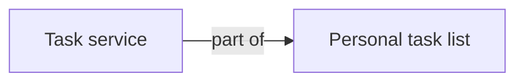

# Task service

The local service that handles browser requests and saves changes to the task list.

[Personal task list](<../../personal-task-list.system.spec-report.md>)

| Section | Explore |
| --- | --- |
| [Responsibilities](<#responsibilities>) | Accept browser changes and persist them locally. See Acknowledge after commit for the confirmation guarantee. |
| [System topology](<#system-topology>) | Part of |
| [Capabilities](<#capabilities>) | [All capabilities](<capabilities.md>) |
| [Requirements](<#requirements>) | [All requirements](<requirements.md>) |
| [Contracts](<#contracts>) | The browser uses the HTML forms to submit changes. |
| [Implementation](<#implementation>) | The Go server owns form handling and storage. |

## Responsibilities

Accept browser changes and persist them locally. See [Acknowledge after commit](<requirements/acknowledge-after-commit.requirement.spec-report.md>) for the confirmation guarantee.

## System topology

### Part of

[Personal task list](<../../personal-task-list.system.spec-report.md>).

- **Parent system** · [Personal task list](<../../personal-task-list.system.spec-report.md>) — A single-user task list that stores open and completed tasks on one computer.

## Capabilities

- [Local task storage](<../../capabilities/local-task-storage.capability.spec-report.md>) — Retains accepted task changes between sessions on the same computer.

## Requirements

- [Acknowledge after commit](<requirements/acknowledge-after-commit.requirement.spec-report.md>) — The task service must commit a change to the local database before acknowledging it to the browser.

## Contracts

- The browser uses the [HTML forms](<../../../app/list.html>) to submit changes.

## Implementation

The [Go server](<../../../app/main.go>) owns form handling and storage.
