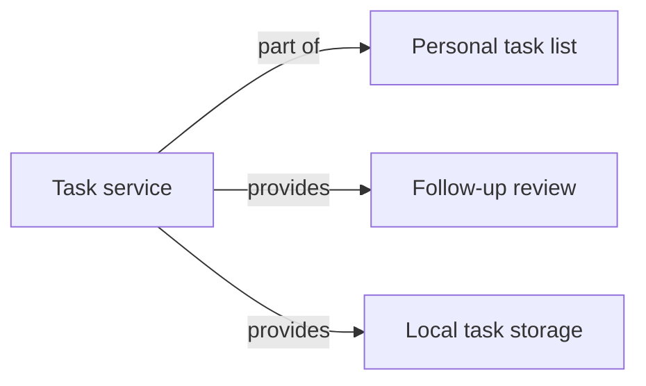

# Task service

The local service that decides whether a submitted action still applies to the selected entry and records accepted changes.

[Personal task list](<../../personal-task-list.system.spec-report.md>)

| Section | Explore |
| --- | --- |
| [Responsibilities](<#responsibilities>) | A browser tab can still show Open after the owner has moved an errand to Waiting in another tab. When the service receives the old form, it compares the submitting view with the entry’s current state. A mismatch leaves the entry as it was and the browser receives a conflict. Checklist action effects. |
| [System topology](<#system-topology>) | Part of |
| Capabilities | [All capabilities](<capabilities.md>) |
| Requirements | [All requirements](<requirements.md>) |
| [Contracts](<#contracts>) | The browser uses the HTML forms to submit changes. |
| [Implementation](<#implementation>) | The Go server owns form handling and storage. |

## Responsibilities

A browser tab can still show Open after the owner has moved an errand to Waiting in another tab. When the service receives the old form, it compares the submitting view with the entry’s current state. A mismatch leaves the entry as it was and the browser receives a conflict. [Checklist action effects](<../../concepts/checklist.concept.spec-report.md#effects-table>).

The service supplies the current local day when it prepares the Waiting view. [Acknowledge after commit](<requirements/acknowledge-after-commit.requirement.spec-report.md>) governs when it may report a successful change.

## System topology

### Part of

[Personal task list](<../../personal-task-list.system.spec-report.md>).

- **Parent system** · [Personal task list](<../../personal-task-list.system.spec-report.md>) — A personal list of errands the owner can act on, replies they are waiting for and commitments they have settled.
- **Provided capability** · [Follow-up review](<../../capabilities/follow-up-review.capability.spec-report.md>) — When the owner reviews waiting errands, they can see which replies they planned to chase by today and what to ask for.
- **Provided capability** · [Local task storage](<../../capabilities/local-task-storage.capability.spec-report.md>) — Keeps a commitment and the owner's last recorded decision together between visits. Finding the title alone would leave someone who returns to a waiting errand searching their messages for the reply they meant to chase.

## Contracts

- The browser uses the [HTML forms](<../../../app/list.html>) to submit changes.

## Implementation

The [Go server](<../../../app/main.go>) owns form handling and storage.
