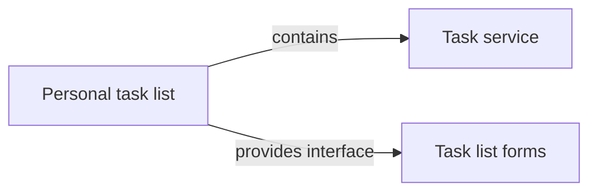

# Personal task list

A single-user task list that stores open and completed tasks on one computer.

| Section | Explore |
| --- | --- |
| [Purpose](<#purpose>) | Help a person pick up unfinished work after an interruption. |
| [Goals](<#goals>) |  |
| [Business rules](<#business-rules>) | [All business rules](<business-rules.md>) |
| [User needs](<#user-needs>) | [Jobs](<jobs.md>) |
| [Scope](<#scope>) | Out of scope · Environment · Assumptions · Project context |
| [System topology](<#system-topology>) | [Components](<components.md>) · [Interfaces](<interfaces.md>) |
| [Features](<#features>) | [All features](<features.md>) |
| Capabilities | [All capabilities](<capabilities.md>) |
| [Use cases](<#use-cases>) | [All use cases](<use-cases.md>) |
| [Concepts](<#concepts>) | [Concept definitions](<concepts.md>) · [Concept uses](<concept-uses.md>) |
| [Requirements](<#requirements>) | [All requirements](<requirements.md>) |
| [Quality attributes](<#quality-attributes>) | [Attribute index](<quality-attributes.md>) · [Quality models](<quality-models.md>) |

## Purpose

Help a person pick up unfinished work after an interruption.

## Goals

### Resume unfinished work

<!-- dotspec-doc {"type":"goal-spec-report","documents":"../specs/personal-task-list.system.spec.md#resume-unfinished-work"} -->

Reduce the effort of working out what still needs attention.

**Supported by** · [Resume interrupted work](<jobs/resume-interrupted-work.job.spec-report.md>)

## Business rules

- [Completion preserves a commitment](<business-rules/completion-preserves-a-commitment.business-rule.spec-report.md>) — A finished commitment stays on the person's list until they explicitly delete it.

## User needs

### Stakeholders

The person who keeps the list also decides which entries can be discarded.

- [Resume interrupted work](<jobs/resume-interrupted-work.job.spec-report.md>) — When I put work down, I want to remember what remains so I can pick it up again.

## Scope

One person's list on one computer. The browser submits forms to a local service.

### Out of scope

Sharing lists, synchronizing devices and recovering from loss of the database file.

### Environment

The person may close the browser or stop the service between work sessions.

### Assumptions

#### Same local storage

<!-- dotspec-doc {"type":"assumption-spec-report","documents":"../specs/personal-task-list.system.spec.md#same-local-storage"} -->

The person returns to the same writable database file.

**Relied on by** · [Preserve tasks across restart](<requirements/preserve-tasks-across-restart.requirement.spec-report.md>)

### Project context

The [walkthrough](<../README.md>) identifies the setup, checks and validation exercise.

## System topology

- **Component** · [Task service](<components/task-service/task-service.component.spec-report.md>) — The local service that handles browser requests and saves changes to the task list.
  - Provides [Local task storage](<capabilities/local-task-storage.capability.spec-report.md>) — Retains accepted task changes between sessions on the same computer.
- **Provided interface** · [Task list forms](<interfaces/task-list-forms.interface.spec-report.md>) — The browser presents open and completed tasks and accepts changes through HTML forms.

## Features

- [Pick up where I left off](<features/pick-up-where-i-left-off.feature.spec-report.md>) — Reopens the task list with each task in its last saved state.

## Use cases

- [Return to my list](<use-cases/return-to-my-list.use-case.spec-report.md>) — Pick up an outstanding task and bring a finished one back for follow-up.

## Concepts

**Concept definitions**

- [Checklist](<concepts/checklist.concept.spec-report.md>) — Keep track of which commitments still need attention.

**Concept uses**

- [My checklist](<concept-uses/my-checklist.concept-use.spec-report.md>) — The checklist used to track one person’s open and completed tasks.
  - Uses [Checklist](<concepts/checklist.concept.spec-report.md>)

## Requirements

[Return to my list](<use-cases/return-to-my-list.use-case.spec-report.md>) includes [Keep recorded work available](<use-cases/return-to-my-list.use-case.spec-report.md#keep-recorded-work-available>). The list must make previously recorded entries available when the person returns.

[Preserve tasks across restart](<requirements/preserve-tasks-across-restart.requirement.spec-report.md>) refines that promise. After the service acknowledges a change, stopping and restarting it on the same database must preserve each surviving entry's identity, title and completion state. Deleted entries must stay absent.

## Quality attributes

The task list is stored locally. Its quality requirements cover what survives between sessions on the same database.

**[Durability](<quality/durability/durability.quality-attribute.spec-report.md>)** — Preservation of acknowledged work between local sessions.
