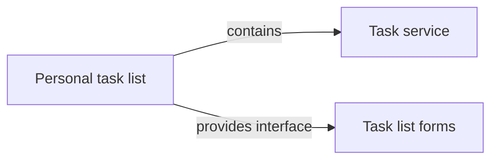

# Personal task list

A single-user task list that stores open and completed tasks on one computer.

| Section | Explore |
| --- | --- |
| [Framing](<#framing>) | An errand can need another action after it seemed finished. The job of resuming interrupted work gives the reason to keep both open and completed commitments available when the person returns. |
| [Purpose](<#purpose>) | Help a person pick up unfinished work after an interruption. |
| [Goals](<#goals>) | [All goals](<goals.md>) |
| Business rules | [All business rules](<business-rules.md>) |
| [Stakeholders and user needs](<#stakeholders-and-user-needs>) | [Jobs](<jobs.md>) |
| [Scope and environment](<#scope-and-environment>) | [All assumptions](<assumptions.md>) |
| [System topology](<#system-topology>) | [Components](<components.md>) · [Interfaces](<interfaces.md>) · [Provided interfaces](<interfaces.md#provided-interfaces>) |
| [Features](<#features>) | [All features](<features.md>) |
| Capabilities | [All capabilities](<capabilities.md>) |
| Use cases | [All use cases](<use-cases.md>) |
| [Concepts](<#concepts>) | [Concept definitions](<concepts.md>) · [Concept uses](<concept-uses.md>) |
| Requirements | [All requirements](<requirements.md>) |
| [Quality attributes](<#quality-attributes>) | [All quality attributes](<quality-attributes.md>) · [Quality models](<quality-models.md>) |

## Framing

An errand can need another action after it seemed finished. The [job of resuming interrupted work](<jobs/resume-interrupted-work.job.spec-report.md>) gives the reason to keep both open and completed commitments available when the person returns.

## Purpose

Help a person pick up unfinished work after an interruption.

## Goals

- [Resume unfinished work](<goals.md#resume-unfinished-work>) — Reduce the effort of working out what still needs attention.

## Stakeholders and user needs

The person who keeps the list also decides which entries can be discarded.

## Scope and environment

The list tracks one person’s open and completed tasks on one computer.

### Out of scope

Sharing lists, synchronizing devices and recovering from loss of the database file.

### Operating environment

The person may close the browser or stop the service between work sessions.

### Assumptions

- [Same local storage](<assumptions.md#same-local-storage>) — The person returns to the same writable database file.

## System topology

- **Component** · [Task service](<components/task-service/task-service.component.spec-report.md>) — The local service that handles browser requests and saves changes to the task list.
  - Provides [Local task storage](<capabilities/local-task-storage.capability.spec-report.md>) — Retains accepted task changes between sessions on the same computer.
- **Provided interface** · [Task list forms](<interfaces/task-list-forms.interface.spec-report.md>) — The browser presents open and completed tasks and accepts changes through HTML forms.

## Features

- [Pick up where I left off](<features/pick-up-where-i-left-off.feature.spec-report.md>) — Reopens the task list with each task in its last saved state.

## Concepts

### Concept uses

- [My checklist](<concept-uses/my-checklist.concept-use.spec-report.md>) — The checklist used to track one person’s open and completed tasks.
  - Uses [Checklist](<concepts/checklist.concept.spec-report.md>)

## Quality attributes

**[Durability](<quality/durability/durability.quality-attribute.spec-report.md>)** — Preservation of acknowledged work between local sessions.
