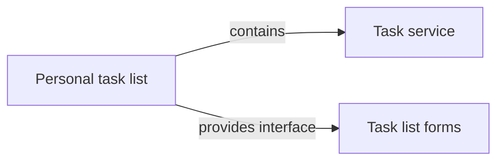

# Personal task list

A personal list of errands the owner can act on, replies they are waiting for and commitments they have settled.

| Section | Explore |
| --- | --- |
| [Framing](<#framing>) | Suppose a guest needs a working sink by Friday. Sending the plumber a photo finishes today's action. The owner still owes the repair. The job of seeing personal commitments through explains what the owner needs to establish when they return. |
| [Purpose](<#purpose>) | Help one person pick up an errand after an interruption and recognize when to chase an outstanding reply. |
| [Goals](<#goals>) | [All goals](<goals.md>) |
| Business rules | [All business rules](<business-rules.md>) |
| [Stakeholders and user needs](<#stakeholders-and-user-needs>) | [Jobs](<jobs.md>) |
| [Scope and environment](<#scope-and-environment>) | [All assumptions](<assumptions.md>) |
| [System topology](<#system-topology>) | [Components](<components.md>) · [Interfaces](<interfaces.md>) · [Provided interfaces](<interfaces.md#provided-interfaces>) |
| [Features](<#features>) | [All features](<features.md>) |
| Capabilities | [All capabilities](<capabilities.md>) |
| Use cases | [All use cases](<use-cases.md>) |
| [Concepts](<#concepts>) | [Concept definitions](<concepts.md>) · [Concept uses](<concept-uses.md>) |
| Requirements | [All requirements](<requirements.md>) |
| [Quality attributes](<#quality-attributes>) | [All quality attributes](<quality-attributes.md>) · [Quality models](<quality-models.md>) |

## Framing

Suppose a guest needs a working sink by Friday. Sending the plumber a photo finishes today's action. The owner still owes the repair. The [job of seeing personal commitments through](<jobs/see-personal-commitments-through.job.spec-report.md>) explains what the owner needs to establish when they return.

## Purpose

Help one person pick up an errand after an interruption and recognize when to chase an outstanding reply.

## Goals

- [Resume unfinished work](<goals.md#resume-unfinished-work>) — Reduce the effort of working out what still needs attention.

## Stakeholders and user needs

The person who keeps the list also decides which entries can be discarded.

## Scope and environment

One person records commitments on one computer and reviews them in Open, Waiting and Completed. They choose what reply to watch for and the day to check back. They receive the reply and judge the result outside the list.

### Out of scope

Sending reminders, reading messages, managing delivery deadlines, sharing lists, synchronizing devices and recovering from loss of the database file.

### Operating environment

The browser and service run on the same computer. The person can close either between visits. The service uses that computer’s local calendar when the person loads Waiting.

### Assumptions

- [Same local storage](<assumptions.md#same-local-storage>) — The person returns to the same writable database file.

## System topology

- **Component** · [Task service](<components/task-service/task-service.component.spec-report.md>) — The local service that decides whether a submitted action still applies to the selected entry and records accepted changes.
  - Provides [Follow-up review](<capabilities/follow-up-review.capability.spec-report.md>) — Identifies the outstanding replies the owner planned to chase by today. A person returning after the weekend can see both which errand needs attention and what to ask for.
  - Provides [Local task storage](<capabilities/local-task-storage.capability.spec-report.md>) — Keeps a commitment and the owner's last recorded decision together between visits. Finding the title alone would leave someone who returns to a waiting errand searching their messages for the reply they meant to chase.
- **Provided interface** · [Task list forms](<interfaces/task-list-forms.interface.spec-report.md>) — Open offers work the owner can advance. Waiting shows the expected reply and when to chase it. Completed holds settled errands the owner may reopen. After an accepted change the browser returns to the view where the person submitted it.

## Features

- [Pick up where I left off](<features/pick-up-where-i-left-off.feature.spec-report.md>) — Find an errand after a break, see whether a reply needs chasing and take up the work again when an answer arrives.

## Concepts

### Concept uses

- [My checklist](<concept-uses/my-checklist.concept-use.spec-report.md>) — Each entry follows one commitment through the owner's next action, an outstanding reply or settlement. Two errands with the same title can be at different stages.
  - Uses [Checklist](<concepts/checklist.concept.spec-report.md>)

## Quality attributes

**[Durability](<quality/durability/durability.quality-attribute.spec-report.md>)** — Preservation of the owner’s acknowledged decisions between local sessions, including the reply and day they recorded for a waiting errand. The follow-up cue can change overnight even though those decisions survive intact.
