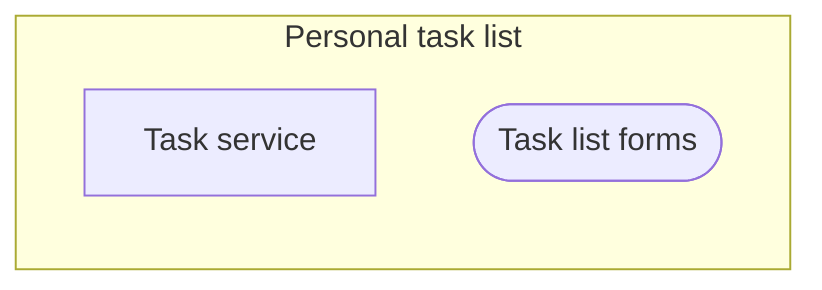

# Personal task list

A personal checklist for errands I want to remember and work I have already finished.

On this page

**Intent**\
[Purpose](<#purpose>) · [Overview](<#overview>) · [Goals](<#goals>) · [Stakeholders](<#stakeholders>) · [Jobs](<#jobs>)

**Context**\
[Scope](<#scope>) · [Environment](<#environment>) · [Assumptions](<#assumptions>) · [Business rules](<#business-rules>)

**Behavior**\
[Features](<#features>) · [Capabilities](<#capabilities>) · [Use cases](<#use-cases>)

[Quality Attributes](<#quality-attributes>)

[Requirements](<#requirements>)

**Design**\
[Concepts](<#concepts>) · [Architecture](<#architecture>)

Browse specifications

- [Contracts](<contracts.md>)
- [Specifications](<specifications.md>)

## Purpose

Give one person a place to put a task down now and find out what is left when they return.

## Overview

At breakfast I remember to return the library books and mail a parcel. I write both down. That afternoon I return the books and cross them off. The next morning the parcel is still in Open. If I find another library book in my bag, I can reopen the same task. [Take care of an errand I have to leave for later](<jobs/take-care-of-an-errand-i-have-to-leave-for-later.job.spec-report.md>).

Sometimes the next action belongs to someone else. The [follow-up example](<features/follow-up-when-someone-owes-me-a-reply.feature.spec-report.md>) shows how I keep track of a reply.

## Goals

- [Resume unfinished work](<goals.md#resume-unfinished-work>) — Reduce the effort of working out what still needs attention.

## Stakeholders

### List owner

<!-- dotspec-doc {"type":"system-stakeholder-role-spec-report","documents":"../specs/personal-task-list.system.spec.md#list-owner"} -->

The person who keeps the list relies on it to pick up unfinished errands after an interruption. They decide which entries can be discarded.

## Jobs

- [See personal commitments through](<jobs/see-personal-commitments-through.job.spec-report.md>) — See personal commitments through from accepting responsibility for an errand to establishing that the promised result has been delivered or someone else has agreed to take responsibility for it.
- [Take care of an errand I have to leave for later](<jobs/take-care-of-an-errand-i-have-to-leave-for-later.job.spec-report.md>) — Take care of an errand that comes to mind before I can do it. …

## Scope

One person records commitments on one computer and reviews them in Open, Waiting and Completed. They choose what reply to watch for and the day to check back. They receive the reply and judge the result outside the list.

### Out of scope

Sending reminders, reading messages, managing delivery deadlines, sharing lists, synchronizing devices and recovering from loss of the database file.

## Environment

The browser and service run on the same computer. The owner can close either between visits and return on a different local calendar day. The [follow-up requirement](<requirements/show-which-replies-need-follow-up.requirement.spec-report.md#conditions>) explains what they should see when they open Waiting again.

## Assumptions

- [Same local storage](<assumptions.md#same-local-storage>) — The person returns to the same writable database file.

## Business rules

- [Follow-up decision table](<business-rules/when-a-reply-needs-chasing.business-rule.spec-report.md#specification.follow-up-decision-table>) *(When a reply needs chasing)*
- [Keep completed tasks until I remove them](<business-rules/keep-completed-tasks-until-i-remove-them.business-rule.spec-report.md>) — A completed task must stay on the person's list until they delete it.
- [When a reply needs chasing](<business-rules/when-a-reply-needs-chasing.business-rule.spec-report.md>) — For a reply the person is still waiting for, the follow-up decision table determines whether to chase it by comparing today with the chosen day.

## Features

- [Follow up when someone owes me a reply](<features/follow-up-when-someone-owes-me-a-reply.feature.spec-report.md>) — Find an errand after a break, see whether a reply needs chasing and take up the work again when an answer arrives.
- [Pick up where I left off](<features/pick-up-where-i-left-off.feature.spec-report.md>) — Put an errand on my list while it is fresh in my mind and come back to see which tasks are still open.

## Capabilities

- [Follow-up review](<capabilities/follow-up-review.capability.spec-report.md>) — When the owner reviews waiting errands, they can see which replies they planned to chase by today and what to ask for.
- [Remember task progress between visits](<capabilities/remember-task-progress-between-visits.capability.spec-report.md>) — Remember my tasks and which ones I have checked off between visits. For a waiting task, keep the expected reply and follow-up day too.

## Use cases

- [Decide what to do about a waiting errand](<use-cases/decide-what-to-do-about-a-waiting-errand.use-case.spec-report.md>) — Decide whether to take up a waiting errand, keep waiting or mark it settled, and see that decision reflected in my list.
- [Save an errand for later](<use-cases/save-an-errand-for-later.use-case.spec-report.md>) — Put an errand down so I can get back to what I was doing.
- [See what is left to do](<use-cases/see-what-is-left-to-do.use-case.spec-report.md>) — Work out which of my saved errands I still need to do.

## Quality Attributes

- [Durability](<quality/durability/durability.quality-attribute.spec-report.md>) — Preservation of the owner’s acknowledged decisions between local sessions, including the reply they expect for a waiting errand and the day they chose to follow up. …

## Requirements

- [Acknowledge after commit](<components/task-service/requirements/acknowledge-after-commit.requirement.spec-report.md>) — The task service must record each change in a single commit to the local database and acknowledge it to the browser only after that commit succeeds.
- [Calendar dates accepted for follow-up](<features/follow-up-when-someone-owes-me-a-reply.feature.spec-report.md#specification.calendar-dates-accepted-for-follow-up>) *(Follow up when someone owes me a reply)*
- [Keep recorded work available](<requirements/keep-recorded-work-available.requirement.spec-report.md>) — When the person returns to the same local database, each saved entry must appear once in the view for its recorded state (Open, Waiting or Completed). …
- [Preserve tasks across restart](<requirements/preserve-tasks-across-restart.requirement.spec-report.md>) — After the service acknowledges a change, stopping and restarting it on the same database must preserve each surviving entry’s identity, title and state. …
- [Saved follow-up dates across time zones](<quality/durability/durability.quality-attribute.spec-report.md#specification.saved-follow-up-dates-across-time-zones>) *(Durability)*
- [Show which replies need follow-up](<requirements/show-which-replies-need-follow-up.requirement.spec-report.md>) — Each time the owner opens or refreshes Waiting, the list must show each waiting entry’s expected reply, recorded follow-up date and whether follow-up is due under the follow-up policy.

## Concepts

- [Checklist](<concepts/checklist.concept.spec-report.md>) — Keep track of what I still need to do and what I have already done. *Uses:*
  - [My checklist](<concept-uses/my-checklist.concept-use.spec-report.md>) — I can cross off one errand, leave another open and put a task back if there is more to do. …
- [Renaming an entry by identity](<concepts/checklist.concept.spec-report.md#specification.renaming-an-entry-by-identity>) *(Checklist)*

## Architecture

### Components

- [Task service](<components/task-service/task-service.component.spec-report.md>) — Checks whether a submitted action still applies to the selected entry and records accepted changes.

### Interfaces

- [Task list forms](<interfaces/task-list-forms.interface.spec-report.md>) — The forms the list owner uses to review and update commitments.

---

[View source](<../specs/personal-task-list.system.spec.md#personal-task-list>) · [Quality models](<quality-models.md>)
